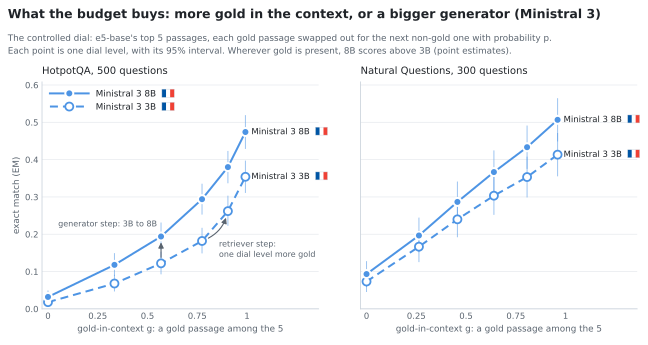
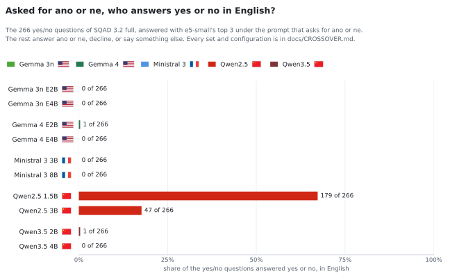

<!-- Generated from templates/README.md and results/stats.json by scripts/fill.py. Edit the template, not this file. -->
English | [Čeština](README.cs.md)

# measureRAG

**A budget-aware retrieval and RAG benchmark in Czech and English, for a
single machine with no network access.**

measureRAG measures retrieval and retrieval-augmented generation (RAG) the way
a deployment on one CPU-only machine with a few gigabytes of RAM and no network
meets them. The budget is imposed first: a configuration either fits a
deployment envelope (memory, retrieval latency, end-to-end latency) or it does
not, and answer quality is reported inside the envelope it fits. Everything
runs locally: no API keys, no cloud models, no telemetry.

Czech is measured beside English, end to end: Czech retrieval on CsFEVER v2 and
Czech RAG on SQAD 3.2 and on a filtered copy of SQAD 3.0, answered by five model families (Gemma 3n 🇺🇸,
Gemma 4 🇺🇸, Ministral 3 🇫🇷, Qwen2.5 🇨🇳 and Qwen3.5 🇨🇳), with the same quality measures and statistics as the English sets; the Czech
answers were generated on a GPU, so no Czech generator has a CPU latency or a budget verdict. Every Czech quality number
recomputes from this repository, or from it and a file you download and check by a published MD5 or SHA-256 hash
([docs/REPRODUCE.md](docs/REPRODUCE.md#10-checking-every-czech-number)); the SQAD retrievers' timings are one machine's record.

<picture>
  <source media="(prefers-color-scheme: dark)" srcset="results/figures/families_dark.svg">
  
</picture>

*Czech RAG, five model families. Each model's EM with yes and no mapped, e5-small's top 3, with its 95% bootstrap
interval; left, each family's smaller model, right, its larger, each panel's models in order of their score on the
released 200 (a tie keeps the makers' country order), and the sets with the released 200 first. Compare the marks within a set; the numbers are in
[Five families, model for model](#five-families-model-for-model). Qwen2.5-3B-Instruct is under the Qwen Research License ([THIRD_PARTY.md](THIRD_PARTY.md)).*

## The question it answers

A RAG system on a fixed machine has two obvious places to spend its next
gigabyte: a stronger retriever or a bigger generator. Which one buys more
answer quality depends on how often the retriever already puts a gold passage
in front of the generator, the *gold-in-context* rate g.

measureRAG answers this with a controlled dial. It takes the strongest
retriever's top 5 passages and replaces each gold passage, with
probability p, by the next-ranked non-gold passage. Corpus, k, prompt and amount
of text stay fixed; only whether the gold is there changes. At each dial level,
a retriever step (one dial level more gold in the context) is set against a
generator step (the generator one size up), with paired bootstrap intervals over
questions (10000 resamples). Exact match (EM) is the quality measure. The
dial is then checked against real retrievers.

<picture>
  <source media="(prefers-color-scheme: dark)" srcset="results/figures/pipeline_dark.svg">
  
</picture>

*One configuration, as the bench runs it. The budgets bind the whole process; the dial exists only in the
experiment, to move gold-in-context while everything else stays fixed.*

## Result: the break-even gold gain

The usable result is not a crossing point but a bar. For each operating point
g, the tables give how much gold-in-context a retriever upgrade must add before
it buys as much EM as the generator step does there, raw, and for an upgrade that
costs as much peak resident memory as the priced retriever step. To use it: measure how much gold-in-context your retriever
upgrade adds on your data at your k, and compare it with the bar at your g.

**HotpotQA** (500 questions):

| p | operating point g | headroom to dial top | gold gain needed to match the generator step, raw [95%] | gold gain needed, for an upgrade costing 0.95 GB like the priced step [95%], as measured, model file memory-mapped (library default) | gold gain needed, for an upgrade costing 0.95 GB like the priced step [95%], estimate without the double-counted mapped pages (probe; see LIMITATIONS) |
|---|---|---|---|---|---|
| 0.0 | 0.992 | 0.000 | > headroom (0.000) [0.000, 0.000]; 10000 censored | > headroom (0.000) [0.000, 0.000]; 10000 censored | > headroom (0.000) [0.000, 0.000]; 10000 censored |
| 0.2 | 0.904 | 0.088 | > headroom (0.088) [0.063, 0.112]; 8981 censored | 0.021 [0.014, 0.031] | 0.039 [0.025, 0.058]; 1 censored |
| 0.4 | 0.774 | 0.218 | 0.161 [0.118, 0.203]; 23 censored | 0.034 [0.022, 0.051] | 0.063 [0.041, 0.095] |
| 0.6 | 0.568 | 0.424 | 0.226 [0.142, 0.286] | 0.046 [0.026, 0.078] | 0.086 [0.049, 0.145] |
| 0.8 | 0.334 | 0.658 | 0.217 [0.110, 0.320] | 0.040 [0.021, 0.071] | 0.075 [0.038, 0.131] |
| 1.0 | 0.000 | 0.992 | 0.094 [0.000, 0.219] | 0.017 [0.000, 0.041] | 0.032 [0.000, 0.076] |

**Natural Questions** (NQ, 300 questions):

| p | operating point g | headroom to dial top | gold gain needed to match the generator step, raw [95%] | gold gain needed, for an upgrade costing 0.83 GB like the priced step [95%], as measured, model file memory-mapped (library default) | gold gain needed, for an upgrade costing 0.83 GB like the priced step [95%], estimate without the double-counted mapped pages (probe; see LIMITATIONS) |
|---|---|---|---|---|---|
| 0.0 | 0.960 | 0.000 | > headroom (0.000) [0.000, 0.000]; 9998 censored | > headroom (0.000) [0.000, 0.000]; 9998 censored | > headroom (0.000) [0.000, 0.000]; 9998 censored |
| 0.2 | 0.807 | 0.153 | > headroom (0.153) [0.077, 0.190]; 7472 censored | 0.033 [0.013, 0.064] | 0.062 [0.023, 0.118]; 88 censored |
| 0.4 | 0.640 | 0.320 | 0.201 [0.054, > headroom]; 528 censored | 0.034 [0.009, 0.078] | 0.064 [0.016, 0.142] |
| 0.6 | 0.457 | 0.503 | 0.135 [0.022, 0.282] | 0.022 [0.004, 0.048] | 0.041 [0.007, 0.088] |
| 0.8 | 0.263 | 0.697 | 0.079 [0.000, 0.184] | 0.013 [0.000, 0.030] | 0.024 [0.000, 0.056] |
| 1.0 | 0.000 | 0.960 | 0.056 [0.000, 0.148] | 0.009 [0.000, 0.024] | 0.017 [0.000, 0.045] |

*The generator step is Ministral 3 3B 🇫🇷 to Ministral 3 8B 🇫🇷 (Instruct 2512, Q4_K_M), the family whose English
sweeps were timed on this laptop's CPU. Its dial's answers were generated on a second machine's GPU
([docs/LIMITATIONS.md](docs/LIMITATIONS.md#the-czech-and-english-families)).*

How to read the tables: p is the dial level; "headroom to dial top" is how much
gold-in-context there is left to add; "> headroom" means no reachable gain
would match the generator step; "censored" counts the bootstrap resamples in
which the headroom above the operating point ran out, and an upper end written
"> headroom" is such an edge, not an estimate. Every table and the prices in
gigabytes and milliseconds are in [docs/CROSSOVER.md](docs/CROSSOVER.md).

The last two columns are not rates. Each is the bar for one upgrade that costs as much peak memory as the priced
retriever step, bm25 → e5-small (0.95 GB on HotpotQA, 0.83 GB on NQ),
set against the generator step's cost (5.07 GB on HotpotQA and 5.11 GB on NQ as measured, model file memory-mapped (library default);
2.73 GB and 2.77 GB, estimate without the double-counted mapped pages (probe; see [docs/LIMITATIONS.md](docs/LIMITATIONS.md#the-machine-and-the-timings))): the gold gain whose EM gain equals the generator
step's EM gain times the ratio of the two costs. Peak memory as measured counts part of each Ministral 3 🇫🇷 model file
twice, because the file is memory-mapped while the CPU backend also copies the weights, so the tables give that bar
twice: without the double count the generator step costs less, and the bar is about
1.86 times as large on HotpotQA and 1.84 times on NQ. For an upgrade
that costs C GB, the bar is the gold gain that buys the generator step's EM gain times C / (the generator step's GB);
where the dial's EM curve is close to straight, that is about the raw bar times C / (the generator step's GB). The
cost C here is the memory of bm25 → e5-small, a step that on HotpotQA moves g any (the share of questions with at
least one gold passage in the context) by only +0.002
(0.984 → 0.986): the columns say what an upgrade of that cost would have to add, not
what that step adds.

## What is and is not established

* **HotpotQA:** g* = 0.39 [0.16, 0.89], the upper end censored; 270 of 10000 resamples have no root, raw EM. Per GB, as measured, model file memory-mapped (library default):
  no crossing inside g = 0.00 to 0.90 (censored above 0.90; 10000 of 10000 resamples have no root); per GB, estimate without the double-counted mapped pages (probe; see [docs/LIMITATIONS.md](docs/LIMITATIONS.md#the-machine-and-the-timings)): no crossing inside g = 0.00 to 0.90 (censored above 0.90; 9999 of 10000 resamples have no root).
* **NQ:** g* = 0.56 [0.29, 0.83], the upper end censored; 1847 of 10000 resamples have no root, raw EM. With every gold passage removed,
  27% of the contexts still contain the answer in a non-gold
  passage. Per GB, as measured, model file memory-mapped (library default): no crossing inside g = 0.00 to 0.81 (censored above 0.81; 10000 of 10000 resamples have no root); per GB, estimate without the double-counted mapped
  pages (probe; see LIMITATIONS): no crossing inside g = 0.00 to 0.81 (censored above 0.81; 9903 of 10000 resamples have no root).
* **No located crossing.** The fitted curves cross on both datasets, but the
  generator step's advantage is established at 0 of 5
  levels on HotpotQA and 0 of 5 on NQ, and wherever gold is
  present the gap between the two moves is established at
  0 of 4 levels on HotpotQA and
  0 of 4 on NQ; some resamples never cross (above). The data
  do not establish that the two moves cross, nor where. Do the two datasets agree?
  not shown to differ: the g* intervals overlap, but both are wide and censored at an end, so their overlap cannot show that the two datasets agree.
* **On HotpotQA, among strong retrievers, the generator step is the larger.** At
  k = 5, on this 100,000-passage slice, from bm25 upwards every real retriever
  step leaves g any almost where it was (bm25 to e5-small: 0.984 → 0.986), and the
  generator step at the lower rung is larger, the difference established at each: bm25 to e5-small buys
  +0.020 [-0.014, +0.054] EM and 3B to 8B in front of bm25
  +0.068 [+0.034, +0.102] (generator minus retriever
  +0.048 [+0.008, +0.088]). e5-base to bge-m3, a change of
  retriever rather than an upgrade, leaves g any where it was and changes EM by
  -0.016 [-0.048, +0.014]. From the weak tfidf-svd to bm25, the
  retriever step is the larger: +0.310 [+0.268, +0.352] against
  +0.030 [+0.014, +0.048]. On NQ, bm25 to e5-small does move
  g any (0.733 → 0.943), and there generator minus retriever is
  +0.040 [-0.017, +0.097]: the generator upgrade, not established. That bm25 already
  puts a gold passage in nearly every HotpotQA context is a property of the slice, which holds every judged
  passage of the sampled questions and a sample of the rest; a full corpus has far more distractors.
* **Per millisecond, HotpotQA has no price.** The priced retriever step
  (bm25 → e5-small) changes the generation-stage latency by
  -2462 ms on HotpotQA, as measured (its retrieval p50 adds
  9.6 ms), so there a cost ratio is undefined. Its lower rung, bm25 with
  Ministral 3 3B 🇫🇷, was timed again after the night it was first timed in (below), and the change stayed negative.
  Two explanations fit, and the records cannot separate them: e5-small's passages may make shorter prompts for the
  generator to read, or the change is variation between runs, since bm25 with Ministral 3 3B 🇫🇷 alone moved by
  3790 ms between its two timings. The prompts' token counts are not recorded
  ([docs/LIMITATIONS.md](docs/LIMITATIONS.md#the-machine-and-the-timings)). On NQ it adds
  115 ms, and the per-ms fit finds
  no crossing inside g = 0.00 to 0.81 (censored above 0.81; 10000 of 10000 resamples have no root).
* **Per GB, no crossing.** The generator step costs 5.07 GB of
  peak memory on HotpotQA and 5.11 GB on NQ as measured, model file memory-mapped (library default), and
  2.73 GB and 2.77 GB, estimate without the double-counted mapped pages (probe; see [docs/LIMITATIONS.md](docs/LIMITATIONS.md#the-machine-and-the-timings)). As measured, the
  per-GB fit finds no crossing, with the generator step priced in front of e5-base or of each of the five rungs in
  turn. Measured peak memory counts part of each model file twice; with that taken out, the fit still finds no crossing
  in front of e5-base on either dataset, but priced in front of each rung it crosses at
  0 of 5 rungs on HotpotQA and 1 of 5 on NQ
  (bge-m3, where the step costs 0.72 GB: g* = 0.51 [0.23, 0.82], the upper end censored; 1239 of 10000 resamples censored; [docs/CROSSOVER.md](docs/CROSSOVER.md), §3 and §4). In every per-GB fit the retriever step is one dial level of gold priced at the
  0.95 GB of bm25 → e5-small, a step that moves g any on HotpotQA by only
  +0.002, so the per-GB comparison prices one move and gains from another.
* **No Ministral 3 🇫🇷 configuration fits a budget in the grid.** Configurations that fit
  one: 0 of 20 with peak memory as measured, and 0 of 20 with the estimate. Their end-to-end p95 runs from
  9.8 s to 45.9 s, against the grid's
  end-to-end limits (3 s and 8 s), and their peak memory from
  5.7 to 13.3 GB as measured, model file memory-mapped (library default), and from 4.3 to 9.6 GB, estimate without the double-counted mapped pages (probe; see [docs/LIMITATIONS.md](docs/LIMITATIONS.md#the-machine-and-the-timings))
  ([docs/BUDGETS.md](docs/BUDGETS.md)). This describes
  Ministral 3 🇫🇷 at 3B and 8B on this CPU, not every generator
  ([docs/LIMITATIONS.md](docs/LIMITATIONS.md#the-czech-and-english-families)).

<picture>
  <source media="(prefers-color-scheme: dark)" srcset="results/figures/dial_dark.svg">
  
</picture>

*The dial as levels, on both English sets, for Ministral 3 3B 🇫🇷 and 8B 🇫🇷. A retriever step is one dial level
to the right along a line; the generator step is the gap between the two lines at one level. The headline above, the
budgets and the prices are Ministral 3's 🇫🇷: its dial answered on a second machine's GPU, its sweeps were timed on this
laptop's CPU. The figure shows one of the three Western families' dials, Ministral 3's 🇫🇷, the one in which the larger
model gains most, chosen by the author after all three were read, and Ministral 3 🇫🇷 became the family whose English
sweeps were timed after the same reading ([docs/LIMITATIONS.md](docs/LIMITATIONS.md#the-czech-and-english-families)).
The other dials are in [docs/CROSSOVER.md](docs/CROSSOVER.md#four-families-english-dials): Gemma 3n's 🇺🇸 and Gemma 4's 🇺🇸,
where the larger model buys little or nothing, and Gemma 4 E4B's 🇺🇸 score below E2B is established at
4 of 6 HotpotQA levels, and Qwen2.5's 🇨🇳. Qwen3.5 🇨🇳 did not answer the English dial.*

## Czech

**Retrieval** (CsFEVER v2, 20,000 Wikipedia pages,
500 claims): BM25 with diacritics stripped scores nDCG@10
0.8399, plain BM25
0.8284, multilingual-e5-small
0.7755. The order holds at 100,000
documents (0.7540, 0.7393
and 0.7012). These are means over the claims with no interval: no per-claim score
ships, so the order is not tested. CsFEVER is entity-heavy, which favours
lexical matching, and every configuration fits every budget at these sizes.
That lead is CsFEVER's. On SQAD, e5-small leads BM25 without diacritics at large
samples: +0.039 [+0.016, +0.061] in nDCG@10 on all 843 test questions of
the SQAD 3.0 copy, and +0.043 [+0.034, +0.052] on all 4,771 test
questions of SQAD 3.2 (95% intervals).

**Ten retrievers on SQAD.** Six more retrievers ranked
both test splits: e5-base, IBM's granite-embedding 107m and 278m multilingual, Google's EmbeddingGemma 300m,
Seznam's simcse-cs-en, and BM25 over Czech lemmas. None leads e5-small by as much as e5-small leads BM25. e5-base, more
than twice its size, gains +0.006 [+0.001, +0.012] in nDCG@10 on SQAD 3.2's
4,771 test questions and nothing established on the copy's 843
(+0.001 [-0.013, +0.016] (not established)). Lemmas help BM25: +0.021 [+0.014, +0.027]
over BM25 without diacritics on SQAD 3.2, about half of e5-small's lead over it on that set, and
+0.026 [+0.012, +0.041] on the copy. That contrast changes two things, because BM25
over lemmas lowercases each word and keeps its diacritics before simplemma lemmatises it (so "Prahy" becomes "práh",
threshold, not "Praha"); against plain BM25, which keeps diacritics too, lemmas gain
+0.023 [+0.017, +0.029] on SQAD 3.2 and +0.028 [+0.013, +0.043] on the copy (a contrast added after the
rankings were read). EmbeddingGemma sits between BM25 and e5-small
(-0.018 [-0.025, -0.010] against e5-small on SQAD 3.2), and both granite models
below BM25 without diacritics (-0.026 [-0.037, -0.016] for the larger).
No gain in the gold in the top 3 over e5-small is established and as large as e5-small's own lead over BM25
(+0.054 [+0.042, +0.067]), the bar a new retriever had to clear, by a rule fixed before the rankings were read, to answer
every set end to end; so none did. Timed on SQAD 3.2's
corpus on the same Mac, e5-base's gain over e5-small costs +1.21 GB of peak memory
and +15.4 ms of p95 latency per query; BM25 over lemmas answers a query in
0.3 ms at p95 with 0.48 GB of peak memory, and e5-small in
6.9 ms with 2.34 GB. Every row is in
[docs/CROSSOVER.md](docs/CROSSOVER.md#ten-retrievers-on-sqad).

**End-to-end RAG** (k = 3). Five model families answer every set, two models each. Each model, with its
maker, the maker's country and the model's licence (in full in [THIRD_PARTY.md](THIRD_PARTY.md)):

<ul>
<li>Gemma 3n E2B: Google, United States; Gemma Terms of Use</li>
<li>Gemma 3n E4B: Google, United States; Gemma Terms of Use</li>
<li>Gemma 4 E2B: Google, United States; Apache 2.0</li>
<li>Gemma 4 E4B: Google, United States; Apache 2.0</li>
<li>Ministral 3 3B Instruct 2512: Mistral AI, France; Apache 2.0</li>
<li>Ministral 3 8B Instruct 2512: Mistral AI, France; Apache 2.0</li>
<li>Qwen2.5-1.5B-Instruct: Alibaba Cloud's Qwen team, China; Apache 2.0</li>
<li>Qwen2.5-3B-Instruct: Alibaba Cloud's Qwen team, China; Qwen Research License, non-commercial research and evaluation use only</li>
<li>Qwen3.5 2B: Alibaba Cloud's Qwen team, China; Apache 2.0</li>
<li>Qwen3.5 4B: Alibaba Cloud's Qwen team, China; Apache 2.0</li>
</ul>

Gemma 4 🇺🇸, chosen by a benchmark of Western candidates on a separate dev set, and Qwen2.5 🇨🇳 answered first. Gemma 3n 🇺🇸, Ministral 3 🇫🇷 and Qwen3.5 🇨🇳 were added at the author's request after the earlier families'
results had been read, each run alone with the questions, rankings, prompt, token cap, seed and machine unchanged
([docs/LIMITATIONS.md](docs/LIMITATIONS.md#the-czech-and-english-families)). There are four sets, and none of them is the headline:
SQAD 3.2 debiased, SQAD 3.2 full, the released 200 of the SQAD 3.0 copy, and the copy debiased. The primary
metric is EM with yes and no mapped to ano and ne, because Qwen2.5 🇨🇳 still answers many yes/no questions in
English. Raw EM and compliance stand beside it: compliance is, of the yes/no questions a model did not decline, the share
it answered with exactly ano or ne ([docs/METRICS.md](docs/METRICS.md)).

### Five families, model for model

Each family's smaller model is set against the other families' smaller models, and its larger against their
larger, all with e5-small's top 3 and paired on the same questions. The pairs are by place in the family,
not by size: at Q4_K_M the smaller models' files are 3.1 GB (Gemma 4 E2B 🇺🇸),
2.1 GB (Ministral 3 3B 🇫🇷), 1.1 GB (Qwen2.5 1.5B 🇨🇳) and
1.3 GB (Qwen3.5 2B 🇨🇳), and the larger models' 5.0,
5.2, 2.1 and 2.7 GB. Gemma 3n E2B 🇺🇸 and
E4B are Gemma 4's 🇺🇸 previous generation at the same two places, and Qwen3.5 🇨🇳 is Qwen2.5's 🇨🇳 newer generation.

* Gemma 3n 🇺🇸, Gemma 4 🇺🇸, Ministral 3 🇫🇷 and Qwen3.5 🇨🇳 each answer better than Qwen2.5 🇨🇳, at both sizes, on every set and in
  both metrics, every difference established. With yes and no mapped, Gemma 3n E2B 🇺🇸 scores above Qwen2.5 1.5B 🇨🇳 by
  +0.078 to +0.115 and E4B above 3B by +0.075 to +0.115; Gemma 4 E2B 🇺🇸 by
  +0.126 to +0.170 and E4B by +0.132 to +0.140; Ministral 3 3B 🇫🇷 by
  +0.100 to +0.135 and 8B by +0.075 to +0.135; Qwen3.5 2B 🇨🇳 by
  +0.088 to +0.130 and 4B by +0.135 to +0.151. The same 1,791
  questions answered on each SQAD version's passages give +0.083 to +0.114 for Gemma 3n 🇺🇸,
  +0.135 to +0.159 for Gemma 4 🇺🇸, +0.118 to +0.126 for Ministral 3 🇫🇷 and
  +0.112 to +0.161 for Qwen3.5 🇨🇳.
* Among the smaller models, Gemma 4 E2B 🇺🇸 scores highest on every set. Its lead over Gemma 3n E2B 🇺🇸 is established
  on SQAD 3.2 debiased, SQAD 3.2 full and the copy debiased, over Ministral 3 3B 🇫🇷 on SQAD 3.2 full and the copy debiased,
  and over Qwen3.5 2B 🇨🇳 on SQAD 3.2 debiased, SQAD 3.2 full and the copy debiased. Among the larger models, no model scores
  highest on every set, and on no set is the highest model's lead over the next established.
* Gemma 4 🇺🇸 scores above its previous generation, Gemma 3n 🇺🇸, on all four sets. Gemma 4 🇺🇸 minus Gemma 3n 🇺🇸 is
  above zero on all four at the smaller place (+0.037 to +0.069),
  established on SQAD 3.2 debiased, SQAD 3.2 full and the copy debiased, and above zero on all four at the
  larger (+0.022 to +0.058), established on SQAD 3.2 debiased and SQAD 3.2 full. On the
  cross-version questions it is +0.044 to +0.054.
* Gemma 4 🇺🇸 scores above Ministral 3 🇫🇷 on all four sets. Gemma 4 🇺🇸 minus Ministral 3 🇫🇷 is above zero on all four for the
  smaller models (+0.013 to +0.038) and for the larger
  (+0.005 to +0.057), established on SQAD 3.2 full and the copy debiased for E2B
  against 3B, and on SQAD 3.2 debiased and SQAD 3.2 full for E4B against 8B. On the cross-version questions it
  is +0.009 to +0.038.
* Gemma 4 🇺🇸 and Ministral 3 🇫🇷 against Qwen3.5 🇨🇳. Gemma 4 E2B 🇺🇸 scores above Qwen3.5 2B 🇨🇳 on all four sets, established on
  SQAD 3.2 debiased, SQAD 3.2 full and the copy debiased. Gemma 4 E4B 🇺🇸 and Qwen3.5 4B 🇨🇳 differ in both directions across the
  four, established on none of the four. Ministral 3 3B 🇫🇷 and Qwen3.5 2B 🇨🇳 differ in both
  directions across the four, established on none of the four. Ministral 3 8B 🇫🇷 scores at
  or below Qwen3.5 4B 🇨🇳 on all four (level on one), by +0.000 to +0.061,
  established on 2 of 4 (SQAD 3.2 debiased and SQAD 3.2 full), Qwen3.5 🇨🇳 higher on each.
* The larger model of each family answers better. For Gemma 3n 🇺🇸 this generator step, E4B over E2B, is
  established on every set, +0.055 to +0.077. For Gemma 4 🇺🇸 it is established on the three
  larger sets and not on the released 200 (below). For Ministral 3 🇫🇷, 8B over 3B, it is established on every set,
  +0.044 to +0.057. For Qwen2.5 🇨🇳 it is established on the three larger sets and not on the
  released 200, and for Qwen3.5 🇨🇳, 4B over 2B, on every set, +0.060 to +0.125.
* Gemma 3n 🇺🇸, Ministral 3 🇫🇷 and Qwen3.5 🇨🇳 answer in Czech. Gemma 3n 🇺🇸 gave 0 yes/no answers
  in English, so its two metrics are the same in every configuration. Ministral 3 🇫🇷 gave 0, so its
  two are the same in every configuration. Gemma 3n's 🇺🇸 compliance is 0.710 to 1.000, lower for E2B,
  which answers some yes/no questions with something other than ano or ne; Ministral 3's 🇫🇷 is
  0.959 to 1.000. Qwen2.5 🇨🇳 gave 1,504 and Qwen3.5 🇨🇳 4;
  Qwen3.5's 🇨🇳 compliance is 0.868 to 1.000, lower for 2B for the same reason
  ([docs/CROSSOVER.md](docs/CROSSOVER.md#the-sets-and-the-answers)).
* Qwen3.5 🇨🇳 answered without thinking. Its cards say it thinks before answering by default; through the
  files' own chat template it answered directly, and 0 of its
  115,563 answer rows on the test sets holds a thinking tag.

EM with yes and no mapped [95%], each model with e5-small's top 3, as [the figure at the top](#measurerag) draws it:

| set | questions | Gemma 3n E2B 🇺🇸 | Gemma 3n E4B 🇺🇸 | Gemma 4 E2B 🇺🇸 | Gemma 4 E4B 🇺🇸 | Ministral 3 3B 🇫🇷 | Ministral 3 8B 🇫🇷 | Qwen2.5 1.5B 🇨🇳 | Qwen2.5 3B 🇨🇳 | Qwen3.5 2B 🇨🇳 | Qwen3.5 4B 🇨🇳 |
|---|---|---|---|---|---|---|---|---|---|---|---|
| SQAD 3.2, debiased at 0.138 | 1,951 | 0.527 [0.505, 0.550] | 0.585 [0.563, 0.606] | 0.564 [0.542, 0.586] | 0.643 [0.622, 0.665] | 0.551 [0.529, 0.573] | 0.595 [0.573, 0.617] | 0.438 [0.416, 0.460] | 0.503 [0.481, 0.526] | 0.539 [0.517, 0.561] | 0.655 [0.633, 0.676] |
| SQAD 3.2, full | 1,995 | 0.572 [0.550, 0.594] | 0.627 [0.606, 0.648] | 0.612 [0.590, 0.633] | 0.684 [0.663, 0.704] | 0.574 [0.552, 0.596] | 0.627 [0.606, 0.648] | 0.475 [0.453, 0.497] | 0.552 [0.530, 0.574] | 0.563 [0.541, 0.585] | 0.688 [0.667, 0.708] |
| SQAD 3.0 copy, the released 200 | 200 | 0.515 [0.445, 0.585] | 0.570 [0.500, 0.635] | 0.570 [0.505, 0.635] | 0.595 [0.530, 0.660] | 0.535 [0.465, 0.605] | 0.590 [0.525, 0.655] | 0.400 [0.335, 0.470] | 0.455 [0.390, 0.525] | 0.530 [0.465, 0.600] | 0.590 [0.525, 0.655] |
| SQAD 3.0 copy, debiased at 0.138 | 771 | 0.546 [0.511, 0.581] | 0.623 [0.588, 0.658] | 0.615 [0.581, 0.650] | 0.645 [0.611, 0.678] | 0.577 [0.542, 0.612] | 0.634 [0.601, 0.668] | 0.468 [0.433, 0.505] | 0.511 [0.476, 0.547] | 0.582 [0.547, 0.617] | 0.651 [0.617, 0.685] |

*Qwen2.5 3B rows: Qwen2.5-3B-Instruct, under the Qwen Research License (non-commercial research and evaluation use only; see [THIRD_PARTY.md](THIRD_PARTY.md)).*

The differences between the families, paired on the same questions, EM with yes and no mapped:

| set | families | smaller models [95%] | larger models [95%] |
|---|---|---|---|
| SQAD 3.2, debiased at 0.138 | Gemma 3n 🇺🇸 minus Qwen2.5 🇨🇳 | E2B minus 1.5B: +0.089 [+0.067, +0.111] | E4B minus 3B: +0.081 [+0.061, +0.102] |
| SQAD 3.2, debiased at 0.138 | Gemma 4 🇺🇸 minus Gemma 3n 🇺🇸 | E2B minus E2B: +0.037 [+0.018, +0.055] | E4B minus E4B: +0.058 [+0.042, +0.075] |
| SQAD 3.2, debiased at 0.138 | Gemma 4 🇺🇸 minus Ministral 3 🇫🇷 | E2B minus 3B: +0.013 [-0.006, +0.033] (not established) | E4B minus 8B: +0.049 [+0.031, +0.067] |
| SQAD 3.2, debiased at 0.138 | Gemma 4 🇺🇸 minus Qwen2.5 🇨🇳 | E2B minus 1.5B: +0.126 [+0.105, +0.147] | E4B minus 3B: +0.140 [+0.117, +0.162] |
| SQAD 3.2, debiased at 0.138 | Gemma 4 🇺🇸 minus Qwen3.5 🇨🇳 | E2B minus 2B: +0.025 [+0.007, +0.044] | E4B minus 4B: -0.011 [-0.029, +0.006] (not established) |
| SQAD 3.2, debiased at 0.138 | Ministral 3 🇫🇷 minus Qwen2.5 🇨🇳 | 3B minus 1.5B: +0.113 [+0.093, +0.132] | 8B minus 3B: +0.091 [+0.070, +0.112] |
| SQAD 3.2, debiased at 0.138 | Ministral 3 🇫🇷 minus Qwen3.5 🇨🇳 | 3B minus 2B: +0.012 [-0.006, +0.030] (not established) | 8B minus 4B: -0.060 [-0.076, -0.044] |
| SQAD 3.2, debiased at 0.138 | Qwen3.5 🇨🇳 minus Qwen2.5 🇨🇳 | 2B minus 1.5B: +0.101 [+0.081, +0.121] | 4B minus 3B: +0.151 [+0.130, +0.172] |
| SQAD 3.2, full | Gemma 3n 🇺🇸 minus Qwen2.5 🇨🇳 | E2B minus 1.5B: +0.097 [+0.077, +0.118] | E4B minus 3B: +0.075 [+0.055, +0.094] |
| SQAD 3.2, full | Gemma 4 🇺🇸 minus Gemma 3n 🇺🇸 | E2B minus E2B: +0.040 [+0.022, +0.059] | E4B minus E4B: +0.057 [+0.041, +0.073] |
| SQAD 3.2, full | Gemma 4 🇺🇸 minus Ministral 3 🇫🇷 | E2B minus 3B: +0.038 [+0.019, +0.056] | E4B minus 8B: +0.057 [+0.040, +0.075] |
| SQAD 3.2, full | Gemma 4 🇺🇸 minus Qwen2.5 🇨🇳 | E2B minus 1.5B: +0.137 [+0.117, +0.158] | E4B minus 3B: +0.132 [+0.111, +0.153] |
| SQAD 3.2, full | Gemma 4 🇺🇸 minus Qwen3.5 🇨🇳 | E2B minus 2B: +0.049 [+0.030, +0.069] | E4B minus 4B: -0.004 [-0.020, +0.012] (not established) |
| SQAD 3.2, full | Ministral 3 🇫🇷 minus Qwen2.5 🇨🇳 | 3B minus 1.5B: +0.100 [+0.081, +0.119] | 8B minus 3B: +0.075 [+0.055, +0.094] |
| SQAD 3.2, full | Ministral 3 🇫🇷 minus Qwen3.5 🇨🇳 | 3B minus 2B: +0.012 [-0.007, +0.031] (not established) | 8B minus 4B: -0.061 [-0.077, -0.045] |
| SQAD 3.2, full | Qwen3.5 🇨🇳 minus Qwen2.5 🇨🇳 | 2B minus 1.5B: +0.088 [+0.068, +0.109] | 4B minus 3B: +0.136 [+0.115, +0.155] |
| SQAD 3.0 copy, the released 200 | Gemma 3n 🇺🇸 minus Qwen2.5 🇨🇳 | E2B minus 1.5B: +0.115 [+0.050, +0.180] | E4B minus 3B: +0.115 [+0.055, +0.175] |
| SQAD 3.0 copy, the released 200 | Gemma 4 🇺🇸 minus Gemma 3n 🇺🇸 | E2B minus E2B: +0.055 [-0.005, +0.115] (not established) | E4B minus E4B: +0.025 [-0.025, +0.075] (not established) |
| SQAD 3.0 copy, the released 200 | Gemma 4 🇺🇸 minus Ministral 3 🇫🇷 | E2B minus 3B: +0.035 [-0.030, +0.100] (not established) | E4B minus 8B: +0.005 [-0.050, +0.060] (not established) |
| SQAD 3.0 copy, the released 200 | Gemma 4 🇺🇸 minus Qwen2.5 🇨🇳 | E2B minus 1.5B: +0.170 [+0.105, +0.235] | E4B minus 3B: +0.140 [+0.075, +0.205] |
| SQAD 3.0 copy, the released 200 | Gemma 4 🇺🇸 minus Qwen3.5 🇨🇳 | E2B minus 2B: +0.040 [-0.020, +0.105] (not established) | E4B minus 4B: +0.005 [-0.045, +0.055] (not established) |
| SQAD 3.0 copy, the released 200 | Ministral 3 🇫🇷 minus Qwen2.5 🇨🇳 | 3B minus 1.5B: +0.135 [+0.070, +0.200] | 8B minus 3B: +0.135 [+0.065, +0.205] |
| SQAD 3.0 copy, the released 200 | Ministral 3 🇫🇷 minus Qwen3.5 🇨🇳 | 3B minus 2B: +0.005 [-0.055, +0.065] (not established) | 8B minus 4B: +0.000 [-0.055, +0.055] (not established) |
| SQAD 3.0 copy, the released 200 | Qwen3.5 🇨🇳 minus Qwen2.5 🇨🇳 | 2B minus 1.5B: +0.130 [+0.065, +0.195] | 4B minus 3B: +0.135 [+0.065, +0.205] |
| SQAD 3.0 copy, debiased at 0.138 | Gemma 3n 🇺🇸 minus Qwen2.5 🇨🇳 | E2B minus 1.5B: +0.078 [+0.044, +0.110] | E4B minus 3B: +0.112 [+0.078, +0.145] |
| SQAD 3.0 copy, debiased at 0.138 | Gemma 4 🇺🇸 minus Gemma 3n 🇺🇸 | E2B minus E2B: +0.069 [+0.038, +0.100] | E4B minus E4B: +0.022 [-0.003, +0.048] (not established) |
| SQAD 3.0 copy, debiased at 0.138 | Gemma 4 🇺🇸 minus Ministral 3 🇫🇷 | E2B minus 3B: +0.038 [+0.008, +0.069] | E4B minus 8B: +0.010 [-0.016, +0.036] (not established) |
| SQAD 3.0 copy, debiased at 0.138 | Gemma 4 🇺🇸 minus Qwen2.5 🇨🇳 | E2B minus 1.5B: +0.147 [+0.112, +0.180] | E4B minus 3B: +0.134 [+0.097, +0.167] |
| SQAD 3.0 copy, debiased at 0.138 | Gemma 4 🇺🇸 minus Qwen3.5 🇨🇳 | E2B minus 2B: +0.032 [+0.003, +0.064] | E4B minus 4B: -0.006 [-0.030, +0.017] (not established) |
| SQAD 3.0 copy, debiased at 0.138 | Ministral 3 🇫🇷 minus Qwen2.5 🇨🇳 | 3B minus 1.5B: +0.109 [+0.077, +0.140] | 8B minus 3B: +0.123 [+0.087, +0.158] |
| SQAD 3.0 copy, debiased at 0.138 | Ministral 3 🇫🇷 minus Qwen3.5 🇨🇳 | 3B minus 2B: -0.005 [-0.036, +0.026] (not established) | 8B minus 4B: -0.017 [-0.043, +0.009] (not established) |
| SQAD 3.0 copy, debiased at 0.138 | Qwen3.5 🇨🇳 minus Qwen2.5 🇨🇳 | 2B minus 1.5B: +0.114 [+0.079, +0.148] | 4B minus 3B: +0.140 [+0.104, +0.175] |

*Qwen2.5 3B rows: Qwen2.5-3B-Instruct, under the Qwen Research License (non-commercial research and evaluation use only; see [THIRD_PARTY.md](THIRD_PARTY.md)).*

### The steps within each family

**What holds on all four sets.**

* e5-small answers better than retromae-cs, by +0.130 to +0.184, in every family
  on every set.
* For Gemma 3n 🇺🇸, Ministral 3 🇫🇷 and Qwen3.5 🇨🇳, the generator step is established on every set in both metrics
  (above).
* With e5-small's top 3, Qwen2.5's 🇨🇳 generator step in raw EM (3B over 1.5B) is established
  on every set, +0.093 to +0.135, and is larger than the retriever step on every set.

**What holds on the three larger sets.** At 80% power the released 200 can detect a retriever step of
0.074, and SQAD 3.2 full one of 0.023,
so the released 200 establishes little on its own.

* **The generator step**, one model size up, with yes and no mapped: +0.055 to +0.077 for
  Gemma 3n 🇺🇸, +0.030 to +0.079 for Gemma 4 🇺🇸, +0.044 to +0.057 for
  Ministral 3 🇫🇷, +0.043 to +0.077 for Qwen2.5 🇨🇳 and +0.069 to +0.125 for
  Qwen3.5 🇨🇳, each established.
* **The retriever step**, e5-small over BM25 with the smaller model: +0.023 to +0.026 for
  Gemma 3n 🇺🇸, established on SQAD 3.2 debiased and SQAD 3.2 full only; +0.031 to +0.054
  for Gemma 4 🇺🇸, established; +0.013 to +0.022 for Ministral 3 🇫🇷, established on
  SQAD 3.2 debiased only; +0.021 to +0.032 for Qwen2.5 🇨🇳 and
  +0.030 to +0.042 for Qwen3.5 🇨🇳, each established.
* **Where the difference is established, the generator step is the larger.** On both SQAD 3.2 sets the generator step is the larger,
  established for Gemma 3n 🇺🇸 and Gemma 4 🇺🇸, for Ministral 3 🇫🇷 on
  SQAD 3.2 full only, and for Qwen2.5 🇨🇳 and Qwen3.5 🇨🇳. On the copy debiased the difference is
  established for Gemma 3n 🇺🇸 alone, whose generator step is the larger there,
  +0.051 [+0.005, +0.096]; for Gemma 4 🇺🇸 the retriever step is the larger point estimate, the
  generator step minus the retriever step being -0.025 [-0.065, +0.016] (not established).

Each family's steps, EM with yes and no mapped:

| set | family | models | generator step [95%] | retriever step, e5-small minus BM25 [95%] | generator step minus retriever step [95%] |
|---|---|---|---|---|---|
| SQAD 3.2, debiased at 0.138 | Gemma 3n 🇺🇸 | E4B minus E2B | +0.057 [+0.043, +0.073] | +0.023 [+0.007, +0.039] | +0.034 [+0.009, +0.059] |
| SQAD 3.2, debiased at 0.138 | Gemma 4 🇺🇸 | E4B minus E2B | +0.079 [+0.062, +0.096] | +0.031 [+0.015, +0.047] | +0.048 [+0.021, +0.075] |
| SQAD 3.2, debiased at 0.138 | Ministral 3 🇫🇷 | 8B minus 3B | +0.044 [+0.028, +0.059] | +0.020 [+0.005, +0.035] | +0.024 [-0.001, +0.049] (not established) |
| SQAD 3.2, debiased at 0.138 | Qwen2.5 🇨🇳 | 3B minus 1.5B | +0.065 [+0.046, +0.085] | +0.027 [+0.011, +0.043] | +0.038 [+0.009, +0.067] |
| SQAD 3.2, debiased at 0.138 | Qwen3.5 🇨🇳 | 4B minus 2B | +0.115 [+0.097, +0.134] | +0.033 [+0.018, +0.049] | +0.082 [+0.055, +0.108] |
| SQAD 3.2, full | Gemma 3n 🇺🇸 | E4B minus E2B | +0.055 [+0.040, +0.070] | +0.024 [+0.008, +0.040] | +0.032 [+0.007, +0.056] |
| SQAD 3.2, full | Gemma 4 🇺🇸 | E4B minus E2B | +0.072 [+0.055, +0.089] | +0.031 [+0.015, +0.047] | +0.041 [+0.016, +0.067] |
| SQAD 3.2, full | Ministral 3 🇫🇷 | 8B minus 3B | +0.052 [+0.037, +0.067] | +0.013 [-0.002, +0.028] (not established) | +0.039 [+0.015, +0.063] |
| SQAD 3.2, full | Qwen2.5 🇨🇳 | 3B minus 1.5B | +0.077 [+0.058, +0.097] | +0.021 [+0.005, +0.037] | +0.057 [+0.028, +0.086] |
| SQAD 3.2, full | Qwen3.5 🇨🇳 | 4B minus 2B | +0.125 [+0.107, +0.143] | +0.030 [+0.014, +0.046] | +0.095 [+0.067, +0.122] |
| SQAD 3.0 copy, the released 200 | Gemma 3n 🇺🇸 | E4B minus E2B | +0.055 [+0.005, +0.110] | +0.010 [-0.050, +0.070] (not established) | +0.045 [-0.040, +0.130] (not established) |
| SQAD 3.0 copy, the released 200 | Gemma 4 🇺🇸 | E4B minus E2B | +0.025 [-0.020, +0.070] (not established) | +0.030 [-0.020, +0.080] (not established) | -0.005 [-0.080, +0.065] (not established) |
| SQAD 3.0 copy, the released 200 | Ministral 3 🇫🇷 | 8B minus 3B | +0.055 [+0.010, +0.100] | -0.005 [-0.055, +0.050] (not established) | +0.060 [-0.020, +0.140] (not established) |
| SQAD 3.0 copy, the released 200 | Qwen2.5 🇨🇳 | 3B minus 1.5B | +0.055 [-0.010, +0.120] (not established) | +0.000 [-0.050, +0.055] (not established) | +0.055 [-0.040, +0.145] (not established) |
| SQAD 3.0 copy, the released 200 | Qwen3.5 🇨🇳 | 4B minus 2B | +0.060 [+0.005, +0.115] | -0.010 [-0.060, +0.040] (not established) | +0.070 [-0.010, +0.155] (not established) |
| SQAD 3.0 copy, debiased at 0.138 | Gemma 3n 🇺🇸 | E4B minus E2B | +0.077 [+0.049, +0.104] | +0.026 [-0.003, +0.054] (not established) | +0.051 [+0.005, +0.096] |
| SQAD 3.0 copy, debiased at 0.138 | Gemma 4 🇺🇸 | E4B minus E2B | +0.030 [+0.004, +0.054] | +0.054 [+0.029, +0.080] | -0.025 [-0.065, +0.016] (not established) |
| SQAD 3.0 copy, debiased at 0.138 | Ministral 3 🇫🇷 | 8B minus 3B | +0.057 [+0.031, +0.082] | +0.022 [-0.004, +0.048] (not established) | +0.035 [-0.008, +0.077] (not established) |
| SQAD 3.0 copy, debiased at 0.138 | Qwen2.5 🇨🇳 | 3B minus 1.5B | +0.043 [+0.010, +0.077] | +0.032 [+0.005, +0.060] | +0.010 [-0.038, +0.057] (not established) |
| SQAD 3.0 copy, debiased at 0.138 | Qwen3.5 🇨🇳 | 4B minus 2B | +0.069 [+0.042, +0.096] | +0.042 [+0.017, +0.069] | +0.027 [-0.016, +0.069] (not established) |

*Qwen2.5 3B rows: Qwen2.5-3B-Instruct, under the Qwen Research License (non-commercial research and evaluation use only; see [THIRD_PARTY.md](THIRD_PARTY.md)).*

### The sets, the prompt, the dial and the gap

*SQAD 3.0 here means the Hugging Face copy `Pehy/cs_sqad-3.0`, pinned at revision
`f9e71384a8f7285412360cecabb7a852f49adbb9`, not the whole archive. It holds
7,663 of the archive's 13,476 records, as
`scripts/sqad_copy_vs_archive.py` counts them in the LINDAT file (LINDAT's page states
13,477). Its card names no source and states no filter, but it is, row for row, the filtered
SQAD 3.0 that Štefánik et al. (2023) published as `fewshot-goes-multilingual/cs_squad-3.0`
(`scripts/sqad_copy_source.py` checks this). Comparing it with the archive shows it leaves out 5,798 of the
6,442 records whose answer sentence opens the article
(90.0%) and keeps all 7,019 records whose
answer sentence comes later. The licence is the one on LINDAT, LGPL-3.0
(http://hdl.handle.net/11234/1-3069), not the copy's own label; see
[THIRD_PARTY.md](THIRD_PARTY.md). SQAD 3.2 is the whole release on LINDAT, under CC BY-SA 3.0
(http://hdl.handle.net/11234/1-5019). A debiased set leaves out questions whose answer starts in the
first 50 characters of the context, or whose words overlap the context heavily (Jaccard above
0.138). Štefánik et al. (2023) reported the first bias, about half of SQAD's questions having
their answer at the beginning of the article, and removed 90% of the questions whose answer starts in the
first 50 characters. The rule follows BenCzechMark's filter for SQAD 3.2 (Fajcik, Docekal,
Dolezal et al., https://arxiv.org/abs/2412.17933, Appendix B.7), which removes 90% of
the pairs whose answer is in the first 50 characters of the context, and
90% of the pairs whose question and context have a TF-IDF cosine similarity above
0.9. This release differs in two ways: its overlap is the Jaccard similarity of the
question's and the context's sets of words, lowercased and without diacritics, above
0.138 (the 90th percentile on the whole SQAD 3.0 archive); and it leaves out
every flagged question, not 90% of them. No SQAD question, context or document text is in this
repository outside the generated answers, which quote it: the longest extract is 356
characters, and 15 answers repeat their own question
([THIRD_PARTY.md](THIRD_PARTY.md)).*

**Read differences within a set, not levels across sets.** The sets differ in which questions they keep,
and SQAD 3.2 full keeps the questions the debias rule flags (see the gap, below). A yes/no question's answer, ano
or ne, is not a span of its context, so the rule can flag it only by overlap, never by position; the debiased sets
therefore keep a larger share of yes/no questions (323 of 1,951 on
SQAD 3.2 debiased, against 266 of 1,995 on SQAD 3.2 full).

**Compliance.** Gemma 3n's 🇺🇸 compliance is 0.710 to 1.000 across models and sets, Gemma 4's 🇺🇸
0.909 to 1.000, Ministral 3's 🇫🇷 0.959 to 1.000, Qwen2.5's 🇨🇳 0.077 to 0.603 and Qwen3.5's 🇨🇳
0.868 to 1.000. For Gemma 3n 🇺🇸 the two metrics are the same in every configuration, for Gemma 4 🇺🇸 they nearly
agree, and for Ministral 3 🇫🇷 they are the same in every configuration. Qwen2.5 3B 🇨🇳 answers ano or ne more
often than 1.5B, by +0.210 to +0.447, so part of Qwen2.5's 🇨🇳 generator step in raw EM is the
language of the answer: on SQAD 3.2 full it is +0.135 [+0.115, +0.154] in EM and
+0.077 [+0.058, +0.097] with yes and no mapped.

<picture>
  <source media="(prefers-color-scheme: dark)" srcset="results/figures/answer_language_dark.svg">
  
</picture>

*The yes/no questions of SQAD 3.2 full, e5-small's top 3. Every set and configuration, with the declined answers, is in
[docs/CROSSOVER.md](docs/CROSSOVER.md#the-sets-and-the-answers). Qwen2.5-3B-Instruct is under the Qwen Research License ([THIRD_PARTY.md](THIRD_PARTY.md)).*

**The prompt.** Czech questions are asked with the English template whose yes/no line asks for ano or ne, the
form of SQAD's gold; its other instructions, its labels and its decline word stay English. It replaced the same
template asking for yes or no, after the answers to the released questions showed that, under it, every yes/no
question scored 0. On the SQAD 3.0 copy's released 200 questions
(39 of them yes/no), answered on one machine under both, EM on the yes/no questions goes
from 0.000 under the yes-or-no line to 0.103
under the ano-or-ne line with e5-small + 1.5B 🇨🇳, and to 0.308 with e5-small + 3B. The
fix is partial: on those questions 1.5B still answers 19 in English and 3B
4. Three more prompts, written in Czech and tried on a separate dev set of
200 questions under rules fixed beforehand, did not make Qwen2.5 🇨🇳 answer in Czech without
losing span answers, so the prompt was kept. Czech EM mostly under-counts: an inflected form of the right
answer is scored wrong
([docs/LIMITATIONS.md](docs/LIMITATIONS.md)).

**The Czech dial** (Gemma 4 🇺🇸, e5-small's top 3), with yes and no mapped. Do its fits cross? On SQAD 3.2
debiased: yes; on SQAD 3.2 full: yes; on the
released 200: no; on the copy debiased: no. The two
moves separate, their difference established, at 3 of 5 levels on SQAD 3.2
debiased, 2 of 5 on SQAD 3.2 full, 0 of 5 on the
released 200 and 4 of 5 on the copy debiased. With every gold passage removed,
36% of the released 200's contexts still contain the answer in a non-gold passage, so the dial
moves gold more than it moves the answer. The dial for every family on every set is in an appendix of
[docs/CROSSOVER.md](docs/CROSSOVER.md), and in no headline or agreement statement.

**The gap between the SQAD versions**, decomposed as planned before the answers were generated, with yes and
no mapped. SQAD 3.2 full minus the released
200 is -0.007 to +0.098 across configurations, established in 4 of 15
(SQAD 3.2 higher). Where it is established, the questions the debias rule flags account for
29% to 55% of it; across every configuration the share is
-280% to 117%, because a gap near zero makes a share of it unstable. On the questions the rule passes the gap is established in 0 of 15.
Between the two debiased sets the difference is -0.050 to +0.003, established in
2 of 15 (SQAD 3.2 lower). Changing only the passages
makes little difference: the same 1,791 questions, answered by the same models on each version's
passages, differ by -0.020 to +0.006, established for 1 of 10 models; with this
many unadjusted intervals, about one excluding zero is what chance alone gives ([docs/CROSSOVER.md](docs/CROSSOVER.md)).

## How to reproduce

Requires Python 3.11 to 3.13 and [uv](https://docs.astral.sh/uv/).

```bash
git clone https://github.com/arytma/measurerag.git && cd measurerag
uv sync --extra dense --extra rag --extra dev
uv run measurerag doctor --fix      # macOS: one OpenMP runtime; re-run after any uv sync
```

Then the smoke test, on a small bundled synthetic fixture: no network, seconds,
a budget table. If it fails, nothing else in the kit will work.

```bash
# test
uv run measurerag smoke
```

A real run. `fetch` pre-downloads a dataset or the models, so the run itself can
be offline:

```bash
uv run measurerag fetch scifact && uv run measurerag fetch models
uv run measurerag run --config configs/en_small.yaml    # BEIR SciFact retrieval
uv run measurerag repro --config configs/en_small.yaml  # run twice, diff the manifests
```

Each run writes `results/<name>/`: quality beside cost as CSV and JSON, the
budget table, quality-against-memory and quality-against-latency curves with the
budget walls drawn in, and a `manifest.json` with the SHA-256 of every slice and
output. `repro` requires the metrics of two runs to match exactly (timings are
physics, not logic).

**The full experiment** is in [docs/REPRODUCE.md](docs/REPRODUCE.md), step by
step: rankings, the controlled dial, the timed sweeps, then the analysis
(`scripts/crossover.py` and `scripts/fill.py --all`, which regenerate
`results/crossover.json`, `results/stats.json` and every document from cached
data). **Hardware used:** one fanless laptop, Apple M4,
10 cores, 32 GB of RAM, CPU only, macOS 27.2.1 for every
Ministral 3 🇫🇷 timing (every timed row records its OS version in [docs/BUDGETS.md](docs/BUDGETS.md)). The Czech answers, and the
English dials of Gemma 3n 🇺🇸, Gemma 4 🇺🇸 and Ministral 3 🇫🇷, were generated on a second machine, an ASUS Ascent GX10
(NVIDIA GB10), with the generator on its GPU; no budget, latency or price comes from it ([docs/LIMITATIONS.md](docs/LIMITATIONS.md)).
**Expected run time:** the smoke test takes seconds. Of the full experiment,
Ministral 3's 🇫🇷 timed sweeps alone took 49.7 hours of
wall-clock, one batch at a time (20 batches); the dense rankings and the dial
generations come on top.

**Why `doctor` comes first.** On macOS the torch, faiss-cpu and scikit-learn
wheels each vendor their own `libomp.dylib`; with two OpenMP runtimes in one
process a dense retriever segfaults inside `__kmp_fork_barrier`, and it crashed
one of this kit's long runs four times. `doctor --fix` points every copy at
one file, and a real run refuses to start until it has. The kit does **not** set
`KMP_DUPLICATE_LIB_OK=TRUE`, which hides the diagnostic and keeps the second
runtime; libomp itself warns that duplicates can "cause incorrect results".

## What it measures

For every configuration (a retriever, optionally with a local generator) on
every dataset:

* **Quality:** nDCG@10, Recall@10, Recall@100; gold-in-context@k (did a relevant
  passage actually reach the generator?); end-to-end exact match and token F1.
* **Cost, measured rather than estimated:** peak resident memory of the whole
  process; index and model size on disk; retrieval latency p50/p95, one query at
  a time with encoding included; end-to-end latency p50/p95; generator
  throughput, prefill included.
* **Verdict:** fits or does not fit, for every budget in a
  `ram_gb × retrieval_ms × e2e_s` grid.

Each configuration runs in its own process, so it inherits no one else's
high-water mark, and latency is one query at a time, because that is what a
user waits for. Exact definitions are in [docs/METRICS.md](docs/METRICS.md).
There is no LLM-as-judge: it is not deterministic, and this kit promises
byte-identical reruns.

## Limitations

The most important; the full list is in [docs/LIMITATIONS.md](docs/LIMITATIONS.md).

* **Two English QA datasets; results are a guide, not a law.** The break-even
  bars are measured on HotpotQA and NQ with two generators of one family
  (Ministral 3 🇫🇷 at 3B and 8B). The Czech appendix adds two SQAD versions and four
  more families, and is reported on its own.
* **The dial and the timings come from two machines.** Ministral 3's 🇫🇷 dial answered on the second
  machine's GPU and its natural sweeps on the laptop's CPU, so the check of the dial against real
  retrievers compares answers from two machines. On the same prompts the two machines' generator step
  differs by -0.018 [-0.032, -0.004] on HotpotQA and +0.007 [-0.010, +0.027] on NQ, an
  effect of the size of some of the differences the check reports
  ([docs/LIMITATIONS.md](docs/LIMITATIONS.md#the-czech-and-english-families)).
* **NQ's gold is a stated assumption, not an annotation.** A passage counts as
  gold only if BEIR judges it relevant and it contains an nq-open answer as a
  whole-token span; 2,083 of 2,255 joined questions
  (92.4%) have such a passage. At NQ's no-gold level
  27% of the contexts still contain the answer in a non-gold
  passage, and on NQ the difference is established at 1 of 5 levels, and only at the no-gold level (g = 0), so nowhere that gold is present
  ([docs/METHOD.md](docs/METHOD.md#stated-assumption-the-nq-gold-mapping)).
* **The timed batches ran without the full measurement hygiene.**
  20 of the 20 accepted timed
  batches ran without the calibration-probe gate and without rejection for
  contention, which the author switched off after two attempts at the first configuration under
  the gate were set aside (one measured against a baseline taken on a warm machine in use, one
  rejected for contention). Contention was still recorded: under the switched-off rule
  4 of 20 accepted batches would have been rejected, and batches more than a quarter
  contended: none. Three HotpotQA configurations first timed in one night
  (04:58 to 15:06 UTC on 12 Nov 2026), picked out after the run by their latencies, were timed again, one at a time on
  the same machine and macOS, from 21:28 UTC on 14 Nov to 07:41 UTC on 15 Nov 2026: HotpotQA e5-base+8b (end-to-end p50 24.45 s when first timed, 19.58 s when timed again; peak RSS 11.80 GB, then 12.57 GB); HotpotQA bm25+3b (end-to-end p50 14.86 s when first timed, 11.07 s when timed again; peak RSS 5.65 GB, then 5.66 GB); HotpotQA bm25+8b (end-to-end p50 28.23 s when first timed, 23.75 s when timed again; peak RSS 10.77 GB, then 10.76 GB) (peak RSS as measured, model file memory-mapped (library default);
  estimate without the double-counted mapped pages (probe; see [docs/LIMITATIONS.md](docs/LIMITATIONS.md#the-machine-and-the-timings)): HotpotQA e5-base+8b 8.10 GB, then 8.87 GB; HotpotQA bm25+3b 4.29 GB, then 4.29 GB; HotpotQA bm25+8b 7.07 GB, then 7.06 GB).
  The author chose to time them again after short probes had been read. The documents use the second timings,
  the first stay in the record, and both priced HotpotQA steps use these rows, in gigabytes and in milliseconds. Rows vary from batch to batch too, so
  every latency price carries this caveat
  ([docs/LIMITATIONS.md](docs/LIMITATIONS.md#the-machine-and-the-timings)). Re-measuring changes no EM
  number and no g\* in raw EM (on one machine and in one order, generation is deterministic); it changes
  timings and peak memory, and with them the prices in milliseconds and in gigabytes, as the three rows timed
  again show.
* **One machine for the timings.** Every English timing (Ministral 3's 🇫🇷) comes from one fanless laptop, on
  one macOS version (27.2.1), each row labelled in [docs/BUDGETS.md](docs/BUDGETS.md); the SQAD
  retrievers' timed rows ran on macOS 27.2 with the hygiene on, and CsFEVER's on an earlier
  version.
* **Corpus slices, not full corpora.** HotpotQA is searched over 100,000 passages and NQ over
  100,000: every judged passage of a sampled question and a seeded sample of the rest. Real retrievers
  face far more distractors in the full collections, so g, EM, index sizes and latencies are these slices'
  ([docs/LIMITATIONS.md](docs/LIMITATIONS.md#the-corpora-and-the-samples)).
* **Exact match only.** EM is strict and is the only bootstrapped quality
  measure; F1 is reported beside it but not bootstrapped.
* **The e5 encoders have seen the training sets.** Their model cards list the
  NQ and HotpotQA training sets among their fine-tuning data; this kit
  evaluates on other splits, but they may look better on these two datasets
  than on unseen ones.

## Documentation

| document | what it holds |
|---|---|
| [README.cs.md](README.cs.md) | a one-page summary in Czech |
| [docs/CROSSOVER.md](docs/CROSSOVER.md) | the dial experiment: definitions, every table, the prices, the check against real retrievers, the Czech appendix |
| [docs/METHOD.md](docs/METHOD.md) | how the numbers are produced, from slice to bootstrap |
| [docs/REPRODUCE.md](docs/REPRODUCE.md) | the commands that reproduce every result |
| [docs/BUDGETS.md](docs/BUDGETS.md) | the English budget tables, timing hygiene, and the OS version of every English timed row |
| [docs/DATASETS_AND_LICENCES.md](docs/DATASETS_AND_LICENCES.md) | every model and dataset: source, revision, licence, restrictions |
| [docs/LIMITATIONS.md](docs/LIMITATIONS.md) | what the results do not show |
| [docs/METRICS.md](docs/METRICS.md) | the definition of every metric and cost |
| [CHANGELOG.md](CHANGELOG.md) | what each release contains |
| [THIRD_PARTY.md](THIRD_PARTY.md) | every dataset and model, with its licence and citation |
| [NOTICE](NOTICE) | the copyright and attribution notice |
| [CITATION.cff](CITATION.cff) | how to cite this work |

File and folder names that contain v020, v030, v040 or first_cut are build labels from before the first public release.

## Extending it

**A retriever** is a class with three methods and one registry line. The runner,
the budget bench and the plots pick it up.

```python
# src/measurerag/retrievers/mine.py
class MyRetriever:
    def __init__(self, **kwargs):
        self.name = "mine"

    def build(self, docs, workdir) -> BuildStats:
        """Index `docs` under `workdir`; index size on disk is measured."""

    def search_one(self, query: str, top_k: int) -> list[tuple[str, float]]:
        """ONE query, encoding included: the latency numbers come from here."""

    def close(self) -> None: ...

# src/measurerag/retrievers/__init__.py
_REGISTRY["mine"] = ("measurerag.retrievers.mine", "MyRetriever")
```

In a config, list it under `retrievers:` as `{id: mine, kind: mine, some_param: 3}`;
everything after `kind` goes to `__init__` and into the manifest. A new *dense
encoder* needs only a line in `MODELS` in `retrievers/dense.py`. Get the
instruction prefixes right: e5 wants `query: ` and `passage: `, and silently
omitting them costs several nDCG points.

**A dataset** is a module exposing `load(cache_dir, **kwargs) -> Dataset` and one
line in `_REGISTRY` in `datasets/__init__.py`.

```python
from .base import Dataset, Doc, DatasetBlocked, DatasetUnavailable

def load(cache_dir=None, max_docs=None, max_queries=None, **_) -> Dataset:
    return Dataset(
        name="mine", language="cs",
        docs=[Doc(doc_id="d1", text="...", title="...")],
        queries={"q1": "..."},
        qrels={"q1": {"d1": 1}},
        answers={"q1": ["gold"]},      # only if you have gold answers
        license="...",                  # required: it ends up in the manifest
        source="...",
        notes=["anything a reader must know before citing a number from this"],
    )
```

Two rules are not optional. If the data is gated behind a login, a form or an
email, raise `DatasetBlocked` with instructions (as the CWRCzech loader does);
do not work around the gate. Cap a large corpus *while streaming*
(`datasets/csfever.py`); caps keep every judged-relevant document of a kept query.

**A budget** is a cross product in the config:

```yaml
budgets:
  ram_gb: [2, 4, 8, 16]
  retrieval_ms: [50, 200, 500]
  e2e_s: [3, 8]          # only used when the RAG stage is enabled
```

For a shape the grid cannot express (a disk ceiling, a throughput floor), add a
field to `Budget` and a check to `check()` in `budget.py`; the table and the
curves read the verdicts, so they follow.

## Licences

* **Code: Apache License 2.0** ([LICENSE](LICENSE)). It covers `src/`,
  `scripts/`, `tests/`, `configs/`, `fixtures/` and the build files
  (`pyproject.toml`, `uv.lock`).
* **Documentation and results: CC BY 4.0** (Creative Commons Attribution
  International; [LICENSE-docs](LICENSE-docs)). It covers the Markdown documents and their
  sources under `templates/`, and everything under `results/`: the numbers,
  tables and figures.
* **The generated Czech answers** (`answers/`): files under `answers/sqad32/` are licensed as a whole under
  CC BY-SA 3.0, the licence of SQAD 3.2; files under `answers/sqad30_copy/` under CC BY 4.0, except the spans
  of SQAD 3.0 an answer quotes, which keep LGPL-3.0. The answers quote SQAD, up to 356
  characters of a passage, and some repeat their own question ([THIRD_PARTY.md](THIRD_PARTY.md)).
* **Third-party models and datasets keep their own licences**, and none is
  redistributed here: scripts download them when a run starts, except SQAD 3.2 and the SQAD 3.0 archive,
  which you download from LINDAT. Each one, with its licence and citation, is in
  [THIRD_PARTY.md](THIRD_PARTY.md). Two need attention: Gemma 3n 🇺🇸 and EmbeddingGemma are under Google's Gemma
  Terms of Use, with its Prohibited Use Policy, and Qwen2.5-3B-Instruct is under the Qwen Research License
  (non-commercial research and evaluation use only).

## How to cite

Use [CITATION.cff](CITATION.cff). In text:

> Laznicek, P. (2026). *measureRAG: a budget-aware retrieval and RAG benchmark
> in Czech and English, for a single machine with no network access* (version
> 0.4.5) [Computer software]. https://github.com/arytma/measurerag
