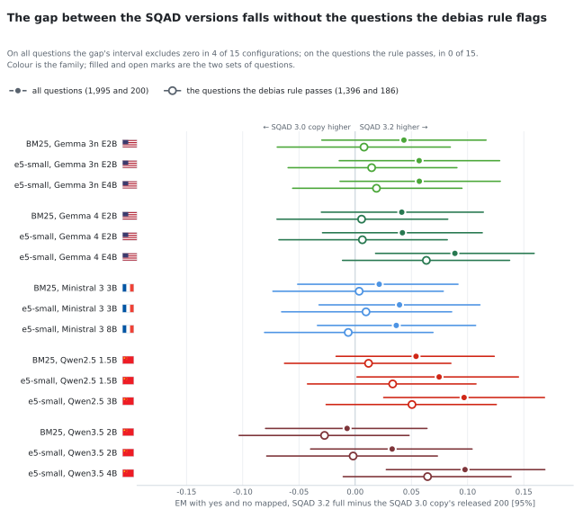

<!-- Generated from templates/docs/CROSSOVER.md and results/stats.json by scripts/fill.py. Edit the template, not this file. -->
# The crossover: where does the next gigabyte go?

A RAG system on one machine can spend its next gigabyte on a stronger retriever or on a bigger generator.
Which buys more exact match (EM) depends on how often the retriever already puts a gold passage in front of the
generator, the gold-in-context rate g. On HotpotQA at k = 5, the step from the weak tfidf-svd to bm25 buys
+0.310 [+0.268, +0.352] EM, and the generator step at tfidf-svd +0.030 [+0.014, +0.048]:
the retriever upgrade, established. One step up, bm25 to e5-small buys +0.020 [-0.014, +0.054]
and the generator step at bm25 +0.068 [+0.034, +0.102]: the generator upgrade, established
(generator minus retriever +0.048 [+0.008, +0.088]; every step, with its g, is in §3).
This document looks for the crossing between such points with a controlled dial, puts an interval on it, prices
both moves in gigabytes and milliseconds, checks the dial against real retrievers, and repeats it on a second
dataset.

The generator step is Ministral 3 3B 🇫🇷 to Ministral 3 8B 🇫🇷 (Instruct 2512, Q4_K_M). Its dial answered on a second
machine's GPU and its natural sweeps were timed on the laptop's CPU
([LIMITATIONS.md](LIMITATIONS.md#the-czech-and-english-families)). The other families' dials are in
[Four families' English dials](#four-families-english-dials).

**The answer in one paragraph.**

* **HotpotQA, raw:** g* = 0.39 [0.16, 0.89], the upper end censored; 270 of 10000 resamples have no root; the difference is established at 1 of 5 levels, and only at the no-gold level (g = 0), so nowhere that gold is present.
* **HotpotQA, per GB:** as measured, model file memory-mapped (library default), no crossing inside g = 0.00 to 0.90 (censored above 0.90; 10000 of 10000 resamples have no root); estimate without the double-counted mapped pages (probe; see [LIMITATIONS.md](LIMITATIONS.md#the-machine-and-the-timings)),
  no crossing inside g = 0.00 to 0.90 (censored above 0.90; 9999 of 10000 resamples have no root).
* **Natural Questions, raw:** g* = 0.56 [0.29, 0.83], the upper end censored; 1847 of 10000 resamples have no root; the difference is established at 1 of 5 levels, and only at the no-gold level (g = 0), so nowhere that gold is present.
* **Do they agree?** not shown to differ: the g* intervals overlap, but both are wide and censored at an end, so their overlap cannot show that the two datasets agree. In full: on hotpotqa the generator step is the larger point estimate at 3 of 5 dial levels, and the isotonic fit gives g* = 0.39 [0.16, 0.89], the upper end censored; 270 of 10000 resamples censored; on nq the retriever step is the larger point estimate at 3 of 5 dial levels, and the isotonic fit gives g* = 0.56 [0.29, 0.83], the upper end censored; 1847 of 10000 resamples censored. The gap between the two moves is established at 0 of 4 hotpotqa and 0 of 4 nq levels that contain gold, so the data do not locate a common g*.
* **What a crossing point cannot say.** A retriever step and a generator step are
  not fixed quantities, so the crossover has to be read with its step size. On
  the dial, a retriever step is one level of gold removed.
* **The usable form is a break-even gold gain.** For each operating point,
  §3 and §4 state how much gold-in-context a retriever upgrade must add before it
  matches the 3B → 8B upgrade. Measure what your upgrade adds, and compare.

---

## 1. Definitions

These are the only definitions of these terms in the kit. The code in
`src/measurerag/crossover/` implements them, and `scripts/crossover.py` is the
only thing that computes the numbers.

**Gold-in-context, g.** The fraction of questions for which the k passages
handed to the generator contain a gold passage. HotpotQA questions have two gold
passages, so two versions are recorded:

* *g any*: at least one gold passage is in the context. **This is the primary g.**
* *g all*: every gold passage is in the context.

A question with no gold passage in the qrels counts as neither.

**The two moves.** Both are measured at the same k, the same prompt template
(`src/measurerag/prompt_template.txt`) and the same
seed, with greedy decoding at `max_tokens` = 64.

* **Δ_gen(g)**: the EM gain from replacing Ministral 3 3B 🇫🇷 with Ministral 3 8B 🇫🇷
  (both Instruct 2512, Q4_K_M), with the retrieval held fixed, at operating
  point g.
* **Δ_ret(g)**: the EM gain, with the 3B generator, from moving one step up
  the retriever ladder, starting from operating point g.

**The crossover, g\*.** The g at which Δ_ret(g) = Δ_gen(g). Below g\*, the next
unit of budget buys more on the retriever; above it, on the generator.

**Per GB and per ms.** Each move is also divided by what it costs, as measured
by the budget bench: the increase in peak resident set size of the whole
process (retriever, index and generator together), and the increase in the
latency a user waits. The bench times retrieval and the generation stage
(prompt build and generation; it calls this "end-to-end") separately, so the
added latency is the change in retrieval p50 plus the change in generation
p50: a sum of medians, not the median of a sum. The per-GB
crossover is where Δ_ret / GB = Δ_gen / GB.
A move that does not *add* cost (a retriever change that lowers p50 because
its passages are shorter) has no per-unit price, and its crossover is reported
as undefined rather than computed from a negative denominator.

### Two ways to move g, never mixed

**The controlled dial.** Take the strongest retriever's top k. Replace each gold
passage, with probability p ∈ {0, 0.2, 0.4, 0.6, 0.8, 1.0}, by the next-ranked
non-gold passage from below rank k. The corpus, k, the prompt and the amount of
text stay fixed; only whether the gold is there changes. At p = 0 the context
is the retriever's own top k; at p = 1 it contains no gold.

The draws are nested: each gold passage gets one uniform u, seeded by the
question id, and is removed at every level with u < p. Whatever is gone at one
level is also gone at every higher one. That makes adjacent levels a paired
comparison.

On the dial, **one step up the retriever ladder is one dial level**: from p to
p − 0.2. This is the clean estimate of g\*.

**The natural sweep.** Real retrievers, through the unchanged budget bench:
tfidf-svd (a deliberately weak instrument), bm25,
multilingual-e5-small, multilingual-e5-base and bge-m3, at k = 5.
This is the check that real retrievers behave the way the dial says they should.

### A property of the definition that travels with every g\*

**g\* depends on how much gold one retriever step recovers.** A retriever step
that recovers more gold buys more EM and moves the crossing. A dial level
removes a sizeable share of the gold; a real upgrade from bm25 to e5-small, where
bm25 already puts gold in nearly every context of this 100,000-passage slice (§3), recovers almost
none. So the dial's g\* answers "if a
retriever step is worth one dial level of gold, where does it stop paying?" It
does not say that every real upgrade above g\* is wasted. For the same reason
the natural sweep is compared with the dial not on raw Δ_ret, but against the
gain the dial predicts for the same move in g. g\* for a step worth two dial
levels is reported as a sensitivity.

---

## 2. Statistics and measurement

* **Paired bootstrap over questions**, 10000 resamples, seeded. One resample
  draws one multiset of questions and re-scores every condition on it, so every
  difference is paired. Resamples are integer count vectors and EM is 0/1, so
  every resampled mean is an exact ratio and the analysis is byte-identical
  across runs (reproduced: yes).
* **95% percentile intervals** on every Δ at every operating point.
  "Established" means the interval excludes zero. No p-values.
* **g\*** is the root of Δ_ret(g) − Δ_gen(g) under two fits over the dial levels:
  a monotone non-increasing (isotonic, pool-adjacent-violators) fit, linearly
  interpolated, and an ordinary least-squares line. The headline uses the
  isotonic root. The two fits **agree** when each root lies inside the other's
  interval. A resample whose curve never crosses zero is censored at the edge of
  the observed g range it fell off, not dropped. The count is reported.
* **Dial versus reality.** For each natural retriever step, the dial's EM curve,
  interpolated in g, predicts the gain of moving from the lower rung's g to the
  upper rung's. For each natural configuration, it predicts Δ_gen at that g. Two
  checks are reported. *Inside band*: the measured point lies inside the dial's
  95% band. *Consistent*: the paired interval on measured minus predicted
  includes zero. The first ignores the natural point's own noise, which the
  second accounts for.
* **Timing hygiene, switched off.** Every configuration was measured alone, with every other process
  sampled for CPU contention every 30 s. Two attempts at the first configuration ran under the
  calibration-probe gate (20 fixed generations, median within 10% of a
  baseline) and were set aside: one was measured against a baseline taken on a warm machine in use, and one, against
  the baseline taken again (2.197 s), was rejected for contention. The author then switched the
  gate and the rejections off: all 20 accepted batches ran one at a time,
  17 of them back to back and the three timed again in a later sitting
  ([BUDGETS.md](BUDGETS.md), §4), their contention recorded but not enforced, except that a batch more than a quarter contended would have been run again (batches
  that were: none). Under the switched-off rule 4 of 20 accepted
  batches would have been rejected. Their timings, and any price that uses them, carry that caveat; the answers do
  not depend on it. Three HotpotQA configurations first timed in one night (04:58 to 15:06 UTC on 12 Nov 2026),
  picked out after the run by their latencies, were timed again: HotpotQA e5-base+8b (end-to-end p50 24.45 s when first timed, 19.58 s when timed again; peak RSS 11.80 GB, then 12.57 GB); HotpotQA bm25+3b (end-to-end p50 14.86 s when first timed, 11.07 s when timed again; peak RSS 5.65 GB, then 5.66 GB); HotpotQA bm25+8b (end-to-end p50 28.23 s when first timed, 23.75 s when timed again; peak RSS 10.77 GB, then 10.76 GB) (peak RSS
  as measured, model file memory-mapped (library default); estimate without the double-counted mapped pages (probe; see [LIMITATIONS.md](LIMITATIONS.md#the-machine-and-the-timings)): HotpotQA e5-base+8b 8.10 GB, then 8.87 GB; HotpotQA bm25+3b 4.29 GB, then 4.29 GB; HotpotQA bm25+8b 7.07 GB, then 7.06 GB).
  The tables use the second timings. Rows vary from batch to batch too, so every latency price carries the
  caveat ([LIMITATIONS.md](LIMITATIONS.md#the-machine-and-the-timings)).
  Details: [BUDGETS.md](BUDGETS.md).

---

## 3. HotpotQA

### HotpotQA: the controlled dial

500 questions; dial on e5-base's top 5; the dial's top operating point is
g = 0.992.

| p | g any | g all | EM 3B | EM 8B | Δ_gen [95%] | Δ_ret [95%] | Δ_ret − Δ_gen [95%] | answer in a non-gold passage |
|---|---|---|---|---|---|---|---|---|
| 0.0 | 0.992 | 0.750 | 0.354 | 0.474 | +0.120 [+0.084, +0.156] | n/a | n/a | 4% |
| 0.2 | 0.904 | 0.480 | 0.262 | 0.380 | +0.118 [+0.086, +0.152] | +0.092 [+0.066, +0.118] | -0.026 [-0.064, +0.012] not established | 5% |
| 0.4 | 0.774 | 0.284 | 0.182 | 0.294 | +0.112 [+0.080, +0.144] | +0.080 [+0.056, +0.106] | -0.032 [-0.070, +0.006] not established | 5% |
| 0.6 | 0.568 | 0.144 | 0.122 | 0.194 | +0.072 [+0.044, +0.100] | +0.060 [+0.038, +0.084] | -0.012 [-0.046, +0.022] not established | 5% |
| 0.8 | 0.334 | 0.034 | 0.068 | 0.118 | +0.050 [+0.026, +0.074] | +0.054 [+0.034, +0.074] | +0.004 [-0.026, +0.034] not established | 5% |
| 1.0 | 0.000 | 0.000 | 0.018 | 0.032 | +0.014 [+0.000, +0.028] | +0.050 [+0.032, +0.070] | +0.036 [+0.012, +0.060] established | 5% |

**Crossover:** g* = 0.39 [0.16, 0.89], the upper end censored; 270 of 10000 resamples censored (isotonic), 0.43 [0.15, 0.88], the upper end censored; 294 of 10000 resamples censored (linear); the difference is established at 1 of 5 levels, and only at the no-gold level (g = 0), so nowhere that gold is present.

* The retriever step is the larger point estimate at 2 of 5 levels.
* Its advantage is established (the paired interval excludes zero) at 1 of 5.
* The generator's advantage is established at 0 of 5.

| fit | g* raw [95%] | g* on the all-gold axis | g* with a two-level retriever step |
|---|---|---|---|
| isotonic (headline) | 0.39 [0.16, 0.89], the upper end censored; 270 of 10000 resamples censored | 0.06 [0.01, 0.45], the upper end censored; 270 of 10000 resamples censored | no crossing in range |
| linear | 0.43 [0.15, 0.88], the upper end censored; 294 of 10000 resamples censored | 0.14 [0.00, 0.45], the lower end censored; 1127 of 10000 resamples censored | no crossing in range |
| fits agree | yes | yes | no |

### HotpotQA: the break-even gold gain

How much gold-in-context a retriever upgrade must add, starting from each operating point, to buy as much EM as the
3B → 8B upgrade does there. "Censored" counts resamples in which the headroom above the operating point was not
enough. The last two columns are each a bar for one upgrade that costs as much peak memory as the priced retriever step,
bm25 → e5-small (0.95 GB), against the generator step's own cost (5.07 GB as measured, model file memory-mapped (library default);
2.73 GB, estimate without the double-counted mapped pages (probe; see [LIMITATIONS.md](LIMITATIONS.md#the-machine-and-the-timings))): the gold gain whose EM gain equals the generator step's times the ratio
of the two costs, so the table gives it twice. It is not a rate. For an upgrade that costs C GB, the bar is the gold gain
that buys the generator step's EM gain times C / (the generator step's GB); where the dial's EM curve is close to
straight, that is about the raw bar times C / (the generator step's GB). The cost C here is the memory of bm25 → e5-small, a step that on HotpotQA moves
g any by only +0.002 (0.984 → 0.986): the columns
say what an upgrade of that cost would have to add, not what that step adds.

| p | operating point g | headroom to dial top | gold gain needed to match the generator step, raw [95%] | gold gain needed, for an upgrade costing 0.95 GB like the priced step [95%], as measured, model file memory-mapped (library default) | gold gain needed, for an upgrade costing 0.95 GB like the priced step [95%], estimate without the double-counted mapped pages (probe; see LIMITATIONS) |
|---|---|---|---|---|---|
| 0.0 | 0.992 | 0.000 | > headroom (0.000) [0.000, 0.000]; 10000 censored | > headroom (0.000) [0.000, 0.000]; 10000 censored | > headroom (0.000) [0.000, 0.000]; 10000 censored |
| 0.2 | 0.904 | 0.088 | > headroom (0.088) [0.063, 0.112]; 8981 censored | 0.021 [0.014, 0.031] | 0.039 [0.025, 0.058]; 1 censored |
| 0.4 | 0.774 | 0.218 | 0.161 [0.118, 0.203]; 23 censored | 0.034 [0.022, 0.051] | 0.063 [0.041, 0.095] |
| 0.6 | 0.568 | 0.424 | 0.226 [0.142, 0.286] | 0.046 [0.026, 0.078] | 0.086 [0.049, 0.145] |
| 0.8 | 0.334 | 0.658 | 0.217 [0.110, 0.320] | 0.040 [0.021, 0.071] | 0.075 [0.038, 0.131] |
| 1.0 | 0.000 | 0.992 | 0.094 [0.000, 0.219] | 0.017 [0.000, 0.041] | 0.032 [0.000, 0.076] |

### HotpotQA: the price

**Two values for every price in GB.** The generator loads its model file memory-mapped, llama-cpp-python's default,
and on the CPU llama.cpp also copies most weights into its own buffers, so each row's peak RSS counts part of the
generator's weights twice. Every figure below that rests on peak RSS is given as measured, model file memory-mapped
(library default), and beside it as an estimate without the double-counted mapped pages (probe; see
[LIMITATIONS.md](LIMITATIONS.md#the-machine-and-the-timings)): each row's measured peak less the surplus a probe
measured for its generator. The retriever step's GB is the same either way, since its two rows load the same
generator; no answer and no timing depends on it.

Each move priced by the bench at k = 5:
* **Retriever step (bm25 → e5-small):** 0.95 GB of peak RSS; -2453 ms of added latency, of
  which 9.6 ms is the change in retrieval p50 and -2462 ms the change in
  generation-stage p50, as measured. bm25 with Ministral 3 3B 🇫🇷 was timed again after the night it was first timed in,
  and the change stayed negative. Two explanations fit, and the records cannot separate them: e5-small's passages may
  make shorter prompts, so less prefill, or the change is variation between runs, since bm25 + 3B alone moved by
  3790 ms between its two timings. The prompts' token counts are not recorded.
* **Generator step:** 5.07 GB as measured, model file memory-mapped (library default), 2.73 GB estimate without the double-counted mapped pages (probe; see [LIMITATIONS.md](LIMITATIONS.md#the-machine-and-the-timings));
  10590 ms of added latency.

The generator step measured in front of every rung. Peak RSS is one maximum over the whole process, index build
included, so the difference between two configurations' peaks moves with the retriever in front
of them; the dial prices the step at one rung, and this table is its sensitivity:

| retriever in front | 3B → 8B: GB of peak RSS, as measured, model file memory-mapped (library default) | 3B → 8B: GB of peak RSS, estimate without the double-counted mapped pages (probe; see LIMITATIONS) | 3B → 8B: ms of added latency |
|---|---|---|---|
| tfidf-svd | 5.54 | 3.20 | 7948 |
| bm25 | 5.10 | 2.76 | 12688 |
| e5-small | 5.10 | 2.76 | 7977 |
| e5-base (priced) | 5.07 | 2.73 | 10590 |
| bge-m3 | 5.10 | 2.76 | 14558 |

bm25's two rows are both from the later sitting ([BUDGETS.md](BUDGETS.md), §4), e5-base's 8B row is from the later
sitting and its 3B row from the first, and the other rungs' rows are both from the first.

The per-GB crossover with the generator step priced in front of each rung
instead. A large spread means the per-GB answer depends on a price the bench
measures only as a difference of two process-wide peaks:

| generator step priced in front of | its GB, as measured, model file memory-mapped (library default) | its GB, estimate without the double-counted mapped pages (probe; see LIMITATIONS) | per-GB g* isotonic [95%] | per-GB g* linear [95%] |
|---|---|---|---|---|
| bge-m3 | 5.10 | 2.76 | no crossing in range | no crossing in range |
| bm25 | 5.10 | 2.76 | no crossing in range | no crossing in range |
| e5-base | 5.07 | 2.73 | no crossing in range | no crossing in range |
| e5-small | 5.10 | 2.76 | no crossing in range | no crossing in range |
| tfidf-svd | 5.54 | 3.20 | no crossing in range | no crossing in range |

Rungs at which the per-GB fit crosses: as measured, model file memory-mapped (library default), none; estimate without the double-counted mapped pages, none.

| crossover | isotonic [95%] | linear [95%] | agree |
|---|---|---|---|
| per GB, as measured, model file memory-mapped (library default) | no crossing in range | no crossing in range | no |
| per GB, estimate without the double-counted mapped pages (probe; see LIMITATIONS) | no crossing in range | no crossing in range | no |
| per ms of added latency (retrieval + generation) | undefined (the priced move does not add cost) | undefined (the priced move does not add cost) | n/a |
| per ms of generation-stage latency only | undefined (the priced move does not add cost) | undefined (the priced move does not add cost) | n/a |
| retriever per ms of retrieval latency only | no crossing in range | no crossing in range | no |

On the per-GB rows, the retriever step is one dial level of gold priced at the 0.95 GB of
bm25 → e5-small, a step that moves g any on HotpotQA by only +0.002, so the
per-GB comparison prices one move and gains from another.

Each move on each side of the crossing, per unit of cost:

| p | g | side | Δ_ret | Δ_gen | Δ_ret / GB | Δ_gen / GB, as measured, model file memory-mapped (library default) | Δ_gen / GB, estimate without the double-counted mapped pages (probe; see LIMITATIONS) | Δ_ret / s of added latency | Δ_gen / s of added latency |
|---|---|---|---|---|---|---|---|---|---|
| 0.2 | 0.904 | above g* | +0.092 | +0.118 | +0.097 | +0.023 | +0.043 | n/a | +0.011 |
| 0.4 | 0.774 | above g* | +0.080 | +0.112 | +0.085 | +0.022 | +0.041 | n/a | +0.011 |
| 0.6 | 0.568 | above g* | +0.060 | +0.072 | +0.063 | +0.014 | +0.026 | n/a | +0.007 |
| 0.8 | 0.334 | below g* | +0.054 | +0.050 | +0.057 | +0.010 | +0.018 | n/a | +0.005 |
| 1.0 | 0.000 | below g* | +0.050 | +0.014 | +0.053 | +0.003 | +0.005 | n/a | +0.001 |

Every other priced retriever step, as a sensitivity:

| pricing | retriever cost | generator cost | g* isotonic | g* linear |
|---|---|---|---|---|
| per GB of peak RSS, as measured, model file memory-mapped (library default): bm25 → e5-small | 0.95 | 5.07 | no crossing in range | no crossing in range |
| per GB of peak RSS, as measured, model file memory-mapped (library default): e5-base → bge-m3 | 0.75 | 5.07 | no crossing in range | no crossing in range |
| per GB of peak RSS, as measured, model file memory-mapped (library default): e5-small → e5-base | 0.90 | 5.07 | no crossing in range | no crossing in range |
| per GB of peak RSS, as measured, model file memory-mapped (library default): tfidf-svd → bm25 | -1.64 | 5.07 | undefined | n/a |
| per GB of peak RSS, estimate without the double-counted mapped pages (probe; see LIMITATIONS): bm25 → e5-small | 0.95 | 2.73 | no crossing in range | no crossing in range |
| per GB of peak RSS, estimate without the double-counted mapped pages (probe; see LIMITATIONS): e5-base → bge-m3 | 0.75 | 2.73 | no crossing in range | no crossing in range |
| per GB of peak RSS, estimate without the double-counted mapped pages (probe; see LIMITATIONS): e5-small → e5-base | 0.90 | 2.73 | no crossing in range | no crossing in range |
| per GB of peak RSS, estimate without the double-counted mapped pages (probe; see LIMITATIONS): tfidf-svd → bm25 | -1.64 | 2.73 | undefined | n/a |
| retriever per ms of retrieval latency, generator per ms of generation: bm25 → e5-small | 9.58 | 10598.76 | no crossing in range | no crossing in range |
| retriever per ms of retrieval latency, generator per ms of generation: e5-base → bge-m3 | 32.38 | 10598.76 | no crossing in range | no crossing in range |
| retriever per ms of retrieval latency, generator per ms of generation: e5-small → e5-base | 26.15 | 10598.76 | no crossing in range | no crossing in range |
| retriever per ms of retrieval latency, generator per ms of generation: tfidf-svd → bm25 | -19.74 | 10598.76 | undefined | n/a |
| per ms of added latency (retrieval + generation): bm25 → e5-small | -2452.88 | 10589.96 | undefined | n/a |
| per ms of added latency (retrieval + generation): e5-base → bge-m3 | 766.00 | 10589.96 | no crossing in range | no crossing in range |
| per ms of added latency (retrieval + generation): e5-small → e5-base | 400.20 | 10589.96 | no crossing in range | no crossing in range |
| per ms of added latency (retrieval + generation): tfidf-svd → bm25 | 5064.19 | 10589.96 | no crossing in range | no crossing in range |
| per ms of generation-stage latency only: bm25 → e5-small | -2462.45 | 10598.76 | undefined | n/a |
| per ms of generation-stage latency only: e5-base → bge-m3 | 733.63 | 10598.76 | no crossing in range | no crossing in range |
| per ms of generation-stage latency only: e5-small → e5-base | 374.05 | 10598.76 | no crossing in range | no crossing in range |
| per ms of generation-stage latency only: tfidf-svd → bm25 | 5083.93 | 10598.76 | no crossing in range | no crossing in range |

### HotpotQA: the dial against real retrievers

Natural sweep measured at k = 5. At the dial's k, 4 of 9 checks fall inside the
dial's band and 6 of 9 are consistent with it (paired difference interval includes zero).
The dial retriever's own generator check counts: its prompts are the dial's p = 0 prompts, but the dial answered on
the GX10 and the sweep on the laptop, so it measures the two machines, -0.018 [-0.032, -0.004].
Inconsistent: the generator step at bm25 (g 0.984): measured minus predicted -0.052 [-0.090, -0.013]; the generator step at e5-small (g 0.986): measured minus predicted -0.038 [-0.074, -0.002]; the generator step at e5-base (g 0.992): measured minus predicted -0.018 [-0.032, -0.004]. Part of the other disagreements can be the machines; a
retriever change that leaves g where it was and still moves EM shows that EM depends on more than whether a gold
passage is present.

At every real step: the retriever upgrade against the generator upgrade made at the lower rung, paired over
questions.

| retriever step | g | Δ_ret [95%] | Δ_gen at the lower rung [95%] | Δ_gen − Δ_ret [95%] |
|---|---|---|---|---|
| tfidf-svd → bm25 | 0.184 → 0.984 | +0.310 [+0.268, +0.352] | +0.030 [+0.014, +0.048] | -0.280 [-0.324, -0.236] established |
| bm25 → e5-small | 0.984 → 0.986 | +0.020 [-0.014, +0.054] | +0.068 [+0.034, +0.102] | +0.048 [+0.008, +0.088] established |
| e5-small → e5-base | 0.986 → 0.992 | -0.016 [-0.044, +0.012] | +0.082 [+0.048, +0.116] | +0.098 [+0.062, +0.134] established |
| e5-base → bge-m3 | 0.992 → 0.992 | -0.016 [-0.048, +0.014] | +0.102 [+0.066, +0.138] | +0.118 [+0.078, +0.158] established |

| retriever | g any | g all | EM 3B | EM 8B | F1 3B | F1 8B |
|---|---|---|---|---|---|---|
| tfidf-svd | 0.184 | 0.008 | 0.050 | 0.080 | 0.069 | 0.102 |
| bm25 | 0.984 | 0.676 | 0.360 | 0.428 | 0.456 | 0.550 |
| e5-small | 0.986 | 0.716 | 0.380 | 0.462 | 0.485 | 0.573 |
| e5-base | 0.992 | 0.750 | 0.364 | 0.466 | 0.464 | 0.588 |
| bge-m3 | 0.992 | 0.724 | 0.348 | 0.438 | 0.449 | 0.561 |

Retriever steps: measured gain against the gain the dial predicts for the same move in g.

| step | g | Δ_ret measured [95%] | dial predicts [95%] | inside band | difference interval includes 0 | extrapolated |
|---|---|---|---|---|---|---|
| tfidf-svd → bm25 | 0.184 → 0.984 | +0.310 [+0.268, +0.352] | +0.300 [+0.258, +0.341] | yes | yes | no |
| bm25 → e5-small | 0.984 → 0.986 | +0.020 [-0.014, +0.054] | +0.002 [-0.011, +0.018] | no | yes | no |
| e5-small → e5-base | 0.986 → 0.992 | -0.016 [-0.044, +0.012] | +0.006 [+0.000, +0.018] | no | yes | no |
| e5-base → bge-m3 | 0.992 → 0.992 | -0.016 [-0.048, +0.014] | +0.000 [-0.011, +0.000] | no | yes | no |

Generator step at each real retriever against the dial's Δ_gen at the same g:

| retriever | g | Δ_gen measured [95%] | dial band [95%] | inside band | difference interval includes 0 | extrapolated |
|---|---|---|---|---|---|---|
| tfidf-svd | 0.184 | +0.030 [+0.014, +0.048] | +0.034 [+0.017, +0.052] | yes | yes | no |
| bm25 | 0.984 | +0.068 [+0.034, +0.102] | +0.120 [+0.085, +0.154] | no | no | no |
| e5-small | 0.986 | +0.082 [+0.048, +0.116] | +0.120 [+0.085, +0.154] | no | no | no |
| e5-base | 0.992 | +0.102 [+0.066, +0.138] | +0.120 [+0.084, +0.156] | yes | no | no |
| bge-m3 | 0.992 | +0.090 [+0.056, +0.126] | +0.120 [+0.085, +0.155] | yes | yes | no |

**Budget rows used for the prices** (peak RSS is the whole process; every row's
operating system is in [BUDGETS.md](BUDGETS.md)). bm25 + 3B, bm25 + 8B and e5-base + 8B were first timed in one
night (04:58 to 15:06 UTC on 12 Nov 2026) and timed again from 21:28 UTC on 14 Nov to 07:41 UTC on 15 Nov 2026; their rows below are the
second timings, and the priced retriever step (bm25 → e5-small, with 3B) and the generator step where it is priced
(in front of e5-base) use them, in peak memory and in latency. Rows vary from batch to batch, so every latency price carries
that caveat ([LIMITATIONS.md](LIMITATIONS.md#the-machine-and-the-timings)):

| configuration | peak RSS GB, as measured, model file memory-mapped (library default) | peak RSS GB, estimate without the double-counted mapped pages (probe; see LIMITATIONS) | index MB | model GB | e2e p50 s | e2e p95 s | max_tokens | source |
|---|---|---|---|---|---|---|---|---|
| bge-m3+3B@k5 | 8.25 | 6.88 | 409.6 | 4.44 | 9.71 | 13.86 | 64 | results/crossover/natural/hotpotqa_k5_ministral |
| bge-m3+8B@k5 | 13.34 | 9.64 | 409.6 | 7.49 | 24.27 | 34.87 | 64 | results/crossover/natural/hotpotqa_k5_ministral |
| bm25+3B@k5 | 5.66 | 4.29 | 33.1 | 2.15 | 11.07 | 15.74 | 64 | results/crossover/natural/hotpotqa_k5_ministral |
| bm25+8B@k5 | 10.76 | 7.06 | 33.1 | 5.20 | 23.75 | 33.39 | 64 | results/crossover/natural/hotpotqa_k5_ministral |
| e5-base+3B@k5 | 7.50 | 6.14 | 307.2 | 3.28 | 8.98 | 14.03 | 64 | results/crossover/natural/hotpotqa_k5_ministral |
| e5-base+8B@k5 | 12.57 | 8.87 | 307.2 | 6.33 | 19.58 | 31.24 | 64 | results/crossover/natural/hotpotqa_k5_ministral |
| e5-small+3B@k5 | 6.60 | 5.24 | 153.6 | 2.64 | 8.60 | 13.54 | 64 | results/crossover/natural/hotpotqa_k5_ministral |
| e5-small+8B@k5 | 11.70 | 8.00 | 153.6 | 5.69 | 16.58 | 28.17 | 64 | results/crossover/natural/hotpotqa_k5_ministral |
| tfidf-svd+3B@k5 | 7.29 | 5.93 | 102.4 | 2.15 | 5.98 | 11.11 | 64 | results/crossover/natural/hotpotqa_k5_ministral |
| tfidf-svd+8B@k5 | 12.83 | 9.13 | 102.4 | 5.20 | 13.94 | 26.70 | 64 | results/crossover/natural/hotpotqa_k5_ministral |

## 4. Natural Questions

### Natural Questions: the controlled dial

300 questions; dial on e5-base's top 5; the dial's top operating point is
g = 0.960.

**The dial leaks on NQ.** The last column of the table below is the share of
contexts in which a *non-gold* passage still contains an nq-open answer:
27% even with every gold passage removed (HotpotQA:
5%). Removing gold does not remove the answer, so the
dial understates what gold is worth on NQ, and the no-gold level, the only level
where NQ's difference between the two moves is established, is the leakiest. Read
NQ's g\* with that in view.

Gold passages are mapped, not annotated: a passage is gold if
BEIR judges it relevant **and** it contains an nq-open answer. Of
3,452 BEIR test questions with judgements, 2,255
(65.3%) join to nq-open, and 2,083 of those
(92.4%) have a mapped gold passage; 300 are sampled.

| p | g any | g all | EM 3B | EM 8B | Δ_gen [95%] | Δ_ret [95%] | Δ_ret − Δ_gen [95%] | answer in a non-gold passage |
|---|---|---|---|---|---|---|---|---|
| 0.0 | 0.960 | 0.930 | 0.413 | 0.507 | +0.093 [+0.040, +0.147] | n/a | n/a | 25% |
| 0.2 | 0.807 | 0.740 | 0.353 | 0.433 | +0.080 [+0.030, +0.130] | +0.060 [+0.033, +0.087] | -0.020 [-0.077, +0.037] not established | 26% |
| 0.4 | 0.640 | 0.563 | 0.303 | 0.367 | +0.063 [+0.017, +0.110] | +0.050 [+0.023, +0.077] | -0.013 [-0.067, +0.040] not established | 26% |
| 0.6 | 0.457 | 0.370 | 0.240 | 0.287 | +0.047 [+0.007, +0.087] | +0.063 [+0.037, +0.093] | +0.017 [-0.030, +0.063] not established | 26% |
| 0.8 | 0.263 | 0.210 | 0.167 | 0.197 | +0.030 [-0.003, +0.063] | +0.073 [+0.047, +0.103] | +0.043 [+0.000, +0.087] not established | 26% |
| 1.0 | 0.000 | 0.000 | 0.073 | 0.093 | +0.020 [-0.010, +0.050] | +0.093 [+0.060, +0.130] | +0.073 [+0.030, +0.117] established | 27% |

**Crossover:** g* = 0.56 [0.29, 0.83], the upper end censored; 1847 of 10000 resamples censored (isotonic), 0.60 [0.32, 0.83], the upper end censored; 1721 of 10000 resamples censored (linear); the difference is established at 1 of 5 levels, and only at the no-gold level (g = 0), so nowhere that gold is present.

* The retriever step is the larger point estimate at 3 of 5 levels.
* Its advantage is established (the paired interval excludes zero) at 1 of 5.
* The generator's advantage is established at 0 of 5.

| fit | g* raw [95%] | g* on the all-gold axis | g* with a two-level retriever step |
|---|---|---|---|
| isotonic (headline) | 0.56 [0.29, 0.83], the upper end censored; 1847 of 10000 resamples censored | 0.48 [0.23, 0.76], the upper end censored; 1847 of 10000 resamples censored | no crossing in range |
| linear | 0.60 [0.32, 0.83], the upper end censored; 1721 of 10000 resamples censored | 0.53 [0.27, 0.76], the upper end censored; 1577 of 10000 resamples censored | no crossing in range |
| fits agree | yes | yes | no |

### Natural Questions: the break-even gold gain

As for HotpotQA; the last columns are the bar for one upgrade of 0.83 GB, the priced step's memory,
against a generator step of 5.11 GB as measured, model file memory-mapped (library default), and of 2.77 GB, estimate without the double-counted mapped pages (probe; see [LIMITATIONS.md](LIMITATIONS.md#the-machine-and-the-timings)).

| p | operating point g | headroom to dial top | gold gain needed to match the generator step, raw [95%] | gold gain needed, for an upgrade costing 0.83 GB like the priced step [95%], as measured, model file memory-mapped (library default) | gold gain needed, for an upgrade costing 0.83 GB like the priced step [95%], estimate without the double-counted mapped pages (probe; see LIMITATIONS) |
|---|---|---|---|---|---|
| 0.0 | 0.960 | 0.000 | > headroom (0.000) [0.000, 0.000]; 9998 censored | > headroom (0.000) [0.000, 0.000]; 9998 censored | > headroom (0.000) [0.000, 0.000]; 9998 censored |
| 0.2 | 0.807 | 0.153 | > headroom (0.153) [0.077, 0.190]; 7472 censored | 0.033 [0.013, 0.064] | 0.062 [0.023, 0.118]; 88 censored |
| 0.4 | 0.640 | 0.320 | 0.201 [0.054, > headroom]; 528 censored | 0.034 [0.009, 0.078] | 0.064 [0.016, 0.142] |
| 0.6 | 0.457 | 0.503 | 0.135 [0.022, 0.282] | 0.022 [0.004, 0.048] | 0.041 [0.007, 0.088] |
| 0.8 | 0.263 | 0.697 | 0.079 [0.000, 0.184] | 0.013 [0.000, 0.030] | 0.024 [0.000, 0.056] |
| 1.0 | 0.000 | 0.960 | 0.056 [0.000, 0.148] | 0.009 [0.000, 0.024] | 0.017 [0.000, 0.045] |

### Natural Questions: the price

Each move priced by the bench at k = 5:
* **Retriever step (bm25 → e5-small):** 0.83 GB of peak RSS; 125 ms of added latency, of
  which 9.8 ms is the change in retrieval p50 and 115 ms the change in generation-stage p50 (other passages
  change the prompt the generator reads).
* **Generator step:** 5.11 GB as measured, model file memory-mapped (library default), 2.77 GB estimate without the double-counted mapped pages (probe; see [LIMITATIONS.md](LIMITATIONS.md#the-machine-and-the-timings));
  15274 ms of added latency.

The generator step measured in front of every rung. Peak RSS is one maximum over the whole process, index build
included, so the difference between two configurations' peaks moves with the retriever in front
of them; the dial prices the step at one rung, and this table is its sensitivity:

| retriever in front | 3B → 8B: GB of peak RSS, as measured, model file memory-mapped (library default) | 3B → 8B: GB of peak RSS, estimate without the double-counted mapped pages (probe; see LIMITATIONS) | 3B → 8B: ms of added latency |
|---|---|---|---|
| tfidf-svd | 5.03 | 2.69 | 6987 |
| bm25 | 5.11 | 2.77 | 17075 |
| e5-small | 5.11 | 2.77 | 14990 |
| e5-base (priced) | 5.11 | 2.77 | 15274 |
| bge-m3 | 3.06 | 0.72 | 14103 |

The per-GB crossover with the generator step priced in front of each rung
instead. A large spread means the per-GB answer depends on a price the bench
measures only as a difference of two process-wide peaks:

| generator step priced in front of | its GB, as measured, model file memory-mapped (library default) | its GB, estimate without the double-counted mapped pages (probe; see LIMITATIONS) | per-GB g* isotonic [95%], as measured, model file memory-mapped (library default) | per-GB g* isotonic [95%], estimate without the double-counted mapped pages (probe; see LIMITATIONS) | per-GB g* linear [95%], as measured, model file memory-mapped (library default) | per-GB g* linear [95%], estimate without the double-counted mapped pages (probe; see LIMITATIONS) |
|---|---|---|---|---|---|---|
| bge-m3 | 3.06 | 0.72 | no crossing in range | 0.51 [0.23, 0.82], the upper end censored; 1239 of 10000 resamples censored | no crossing in range | 0.53 [0.24, 0.82], the upper end censored; 1121 of 10000 resamples censored |
| bm25 | 5.11 | 2.77 | no crossing in range | no crossing in range | no crossing in range | no crossing in range |
| e5-base | 5.11 | 2.77 | no crossing in range | no crossing in range | no crossing in range | no crossing in range |
| e5-small | 5.11 | 2.77 | no crossing in range | no crossing in range | no crossing in range | no crossing in range |
| tfidf-svd | 5.03 | 2.69 | no crossing in range | no crossing in range | no crossing in range | no crossing in range |

Rungs at which the per-GB fit crosses: as measured, model file memory-mapped (library default), none; estimate without the double-counted mapped pages, bge-m3, where the step costs 0.72 GB: g* = 0.51 [0.23, 0.82], the upper end censored; 1239 of 10000 resamples censored.

| crossover | isotonic [95%] | linear [95%] | agree |
|---|---|---|---|
| per GB, as measured, model file memory-mapped (library default) | no crossing in range | no crossing in range | no |
| per GB, estimate without the double-counted mapped pages (probe; see LIMITATIONS) | no crossing in range | no crossing in range | no |
| per ms of added latency (retrieval + generation) | no crossing in range | no crossing in range | no |
| per ms of generation-stage latency only | no crossing in range | no crossing in range | no |
| retriever per ms of retrieval latency only | no crossing in range | no crossing in range | no |

| p | g | side | Δ_ret | Δ_gen | Δ_ret / GB | Δ_gen / GB, as measured, model file memory-mapped (library default) | Δ_gen / GB, estimate without the double-counted mapped pages (probe; see LIMITATIONS) | Δ_ret / s of added latency | Δ_gen / s of added latency |
|---|---|---|---|---|---|---|---|---|---|
| 0.2 | 0.807 | above g* | +0.060 | +0.080 | +0.072 | +0.016 | +0.029 | +0.480 | +0.005 |
| 0.4 | 0.640 | above g* | +0.050 | +0.063 | +0.060 | +0.012 | +0.023 | +0.400 | +0.004 |
| 0.6 | 0.457 | below g* | +0.063 | +0.047 | +0.076 | +0.009 | +0.017 | +0.506 | +0.003 |
| 0.8 | 0.263 | below g* | +0.073 | +0.030 | +0.088 | +0.006 | +0.011 | +0.586 | +0.002 |
| 1.0 | 0.000 | below g* | +0.093 | +0.020 | +0.112 | +0.004 | +0.007 | +0.746 | +0.001 |

### Natural Questions: the dial against real retrievers

At k = 5, 5 of 9 checks fall inside the dial's band and
8 of 9 are consistent with it (the dial retriever's own check counted, as for HotpotQA:
the two machines differ by +0.007 [-0.010, +0.027]). Inconsistent: tfidf-svd → bm25 (g 0.060 → 0.733): measured minus predicted +0.067 [+0.015, +0.120].

| retriever step | g | Δ_ret [95%] | Δ_gen at the lower rung [95%] | Δ_gen − Δ_ret [95%] |
|---|---|---|---|---|
| tfidf-svd → bm25 | 0.060 → 0.733 | +0.303 [+0.250, +0.357] | +0.007 [-0.013, +0.027] | -0.297 [-0.353, -0.243] established |
| bm25 → e5-small | 0.733 → 0.943 | +0.033 [-0.020, +0.083] | +0.073 [+0.030, +0.117] | +0.040 [-0.017, +0.097] not established |
| e5-small → e5-base | 0.943 → 0.960 | +0.030 [-0.010, +0.070] | +0.110 [+0.060, +0.160] | +0.080 [+0.030, +0.133] established |
| e5-base → bge-m3 | 0.960 → 0.950 | -0.017 [-0.060, +0.027] | +0.100 [+0.050, +0.153] | +0.117 [+0.067, +0.170] established |

| retriever | g any | g all | EM 3B | EM 8B | F1 3B | F1 8B |
|---|---|---|---|---|---|---|
| tfidf-svd | 0.060 | 0.053 | 0.040 | 0.047 | 0.045 | 0.052 |
| bm25 | 0.733 | 0.680 | 0.343 | 0.417 | 0.453 | 0.539 |
| e5-small | 0.943 | 0.923 | 0.377 | 0.487 | 0.517 | 0.645 |
| e5-base | 0.960 | 0.930 | 0.407 | 0.507 | 0.525 | 0.650 |
| bge-m3 | 0.950 | 0.930 | 0.390 | 0.497 | 0.531 | 0.641 |

| step | g | Δ_ret measured [95%] | dial predicts [95%] | inside band | difference interval includes 0 | extrapolated |
|---|---|---|---|---|---|---|
| tfidf-svd → bm25 | 0.060 → 0.733 | +0.303 [+0.250, +0.357] | +0.237 [+0.190, +0.285] | no | no | no |
| bm25 → e5-small | 0.733 → 0.943 | +0.033 [-0.020, +0.083] | +0.075 [+0.051, +0.104] | no | yes | no |
| e5-small → e5-base | 0.943 → 0.960 | +0.030 [-0.010, +0.070] | +0.007 [+0.000, +0.018] | no | yes | no |
| e5-base → bge-m3 | 0.960 → 0.950 | -0.017 [-0.060, +0.027] | -0.004 [-0.013, +0.000] | no | yes | no |

| retriever | g | Δ_gen measured [95%] | dial band [95%] | inside band | difference interval includes 0 | extrapolated |
|---|---|---|---|---|---|---|
| tfidf-svd | 0.060 | +0.007 [-0.013, +0.027] | +0.022 [-0.006, +0.051] | yes | yes | no |
| bm25 | 0.733 | +0.073 [+0.030, +0.117] | +0.073 [+0.026, +0.121] | yes | yes | no |
| e5-small | 0.943 | +0.110 [+0.060, +0.160] | +0.092 [+0.040, +0.145] | yes | yes | no |
| e5-base | 0.960 | +0.100 [+0.050, +0.153] | +0.093 [+0.040, +0.147] | yes | yes | no |
| bge-m3 | 0.950 | +0.107 [+0.057, +0.157] | +0.092 [+0.040, +0.146] | yes | yes | no |

| configuration | peak RSS GB, as measured, model file memory-mapped (library default) | peak RSS GB, estimate without the double-counted mapped pages (probe; see LIMITATIONS) | index MB | model GB | e2e p50 s | e2e p95 s | max_tokens | source |
|---|---|---|---|---|---|---|---|---|
| bge-m3+3B@k5 | 8.73 | 7.37 | 409.6 | 4.44 | 12.21 | 19.68 | 64 | results/crossover/natural/nq_k5_ministral |
| bge-m3+8B@k5 | 11.79 | 8.09 | 409.6 | 7.49 | 26.31 | 40.06 | 64 | results/crossover/natural/nq_k5_ministral |
| bm25+3B@k5 | 5.85 | 4.49 | 50.0 | 2.15 | 13.38 | 19.24 | 64 | results/crossover/natural/nq_k5_ministral |
| bm25+8B@k5 | 10.96 | 7.26 | 50.0 | 5.20 | 30.46 | 44.78 | 64 | results/crossover/natural/nq_k5_ministral |
| e5-base+3B@k5 | 7.53 | 6.17 | 307.2 | 3.28 | 12.40 | 20.25 | 64 | results/crossover/natural/nq_k5_ministral |
| e5-base+8B@k5 | 12.64 | 8.94 | 307.2 | 6.33 | 27.68 | 45.44 | 64 | results/crossover/natural/nq_k5_ministral |
| e5-small+3B@k5 | 6.69 | 5.33 | 153.6 | 2.64 | 13.50 | 21.33 | 64 | results/crossover/natural/nq_k5_ministral |
| e5-small+8B@k5 | 11.80 | 8.10 | 153.6 | 5.69 | 28.49 | 45.89 | 64 | results/crossover/natural/nq_k5_ministral |
| tfidf-svd+3B@k5 | 7.91 | 6.55 | 102.4 | 2.15 | 4.65 | 9.79 | 64 | results/crossover/natural/nq_k5_ministral |
| tfidf-svd+8B@k5 | 12.95 | 9.25 | 102.4 | 5.20 | 11.64 | 24.83 | 64 | results/crossover/natural/nq_k5_ministral |

## Four families' English dials

The dial above is Ministral 3's 🇫🇷, the family whose English sweeps were timed on this laptop. The same controlled
dial ran with three more families of the Czech comparison, each family's smaller model in 3B's place and its larger in
8B's: Gemma 4 E2B 🇺🇸 and E4B 🇺🇸, chosen first, and, after Gemma 4's 🇺🇸 dial was read, Gemma 3n E2B 🇺🇸 and E4B 🇺🇸 and
Ministral 3 🇫🇷, all three answered on the GX10's GPU; Qwen2.5 1.5B 🇨🇳 and 3B 🇨🇳 answered it on the laptop's CPU. Qwen3.5 🇨🇳
did not answer the English dial
([LIMITATIONS.md](LIMITATIONS.md#the-czech-and-english-families)). Same questions, rankings (e5-base, k = 5), levels,
prompt, token cap, seed and resamples. The README's dial figure shows Ministral 3's 🇫🇷 dial, the author's choice after
these dials were read, and Ministral 3's 🇫🇷 English sweeps were timed after the same reading. The documents read no
budget or price for the other families.

**Gemma 3n 🇺🇸**, E2B to E4B: -0.004 to +0.056 on HotpotQA, established above zero at
1 of 6 levels, and +0.007 to +0.043 on NQ, at
0 of 6.

**Gemma 4 🇺🇸**, E2B to E4B: -0.070 to +0.008 on HotpotQA, where E4B scores below E2B, established at
4 of 6 levels, and -0.040 to +0.017 on NQ. In English, at this
prompt and cap, Gemma 4's 🇺🇸 larger model buys nothing on the dial.

**Ministral 3 🇫🇷**, 3B to 8B: the generator step is +0.014 to +0.120 on HotpotQA, above zero and
established at 5 of 6 levels, and +0.020 to +0.093 on
NQ, established at 4 of 6. Its full tables are in §3 and §4.

Qwen2.5 🇨🇳, 1.5B to 3B: +0.000 to +0.058 on HotpotQA, established above zero at
5 of 6 levels, and +0.043 to +0.103 on NQ, at
6 of 6.

HotpotQA, Gemma 3n 🇺🇸:

| p | g any | EM E2B | EM E4B | Δ_gen [95%] | Δ_ret [95%] |
|---|---|---|---|---|---|
| 1.0 | 0.000 | 0.010 | 0.014 | +0.004 [-0.006, +0.016] | +0.088 [+0.064, +0.114] |
| 0.8 | 0.334 | 0.098 | 0.094 | -0.004 [-0.024, +0.014] | +0.068 [+0.046, +0.092] |
| 0.6 | 0.568 | 0.166 | 0.162 | -0.004 [-0.024, +0.016] | +0.070 [+0.048, +0.094] |
| 0.4 | 0.774 | 0.236 | 0.254 | +0.018 [-0.006, +0.042] | +0.076 [+0.050, +0.102] |
| 0.2 | 0.904 | 0.312 | 0.338 | +0.026 [+0.000, +0.052] | +0.054 [+0.032, +0.078] |
| 0.0 | 0.992 | 0.366 | 0.422 | +0.056 [+0.028, +0.086] | n/a |

NQ, Gemma 3n 🇺🇸:

| p | g any | EM E2B | EM E4B | Δ_gen [95%] | Δ_ret [95%] |
|---|---|---|---|---|---|
| 1.0 | 0.000 | 0.100 | 0.107 | +0.007 [-0.013, +0.027] | +0.100 [+0.067, +0.137] |
| 0.8 | 0.263 | 0.200 | 0.210 | +0.010 [-0.020, +0.040] | +0.073 [+0.043, +0.107] |
| 0.6 | 0.457 | 0.273 | 0.283 | +0.010 [-0.020, +0.040] | +0.093 [+0.060, +0.130] |
| 0.4 | 0.640 | 0.367 | 0.383 | +0.017 [-0.020, +0.053] | +0.060 [+0.033, +0.090] |
| 0.2 | 0.807 | 0.427 | 0.450 | +0.023 [-0.017, +0.067] | +0.057 [+0.023, +0.090] |
| 0.0 | 0.960 | 0.483 | 0.527 | +0.043 [+0.000, +0.087] | n/a |

HotpotQA, Gemma 4 🇺🇸:

| p | g any | EM E2B | EM E4B | Δ_gen [95%] | Δ_ret [95%] |
|---|---|---|---|---|---|
| 1.0 | 0.000 | 0.026 | 0.008 | -0.018 [-0.032, -0.004] | +0.090 [+0.066, +0.116] |
| 0.8 | 0.334 | 0.116 | 0.058 | -0.058 [-0.082, -0.034] | +0.072 [+0.050, +0.096] |
| 0.6 | 0.568 | 0.188 | 0.118 | -0.070 [-0.098, -0.042] | +0.072 [+0.046, +0.100] |
| 0.4 | 0.774 | 0.260 | 0.204 | -0.056 [-0.086, -0.026] | +0.060 [+0.036, +0.086] |
| 0.2 | 0.904 | 0.320 | 0.290 | -0.030 [-0.062, +0.004] | +0.064 [+0.042, +0.088] |
| 0.0 | 0.992 | 0.384 | 0.392 | +0.008 [-0.026, +0.042] | n/a |

NQ, Gemma 4 🇺🇸:

| p | g any | EM E2B | EM E4B | Δ_gen [95%] | Δ_ret [95%] |
|---|---|---|---|---|---|
| 1.0 | 0.000 | 0.097 | 0.057 | -0.040 [-0.063, -0.020] | +0.097 [+0.063, +0.133] |
| 0.8 | 0.263 | 0.193 | 0.167 | -0.027 [-0.060, +0.007] | +0.063 [+0.030, +0.100] |
| 0.6 | 0.457 | 0.257 | 0.260 | +0.003 [-0.037, +0.043] | +0.093 [+0.060, +0.130] |
| 0.4 | 0.640 | 0.350 | 0.367 | +0.017 [-0.027, +0.060] | +0.077 [+0.047, +0.107] |
| 0.2 | 0.807 | 0.427 | 0.437 | +0.010 [-0.040, +0.060] | +0.087 [+0.053, +0.120] |
| 0.0 | 0.960 | 0.513 | 0.520 | +0.007 [-0.043, +0.060] | n/a |

HotpotQA, Qwen2.5 🇨🇳:

| p | g any | EM 1.5B | EM 3B | Δ_gen [95%] | Δ_ret [95%] |
|---|---|---|---|---|---|
| 1.0 | 0.000 | 0.010 | 0.010 | +0.000 [-0.012, +0.012] | +0.030 [+0.014, +0.048] |
| 0.8 | 0.334 | 0.040 | 0.070 | +0.030 [+0.008, +0.052] | +0.038 [+0.020, +0.058] |
| 0.6 | 0.568 | 0.078 | 0.130 | +0.052 [+0.024, +0.080] | +0.068 [+0.046, +0.092] |
| 0.4 | 0.774 | 0.146 | 0.190 | +0.044 [+0.010, +0.078] | +0.054 [+0.034, +0.076] |
| 0.2 | 0.904 | 0.200 | 0.258 | +0.058 [+0.022, +0.094] | +0.070 [+0.046, +0.094] |
| 0.0 | 0.992 | 0.270 | 0.324 | +0.054 [+0.014, +0.092] | n/a |

*Qwen2.5 3B rows: Qwen2.5-3B-Instruct, under the Qwen Research License (non-commercial research and evaluation use only; see [THIRD_PARTY.md](../THIRD_PARTY.md)).*

NQ, Qwen2.5 🇨🇳:

| p | g any | EM 1.5B | EM 3B | Δ_gen [95%] | Δ_ret [95%] |
|---|---|---|---|---|---|
| 1.0 | 0.000 | 0.037 | 0.080 | +0.043 [+0.017, +0.073] | +0.063 [+0.037, +0.093] |
| 0.8 | 0.263 | 0.100 | 0.183 | +0.083 [+0.050, +0.120] | +0.047 [+0.023, +0.070] |
| 0.6 | 0.457 | 0.147 | 0.247 | +0.100 [+0.060, +0.143] | +0.073 [+0.047, +0.103] |
| 0.4 | 0.640 | 0.220 | 0.323 | +0.103 [+0.060, +0.150] | +0.063 [+0.037, +0.093] |
| 0.2 | 0.807 | 0.283 | 0.370 | +0.087 [+0.040, +0.137] | +0.053 [+0.027, +0.080] |
| 0.0 | 0.960 | 0.337 | 0.437 | +0.100 [+0.050, +0.153] | n/a |

*Qwen2.5 3B rows: Qwen2.5-3B-Instruct, under the Qwen Research License (non-commercial research and evaluation use only; see [THIRD_PARTY.md](../THIRD_PARTY.md)).*

## 5. Do the two datasets agree?

| dataset | dial g range | g* (isotonic) [95%] |
|---|---|---|
| hotpotqa | 0.00 to 0.90 | 0.39 [0.16, 0.89], the upper end censored; 270 of 10000 resamples censored |
| nq | 0.00 to 0.81 | 0.56 [0.29, 0.83], the upper end censored; 1847 of 10000 resamples censored |

on hotpotqa the generator step is the larger point estimate at 3 of 5 dial levels, and the isotonic fit gives g* = 0.39 [0.16, 0.89], the upper end censored; 270 of 10000 resamples censored; on nq the retriever step is the larger point estimate at 3 of 5 dial levels, and the isotonic fit gives g* = 0.56 [0.29, 0.83], the upper end censored; 1847 of 10000 resamples censored. The gap between the two moves is established at 0 of 4 hotpotqa and 0 of 4 nq levels that contain gold, so the data do not locate a common g*.

Overlap of the HotpotQA and NQ g\* intervals (the specification's test), raw: yes; per GB, as measured, model file memory-mapped (library default):
not applicable: hotpotqa and nq have no crossing inside their dial ranges, so there are no g* intervals to overlap (every resample is censored at its own dial range's edge, so the roots say nothing about agreement); per GB, estimate without the double-counted mapped pages (probe; see [LIMITATIONS.md](LIMITATIONS.md#the-machine-and-the-timings)): not applicable: hotpotqa and nq have no crossing inside their dial ranges, so there are no g* intervals to overlap (every resample is censored at its own dial range's edge, so the roots say nothing about agreement).
Both raw intervals are wide, so their overlap says little about where the two datasets cross.

## 6. What this does not show

* **g\* depends on step size.** Every g\* here is conditional on a retriever step being one dial level. The break-even
  gold gain removes that dependence; the crossing point does not.
* **Two generators, one family.** Ministral 3 🇫🇷 at 3B and 8B, Q4_K_M, greedy. Nothing here says where a smaller or a
  larger model, or another family, would sit; the other families' dials are above, untimed.
* **Exact match only.** EM is strict. F1 moves with it in the tables but is not bootstrapped.
* **HotpotQA is multi-hop.** "Any gold" is a floor on the evidence. EM tracks the all-gold rate closely, which is why
  g\* on the all-gold axis is reported beside it.
* **The dial is a model of retrieval quality, not a retriever.** A real upgrade changes *which* non-gold passages
  appear too. The natural-sweep checks are the evidence about how much that matters, and they are only as good as
  the range of g the real retrievers reach.
* **The dial and the natural sweeps come from two machines.** The dial's answers are the GX10's, the natural sweeps'
  the laptop's. On the same prompts the two machines' generator step differs by -0.018 [-0.032, -0.004] on
  HotpotQA and +0.007 [-0.010, +0.027] on NQ, so part of any disagreement between the dial and the sweeps can be
  the machines ([LIMITATIONS.md](LIMITATIONS.md#the-czech-and-english-families)). Comparing Qwen2.5's 🇨🇳 dial, answered on
  the laptop, with the others' carries the same machine effect.
* **NQ's gold is mapped, and its dial leaks.** A judged passage that does not contain the answer string is not gold,
  and an unjudged passage that does is not gold either; 27% of NQ's no-gold contexts still contain
  an answer in a non-gold passage.
* **EM depends on more than g.** The natural sweeps disagree with the dial at some points: on HotpotQA
  the generator step at bm25 (g 0.984): measured minus predicted -0.052 [-0.090, -0.013]; the generator step at e5-small (g 0.986): measured minus predicted -0.038 [-0.074, -0.002]; the generator step at e5-base (g 0.992): measured minus predicted -0.018 [-0.032, -0.004]; on NQ tfidf-svd → bm25 (g 0.060 → 0.733): measured minus predicted +0.067 [+0.015, +0.120]. The break-even gold gain assumes EM
  follows g; it is a guide, not a law.
* **The per-GB result is priced at one rung**, and the generator step's memory price is a difference of two
  process-wide peaks that moves with the rung; the per-rung tables in §3 and §4 price it in front of each.
* **Where the difference is established.** HotpotQA: the difference is established at 1 of 5 levels, and only at the no-gold level (g = 0), so nowhere that gold is present. NQ:
  the difference is established at 1 of 5 levels, and only at the no-gold level (g = 0), so nowhere that gold is present.
* **Samples.** 500 HotpotQA and 300 NQ questions; intervals widen accordingly.
* **One machine for the timings.** Every English timing is from one fanless laptop on one macOS version
  (27.2.1), without the full measurement hygiene; three HotpotQA configurations first timed in one night
  (04:58 to 15:06 UTC on 12 Nov 2026) were timed again, and the tables use the second timings. Every latency price carries
  that caveat
  ([BUDGETS.md](BUDGETS.md), [LIMITATIONS.md](LIMITATIONS.md#the-machine-and-the-timings)).

---

## Appendix: Czech (SQAD 3.2 and the SQAD 3.0 copy)

This section is **separate from the English result above**, and it is in no headline, verdict or
agreement statement. The prompt asks Czech questions for ano or ne, the form of SQAD's gold ([The
prompt](#the-prompt), below). Every Czech generation ran under an analysis fixed before any of it: sets sized
for power, and every generation on one second machine ([LIMITATIONS.md](LIMITATIONS.md)). Qwen2.5 🇨🇳 and
Gemma 4 🇺🇸 answered first; Ministral 3 🇫🇷, Qwen3.5 🇨🇳 and Gemma 3n 🇺🇸 were added later, each run alone on the same
machine with everything else unchanged ([LIMITATIONS.md](LIMITATIONS.md#the-czech-and-english-families)).
Every number here recomputes from `answers/` and `results/czech/records/` with
`scripts/rescore_czech.py`, which needs no model and no data
([REPRODUCE.md](REPRODUCE.md#10-checking-every-czech-number)). SQAD 3.0 is under LGPL-3.0 on LINDAT
(http://hdl.handle.net/11234/1-3069) and SQAD 3.2 under CC BY-SA 3.0
(http://hdl.handle.net/11234/1-5019; [THIRD_PARTY.md](../THIRD_PARTY.md)).

**How to read it.** EM with yes and no mapped to ano and ne is the primary Czech metric, because Qwen2.5 🇨🇳
still answers many yes/no questions in English, and raw EM would then score the language of the answer
more than the answer. Raw EM and compliance stand beside it: compliance is, of the yes/no questions a model did not
decline, the share it answered with exactly ano or ne ([METRICS.md](METRICS.md)). Read differences within a set, not levels across sets. Every
table lists SQAD 3.2 debiased, SQAD 3.2 full, the released 200 and the SQAD 3.0 copy debiased, in that
order, and none of them is the headline. E2B and E4B are Gemma 4 🇺🇸; Gemma 3n E2B 🇺🇸 and E4B are Gemma 3n 🇺🇸, Gemma 4's 🇺🇸
previous generation; Ministral 3B 🇫🇷 and 8B are Ministral 3 🇫🇷; 1.5B and 3B are Qwen2.5 🇨🇳; Qwen3.5 2B 🇨🇳 and 4B are Qwen3.5 🇨🇳.
The generator
step is one model size up with e5-small's top 3, and the retriever step is e5-small over BM25 with the
smaller model.

### What holds on all four sets

**Qwen2.5 🇨🇳.** In raw EM the generator step is established on all four sets,
+0.093 to +0.135, and so is its lead over the retriever step,
+0.053 to +0.130. With yes and no mapped, the generator step
(+0.043 to +0.077) and the retriever step (+0.021 to +0.032) are each
established on the three larger sets, and the generator step's lead over the retriever step on the two
SQAD 3.2 sets only. On the released 200, neither step is established with yes and no mapped.

**Gemma 4 🇺🇸.** The two metrics nearly agree, because Gemma 4 🇺🇸 answers yes/no questions in Czech. The
generator step (+0.030 to +0.079) and the retriever step
(+0.031 to +0.054) are each established on the three larger sets, and the generator
step's lead over the retriever step on the two SQAD 3.2 sets only. On the copy debiased the retriever step
is the larger point estimate. The released 200 establishes no step for Gemma 4 🇺🇸.

**Gemma 3n 🇺🇸.** It gave 0 yes/no answers in English, so its two metrics are
the same in every configuration. The generator step, E4B over E2B, is established on all four sets,
+0.055 to +0.077. The retriever step (+0.023 to +0.026 on the three
larger sets) is established on SQAD 3.2 debiased and SQAD 3.2 full only, and the generator step's lead over it
on SQAD 3.2 debiased, SQAD 3.2 full and the copy debiased.

**Ministral 3 🇫🇷.** It gave 0 yes/no answers in English, so its two metrics are
the same in every configuration. The generator step, 8B over 3B, is established on all four sets,
+0.044 to +0.057. The retriever step (+0.013 to +0.022 on the three
larger sets) is established on SQAD 3.2 debiased only, and the generator step's lead
over it on SQAD 3.2 full only.

**Qwen3.5 🇨🇳.** It gave 4 yes/no answers in English, so its two metrics are
not the same in every configuration. The generator step, 4B over 2B, is established on all four sets,
+0.060 to +0.125. The retriever step (+0.030 to +0.042 on the three
larger sets) is established on SQAD 3.2 debiased, SQAD 3.2 full and the copy debiased, and the generator step's lead over it
on SQAD 3.2 debiased and SQAD 3.2 full only.

**The five families.** Gemma 4 E2B 🇺🇸, Gemma 3n E2B 🇺🇸, Ministral 3 3B 🇫🇷 and Qwen3.5 2B 🇨🇳 each score above Qwen2.5 1.5B 🇨🇳,
and Gemma 4 E4B 🇺🇸, Gemma 3n E4B 🇺🇸, Ministral 3 8B 🇫🇷 and Qwen3.5 4B 🇨🇳 above 3B, on every set and in both metrics, each
difference established: with yes and no mapped, +0.126 to +0.170 and
+0.132 to +0.140 for Gemma 4 🇺🇸, +0.078 to +0.115 and
+0.075 to +0.115 for Gemma 3n 🇺🇸, +0.100 to +0.135 and
+0.075 to +0.135 for Ministral 3 🇫🇷, and +0.088 to +0.130 and
+0.135 to +0.151 for Qwen3.5 🇨🇳. Gemma 4 🇺🇸 minus Gemma 3n 🇺🇸, one maker's two generations, is
above zero on all four for the smaller models, established on
SQAD 3.2 debiased, SQAD 3.2 full and the copy debiased, and above zero on all four for the larger,
established on SQAD 3.2 debiased and SQAD 3.2 full. Ministral 3 🇫🇷 minus
Gemma 4 🇺🇸 is below zero on all four for the smaller models and
below zero on all four for the larger, and established on SQAD 3.2 full and the copy debiased
(3B against E2B) and on SQAD 3.2 debiased and SQAD 3.2 full (8B against E4B): it does not hold on all four.
Qwen3.5 🇨🇳 minus Gemma 4 🇺🇸 is below zero on all four for the smaller models, established on
SQAD 3.2 debiased, SQAD 3.2 full and the copy debiased, and of both signs across the four for the larger,
established on none of the four. Qwen3.5 🇨🇳 minus Ministral 3 🇫🇷 is
of both signs across the four for the smaller models, established on
none of the four, and at or above zero on all four (zero on 1) for the larger
(+0.000 to +0.061), established on 2 of 4 (SQAD 3.2 debiased and SQAD 3.2 full), Qwen3.5 🇨🇳 higher on each.

| family | reading | metric | across the four sets |
|---|---|---|---|
| Gemma 3n 🇺🇸 | generator step | EM with yes and no mapped | established on all four, with one sign |
| Gemma 3n 🇺🇸 | generator step | EM | established on all four, with one sign |
| Gemma 3n 🇺🇸 | retriever step | EM with yes and no mapped | established on 2 of 4 |
| Gemma 3n 🇺🇸 | retriever step | EM | established on 2 of 4 |
| Gemma 3n 🇺🇸 | generator step minus retriever step | EM with yes and no mapped | established on 3 of 4 |
| Gemma 3n 🇺🇸 | generator step minus retriever step | EM | established on 3 of 4 |
| Gemma 4 🇺🇸 | generator step | EM with yes and no mapped | established on 3 of 4 |
| Gemma 4 🇺🇸 | generator step | EM | established on 3 of 4 |
| Gemma 4 🇺🇸 | retriever step | EM with yes and no mapped | established on 3 of 4 |
| Gemma 4 🇺🇸 | retriever step | EM | established on 3 of 4 |
| Gemma 4 🇺🇸 | generator step minus retriever step | EM with yes and no mapped | established on 2 of 4 |
| Gemma 4 🇺🇸 | generator step minus retriever step | EM | established on 2 of 4 |
| Ministral 3 🇫🇷 | generator step | EM with yes and no mapped | established on all four, with one sign |
| Ministral 3 🇫🇷 | generator step | EM | established on all four, with one sign |
| Ministral 3 🇫🇷 | retriever step | EM with yes and no mapped | established on 1 of 4 |
| Ministral 3 🇫🇷 | retriever step | EM | established on 1 of 4 |
| Ministral 3 🇫🇷 | generator step minus retriever step | EM with yes and no mapped | established on 1 of 4 |
| Ministral 3 🇫🇷 | generator step minus retriever step | EM | established on 1 of 4 |
| Qwen2.5 🇨🇳 | generator step | EM with yes and no mapped | established on 3 of 4 |
| Qwen2.5 🇨🇳 | generator step | EM | established on all four, with one sign |
| Qwen2.5 🇨🇳 | retriever step | EM with yes and no mapped | established on 3 of 4 |
| Qwen2.5 🇨🇳 | retriever step | EM | established on 3 of 4 |
| Qwen2.5 🇨🇳 | generator step minus retriever step | EM with yes and no mapped | established on 2 of 4 |
| Qwen2.5 🇨🇳 | generator step minus retriever step | EM | established on all four, with one sign |
| Qwen3.5 🇨🇳 | generator step | EM with yes and no mapped | established on all four, with one sign |
| Qwen3.5 🇨🇳 | generator step | EM | established on all four, with one sign |
| Qwen3.5 🇨🇳 | retriever step | EM with yes and no mapped | established on 3 of 4 |
| Qwen3.5 🇨🇳 | retriever step | EM | established on 3 of 4 |
| Qwen3.5 🇨🇳 | generator step minus retriever step | EM with yes and no mapped | established on 2 of 4 |
| Qwen3.5 🇨🇳 | generator step minus retriever step | EM | established on 2 of 4 |
| Gemma 3n 🇺🇸 and Qwen2.5 🇨🇳 | Gemma 3n E2B 🇺🇸 minus Qwen2.5 1.5B 🇨🇳 | EM with yes and no mapped | established on all four, with one sign, Gemma 3n 🇺🇸 higher |
| Gemma 3n 🇺🇸 and Qwen2.5 🇨🇳 | Gemma 3n E2B 🇺🇸 minus Qwen2.5 1.5B 🇨🇳 | EM | established on all four, with one sign, Gemma 3n 🇺🇸 higher |
| Gemma 3n 🇺🇸 and Qwen2.5 🇨🇳 | Gemma 3n E4B 🇺🇸 minus Qwen2.5 3B 🇨🇳 | EM with yes and no mapped | established on all four, with one sign, Gemma 3n 🇺🇸 higher |
| Gemma 3n 🇺🇸 and Qwen2.5 🇨🇳 | Gemma 3n E4B 🇺🇸 minus Qwen2.5 3B 🇨🇳 | EM | established on all four, with one sign, Gemma 3n 🇺🇸 higher |
| Gemma 4 🇺🇸 and Qwen2.5 🇨🇳 | Gemma 4 E2B 🇺🇸 minus Qwen2.5 1.5B 🇨🇳 | EM with yes and no mapped | established on all four, with one sign, Gemma 4 🇺🇸 higher |
| Gemma 4 🇺🇸 and Qwen2.5 🇨🇳 | Gemma 4 E2B 🇺🇸 minus Qwen2.5 1.5B 🇨🇳 | EM | established on all four, with one sign, Gemma 4 🇺🇸 higher |
| Gemma 4 🇺🇸 and Qwen2.5 🇨🇳 | Gemma 4 E4B 🇺🇸 minus Qwen2.5 3B 🇨🇳 | EM with yes and no mapped | established on all four, with one sign, Gemma 4 🇺🇸 higher |
| Gemma 4 🇺🇸 and Qwen2.5 🇨🇳 | Gemma 4 E4B 🇺🇸 minus Qwen2.5 3B 🇨🇳 | EM | established on all four, with one sign, Gemma 4 🇺🇸 higher |
| Ministral 3 🇫🇷 and Qwen2.5 🇨🇳 | Ministral 3 3B 🇫🇷 minus Qwen2.5 1.5B 🇨🇳 | EM with yes and no mapped | established on all four, with one sign, Ministral 3 🇫🇷 higher |
| Ministral 3 🇫🇷 and Qwen2.5 🇨🇳 | Ministral 3 3B 🇫🇷 minus Qwen2.5 1.5B 🇨🇳 | EM | established on all four, with one sign, Ministral 3 🇫🇷 higher |
| Ministral 3 🇫🇷 and Qwen2.5 🇨🇳 | Ministral 3 8B 🇫🇷 minus Qwen2.5 3B 🇨🇳 | EM with yes and no mapped | established on all four, with one sign, Ministral 3 🇫🇷 higher |
| Ministral 3 🇫🇷 and Qwen2.5 🇨🇳 | Ministral 3 8B 🇫🇷 minus Qwen2.5 3B 🇨🇳 | EM | established on all four, with one sign, Ministral 3 🇫🇷 higher |
| Qwen3.5 🇨🇳 and Qwen2.5 🇨🇳 | Qwen3.5 2B 🇨🇳 minus Qwen2.5 1.5B 🇨🇳 | EM with yes and no mapped | established on all four, with one sign, Qwen3.5 🇨🇳 higher |
| Qwen3.5 🇨🇳 and Qwen2.5 🇨🇳 | Qwen3.5 2B 🇨🇳 minus Qwen2.5 1.5B 🇨🇳 | EM | established on all four, with one sign, Qwen3.5 🇨🇳 higher |
| Qwen3.5 🇨🇳 and Qwen2.5 🇨🇳 | Qwen3.5 4B 🇨🇳 minus Qwen2.5 3B 🇨🇳 | EM with yes and no mapped | established on all four, with one sign, Qwen3.5 🇨🇳 higher |
| Qwen3.5 🇨🇳 and Qwen2.5 🇨🇳 | Qwen3.5 4B 🇨🇳 minus Qwen2.5 3B 🇨🇳 | EM | established on all four, with one sign, Qwen3.5 🇨🇳 higher |
| Gemma 4 🇺🇸 and Gemma 3n 🇺🇸 | Gemma 4 E2B 🇺🇸 minus Gemma 3n E2B 🇺🇸 | EM with yes and no mapped | established on 3 of 4 (SQAD 3.2 debiased, SQAD 3.2 full and the copy debiased), Gemma 4 🇺🇸 higher on each |
| Gemma 4 🇺🇸 and Gemma 3n 🇺🇸 | Gemma 4 E2B 🇺🇸 minus Gemma 3n E2B 🇺🇸 | EM | established on 3 of 4 (SQAD 3.2 debiased, SQAD 3.2 full and the copy debiased), Gemma 4 🇺🇸 higher on each |
| Gemma 4 🇺🇸 and Gemma 3n 🇺🇸 | Gemma 4 E4B 🇺🇸 minus Gemma 3n E4B 🇺🇸 | EM with yes and no mapped | established on 2 of 4 (SQAD 3.2 debiased and SQAD 3.2 full), Gemma 4 🇺🇸 higher on each |
| Gemma 4 🇺🇸 and Gemma 3n 🇺🇸 | Gemma 4 E4B 🇺🇸 minus Gemma 3n E4B 🇺🇸 | EM | established on 2 of 4 (SQAD 3.2 debiased and SQAD 3.2 full), Gemma 4 🇺🇸 higher on each |
| Ministral 3 🇫🇷 and Gemma 4 🇺🇸 | Ministral 3 3B 🇫🇷 minus Gemma 4 E2B 🇺🇸 | EM with yes and no mapped | established on 2 of 4 (SQAD 3.2 full and the copy debiased), Gemma 4 🇺🇸 higher on each |
| Ministral 3 🇫🇷 and Gemma 4 🇺🇸 | Ministral 3 3B 🇫🇷 minus Gemma 4 E2B 🇺🇸 | EM | established on 2 of 4 (SQAD 3.2 full and the copy debiased), Gemma 4 🇺🇸 higher on each |
| Ministral 3 🇫🇷 and Gemma 4 🇺🇸 | Ministral 3 8B 🇫🇷 minus Gemma 4 E4B 🇺🇸 | EM with yes and no mapped | established on 2 of 4 (SQAD 3.2 debiased and SQAD 3.2 full), Gemma 4 🇺🇸 higher on each |
| Ministral 3 🇫🇷 and Gemma 4 🇺🇸 | Ministral 3 8B 🇫🇷 minus Gemma 4 E4B 🇺🇸 | EM | established on 2 of 4 (SQAD 3.2 debiased and SQAD 3.2 full), Gemma 4 🇺🇸 higher on each |
| Qwen3.5 🇨🇳 and Gemma 4 🇺🇸 | Qwen3.5 2B 🇨🇳 minus Gemma 4 E2B 🇺🇸 | EM with yes and no mapped | established on 3 of 4 (SQAD 3.2 debiased, SQAD 3.2 full and the copy debiased), Gemma 4 🇺🇸 higher on each |
| Qwen3.5 🇨🇳 and Gemma 4 🇺🇸 | Qwen3.5 2B 🇨🇳 minus Gemma 4 E2B 🇺🇸 | EM | established on 2 of 4 (SQAD 3.2 debiased and SQAD 3.2 full), Gemma 4 🇺🇸 higher on each |
| Qwen3.5 🇨🇳 and Gemma 4 🇺🇸 | Qwen3.5 4B 🇨🇳 minus Gemma 4 E4B 🇺🇸 | EM with yes and no mapped | established on 0 of 4 |
| Qwen3.5 🇨🇳 and Gemma 4 🇺🇸 | Qwen3.5 4B 🇨🇳 minus Gemma 4 E4B 🇺🇸 | EM | established on 0 of 4 |
| Qwen3.5 🇨🇳 and Ministral 3 🇫🇷 | Qwen3.5 2B 🇨🇳 minus Ministral 3 3B 🇫🇷 | EM with yes and no mapped | established on 0 of 4 |
| Qwen3.5 🇨🇳 and Ministral 3 🇫🇷 | Qwen3.5 2B 🇨🇳 minus Ministral 3 3B 🇫🇷 | EM | established on 0 of 4 |
| Qwen3.5 🇨🇳 and Ministral 3 🇫🇷 | Qwen3.5 4B 🇨🇳 minus Ministral 3 8B 🇫🇷 | EM with yes and no mapped | established on 2 of 4 (SQAD 3.2 debiased and SQAD 3.2 full), Qwen3.5 🇨🇳 higher on each |
| Qwen3.5 🇨🇳 and Ministral 3 🇫🇷 | Qwen3.5 4B 🇨🇳 minus Ministral 3 8B 🇫🇷 | EM | established on 2 of 4 (SQAD 3.2 debiased and SQAD 3.2 full), Qwen3.5 🇨🇳 higher on each |

*Qwen2.5 3B rows: Qwen2.5-3B-Instruct, under the Qwen Research License (non-commercial research and evaluation use only; see [THIRD_PARTY.md](../THIRD_PARTY.md)).*

### The sets and the answers

| set | questions | yes/no questions | answer sentence opens its article | nDCG@10, e5-small | g @3, e5-small | EM mapped, BM25 + Gemma 4 E2B 🇺🇸 | EM mapped, e5-small + Gemma 4 E2B 🇺🇸 | EM mapped, retromae-cs + Gemma 4 E2B 🇺🇸 | EM mapped, e5-small + Gemma 4 E4B 🇺🇸 | raw EM, e5-small + Gemma 4 E2B 🇺🇸 | F1, e5-small + Gemma 4 E2B 🇺🇸 |
|---|---|---|---|---|---|---|---|---|---|---|---|
| SQAD 3.2, debiased at 0.138 | 1,951 | 323 | 422 | 0.800 | 0.863 | 0.534 | 0.564 | 0.380 | 0.643 | 0.564 | 0.688 |
| SQAD 3.2, full | 1,995 | 266 | 828 | 0.800 | 0.861 | 0.581 | 0.612 | 0.432 | 0.684 | 0.612 | 0.723 |
| SQAD 3.0 copy, the released 200 | 200 | 39 | 14 | 0.800 | 0.835 | 0.540 | 0.570 | 0.390 | 0.595 | 0.565 | 0.717 |
| SQAD 3.0 copy, debiased at 0.138 | 771 | 163 | 30 | 0.790 | 0.851 | 0.560 | 0.615 | 0.433 | 0.645 | 0.612 | 0.733 |

| set | configuration | EM with yes and no mapped [95%] | EM [95%] | compliance [95%] | Czech yes or no, share of all yes/no questions |
|---|---|---|---|---|---|
| SQAD 3.2, debiased at 0.138 | BM25 + Gemma 3n E2B 🇺🇸 | 0.504 [0.482, 0.527] | 0.504 [0.482, 0.527] | 0.763 [0.713, 0.812] | 0.669 |
| SQAD 3.2, debiased at 0.138 | e5-small + Gemma 3n E2B 🇺🇸 | 0.527 [0.505, 0.550] | 0.527 [0.505, 0.550] | 0.785 [0.736, 0.831] | 0.721 |
| SQAD 3.2, debiased at 0.138 | retromae-cs + Gemma 3n E2B 🇺🇸 | 0.347 [0.326, 0.369] | 0.347 [0.326, 0.369] | 0.801 [0.745, 0.853] | 0.511 |
| SQAD 3.2, debiased at 0.138 | e5-small + Gemma 3n E4B 🇺🇸 | 0.585 [0.563, 0.606] | 0.585 [0.563, 0.606] | 0.987 [0.974, 0.997] | 0.932 |
| SQAD 3.2, debiased at 0.138 | BM25 + E2B 🇺🇸 | 0.534 [0.511, 0.556] | 0.533 [0.510, 0.555] | 0.952 [0.926, 0.976] | 0.867 |
| SQAD 3.2, debiased at 0.138 | e5-small + E2B 🇺🇸 | 0.564 [0.542, 0.586] | 0.564 [0.542, 0.585] | 0.966 [0.944, 0.986] | 0.892 |
| SQAD 3.2, debiased at 0.138 | retromae-cs + E2B 🇺🇸 | 0.380 [0.359, 0.402] | 0.380 [0.358, 0.401] | 0.973 [0.948, 0.991] | 0.659 |
| SQAD 3.2, debiased at 0.138 | e5-small + E4B 🇺🇸 | 0.643 [0.622, 0.665] | 0.643 [0.622, 0.665] | 0.974 [0.955, 0.990] | 0.941 |
| SQAD 3.2, debiased at 0.138 | BM25 + Ministral 3B 🇫🇷 | 0.531 [0.509, 0.553] | 0.531 [0.509, 0.553] | 0.987 [0.973, 0.997] | 0.923 |
| SQAD 3.2, debiased at 0.138 | e5-small + Ministral 3B 🇫🇷 | 0.551 [0.529, 0.573] | 0.551 [0.529, 0.573] | 0.994 [0.984, 1.000] | 0.978 |
| SQAD 3.2, debiased at 0.138 | retromae-cs + Ministral 3B 🇫🇷 | 0.369 [0.347, 0.390] | 0.369 [0.347, 0.390] | 0.992 [0.980, 1.000] | 0.786 |
| SQAD 3.2, debiased at 0.138 | e5-small + Ministral 8B 🇫🇷 | 0.595 [0.573, 0.617] | 0.595 [0.573, 0.617] | 0.997 [0.991, 1.000] | 0.994 |
| SQAD 3.2, debiased at 0.138 | BM25 + 1.5B 🇨🇳 | 0.411 [0.390, 0.433] | 0.329 [0.309, 0.350] | 0.175 [0.132, 0.222] | 0.146 |
| SQAD 3.2, debiased at 0.138 | e5-small + 1.5B 🇨🇳 | 0.438 [0.416, 0.460] | 0.348 [0.326, 0.369] | 0.191 [0.147, 0.238] | 0.167 |
| SQAD 3.2, debiased at 0.138 | retromae-cs + 1.5B 🇨🇳 | 0.287 [0.267, 0.307] | 0.221 [0.202, 0.239] | 0.178 [0.129, 0.230] | 0.121 |
| SQAD 3.2, debiased at 0.138 | e5-small + 3B 🇨🇳 | 0.503 [0.481, 0.526] | 0.475 [0.453, 0.497] | 0.603 [0.543, 0.662] | 0.489 |
| SQAD 3.2, debiased at 0.138 | BM25 + Qwen3.5 2B 🇨🇳 | 0.506 [0.483, 0.528] | 0.506 [0.483, 0.528] | 0.904 [0.869, 0.936] | 0.879 |
| SQAD 3.2, debiased at 0.138 | e5-small + Qwen3.5 2B 🇨🇳 | 0.539 [0.517, 0.561] | 0.539 [0.517, 0.561] | 0.918 [0.887, 0.947] | 0.907 |
| SQAD 3.2, debiased at 0.138 | retromae-cs + Qwen3.5 2B 🇨🇳 | 0.356 [0.335, 0.377] | 0.355 [0.334, 0.376] | 0.911 [0.875, 0.943] | 0.793 |
| SQAD 3.2, debiased at 0.138 | e5-small + Qwen3.5 4B 🇨🇳 | 0.655 [0.633, 0.676] | 0.655 [0.633, 0.676] | 1.000 [1.000, 1.000] | 0.981 |
| SQAD 3.2, full | BM25 + Gemma 3n E2B 🇺🇸 | 0.548 [0.527, 0.570] | 0.548 [0.527, 0.570] | 0.751 [0.696, 0.805] | 0.680 |
| SQAD 3.2, full | e5-small + Gemma 3n E2B 🇺🇸 | 0.572 [0.550, 0.594] | 0.572 [0.550, 0.594] | 0.771 [0.717, 0.822] | 0.695 |
| SQAD 3.2, full | retromae-cs + Gemma 3n E2B 🇺🇸 | 0.390 [0.369, 0.412] | 0.390 [0.369, 0.412] | 0.753 [0.689, 0.816] | 0.492 |
| SQAD 3.2, full | e5-small + Gemma 3n E4B 🇺🇸 | 0.627 [0.606, 0.648] | 0.627 [0.606, 0.648] | 0.992 [0.980, 1.000] | 0.921 |
| SQAD 3.2, full | BM25 + E2B 🇺🇸 | 0.581 [0.560, 0.604] | 0.581 [0.559, 0.603] | 0.963 [0.939, 0.984] | 0.891 |
| SQAD 3.2, full | e5-small + E2B 🇺🇸 | 0.612 [0.590, 0.633] | 0.612 [0.590, 0.633] | 0.960 [0.933, 0.984] | 0.895 |
| SQAD 3.2, full | retromae-cs + E2B 🇺🇸 | 0.432 [0.411, 0.454] | 0.431 [0.409, 0.453] | 0.957 [0.926, 0.984] | 0.677 |
| SQAD 3.2, full | e5-small + E4B 🇺🇸 | 0.684 [0.663, 0.704] | 0.684 [0.663, 0.704] | 0.977 [0.957, 0.992] | 0.940 |
| SQAD 3.2, full | BM25 + Ministral 3B 🇫🇷 | 0.561 [0.540, 0.583] | 0.561 [0.540, 0.583] | 0.992 [0.980, 1.000] | 0.936 |
| SQAD 3.2, full | e5-small + Ministral 3B 🇫🇷 | 0.574 [0.552, 0.596] | 0.574 [0.552, 0.596] | 0.996 [0.988, 1.000] | 0.970 |
| SQAD 3.2, full | retromae-cs + Ministral 3B 🇫🇷 | 0.413 [0.391, 0.434] | 0.413 [0.391, 0.434] | 0.995 [0.986, 1.000] | 0.808 |
| SQAD 3.2, full | e5-small + Ministral 8B 🇫🇷 | 0.627 [0.606, 0.648] | 0.627 [0.606, 0.648] | 1.000 [1.000, 1.000] | 0.996 |
| SQAD 3.2, full | BM25 + 1.5B 🇨🇳 | 0.454 [0.433, 0.476] | 0.379 [0.357, 0.400] | 0.176 [0.129, 0.227] | 0.150 |
| SQAD 3.2, full | e5-small + 1.5B 🇨🇳 | 0.475 [0.453, 0.497] | 0.395 [0.374, 0.417] | 0.153 [0.107, 0.202] | 0.132 |
| SQAD 3.2, full | retromae-cs + 1.5B 🇨🇳 | 0.323 [0.303, 0.343] | 0.265 [0.246, 0.285] | 0.181 [0.126, 0.239] | 0.124 |
| SQAD 3.2, full | e5-small + 3B 🇨🇳 | 0.552 [0.530, 0.574] | 0.530 [0.508, 0.552] | 0.600 [0.535, 0.665] | 0.496 |
| SQAD 3.2, full | BM25 + Qwen3.5 2B 🇨🇳 | 0.533 [0.511, 0.555] | 0.533 [0.511, 0.555] | 0.919 [0.884, 0.950] | 0.898 |
| SQAD 3.2, full | e5-small + Qwen3.5 2B 🇨🇳 | 0.563 [0.541, 0.585] | 0.562 [0.541, 0.584] | 0.924 [0.890, 0.954] | 0.910 |
| SQAD 3.2, full | retromae-cs + Qwen3.5 2B 🇨🇳 | 0.393 [0.372, 0.415] | 0.393 [0.372, 0.415] | 0.930 [0.896, 0.961] | 0.805 |
| SQAD 3.2, full | e5-small + Qwen3.5 4B 🇨🇳 | 0.688 [0.667, 0.708] | 0.688 [0.667, 0.708] | 1.000 [1.000, 1.000] | 0.977 |
| SQAD 3.0 copy, the released 200 | BM25 + Gemma 3n E2B 🇺🇸 | 0.505 [0.435, 0.575] | 0.505 [0.435, 0.575] | 0.722 [0.571, 0.861] | 0.667 |
| SQAD 3.0 copy, the released 200 | e5-small + Gemma 3n E2B 🇺🇸 | 0.515 [0.445, 0.585] | 0.515 [0.445, 0.585] | 0.806 [0.667, 0.919] | 0.744 |
| SQAD 3.0 copy, the released 200 | retromae-cs + Gemma 3n E2B 🇺🇸 | 0.375 [0.310, 0.445] | 0.375 [0.310, 0.445] | 0.815 [0.656, 0.957] | 0.564 |
| SQAD 3.0 copy, the released 200 | e5-small + Gemma 3n E4B 🇺🇸 | 0.570 [0.500, 0.635] | 0.570 [0.500, 0.635] | 1.000 [1.000, 1.000] | 0.872 |
| SQAD 3.0 copy, the released 200 | BM25 + E2B 🇺🇸 | 0.540 [0.470, 0.610] | 0.535 [0.465, 0.605] | 0.909 [0.800, 1.000] | 0.769 |
| SQAD 3.0 copy, the released 200 | e5-small + E2B 🇺🇸 | 0.570 [0.505, 0.635] | 0.565 [0.500, 0.630] | 0.943 [0.853, 1.000] | 0.846 |
| SQAD 3.0 copy, the released 200 | retromae-cs + E2B 🇺🇸 | 0.390 [0.320, 0.460] | 0.390 [0.320, 0.460] | 0.926 [0.808, 1.000] | 0.641 |
| SQAD 3.0 copy, the released 200 | e5-small + E4B 🇺🇸 | 0.595 [0.530, 0.660] | 0.595 [0.530, 0.660] | 1.000 [1.000, 1.000] | 0.923 |
| SQAD 3.0 copy, the released 200 | BM25 + Ministral 3B 🇫🇷 | 0.540 [0.470, 0.610] | 0.540 [0.470, 0.610] | 1.000 [1.000, 1.000] | 0.897 |
| SQAD 3.0 copy, the released 200 | e5-small + Ministral 3B 🇫🇷 | 0.535 [0.465, 0.605] | 0.535 [0.465, 0.605] | 1.000 [1.000, 1.000] | 0.872 |
| SQAD 3.0 copy, the released 200 | retromae-cs + Ministral 3B 🇫🇷 | 0.395 [0.330, 0.465] | 0.395 [0.330, 0.465] | 1.000 [1.000, 1.000] | 0.821 |
| SQAD 3.0 copy, the released 200 | e5-small + Ministral 8B 🇫🇷 | 0.590 [0.525, 0.655] | 0.590 [0.525, 0.655] | 1.000 [1.000, 1.000] | 1.000 |
| SQAD 3.0 copy, the released 200 | BM25 + 1.5B 🇨🇳 | 0.400 [0.335, 0.470] | 0.305 [0.245, 0.370] | 0.200 [0.067, 0.353] | 0.154 |
| SQAD 3.0 copy, the released 200 | e5-small + 1.5B 🇨🇳 | 0.400 [0.335, 0.470] | 0.305 [0.245, 0.370] | 0.207 [0.071, 0.367] | 0.154 |
| SQAD 3.0 copy, the released 200 | retromae-cs + 1.5B 🇨🇳 | 0.270 [0.210, 0.330] | 0.185 [0.135, 0.240] | 0.077 [0.000, 0.200] | 0.051 |
| SQAD 3.0 copy, the released 200 | e5-small + 3B 🇨🇳 | 0.455 [0.390, 0.525] | 0.435 [0.370, 0.500] | 0.429 [0.250, 0.615] | 0.308 |
| SQAD 3.0 copy, the released 200 | BM25 + Qwen3.5 2B 🇨🇳 | 0.540 [0.470, 0.610] | 0.540 [0.470, 0.610] | 0.919 [0.816, 1.000] | 0.872 |
| SQAD 3.0 copy, the released 200 | e5-small + Qwen3.5 2B 🇨🇳 | 0.530 [0.465, 0.600] | 0.530 [0.465, 0.600] | 0.868 [0.757, 0.974] | 0.846 |
| SQAD 3.0 copy, the released 200 | retromae-cs + Qwen3.5 2B 🇨🇳 | 0.400 [0.335, 0.470] | 0.400 [0.335, 0.470] | 0.971 [0.906, 1.000] | 0.846 |
| SQAD 3.0 copy, the released 200 | e5-small + Qwen3.5 4B 🇨🇳 | 0.590 [0.525, 0.655] | 0.590 [0.525, 0.655] | 1.000 [1.000, 1.000] | 0.949 |
| SQAD 3.0 copy, debiased at 0.138 | BM25 + Gemma 3n E2B 🇺🇸 | 0.520 [0.485, 0.555] | 0.520 [0.485, 0.555] | 0.710 [0.634, 0.783] | 0.632 |
| SQAD 3.0 copy, debiased at 0.138 | e5-small + Gemma 3n E2B 🇺🇸 | 0.546 [0.511, 0.581] | 0.546 [0.511, 0.581] | 0.748 [0.678, 0.816] | 0.675 |
| SQAD 3.0 copy, debiased at 0.138 | retromae-cs + Gemma 3n E2B 🇺🇸 | 0.407 [0.372, 0.442] | 0.407 [0.372, 0.442] | 0.750 [0.667, 0.829] | 0.497 |
| SQAD 3.0 copy, debiased at 0.138 | e5-small + Gemma 3n E4B 🇺🇸 | 0.623 [0.588, 0.658] | 0.623 [0.588, 0.658] | 0.960 [0.925, 0.987] | 0.877 |
| SQAD 3.0 copy, debiased at 0.138 | BM25 + E2B 🇺🇸 | 0.560 [0.525, 0.595] | 0.559 [0.524, 0.594] | 0.950 [0.912, 0.985] | 0.822 |
| SQAD 3.0 copy, debiased at 0.138 | e5-small + E2B 🇺🇸 | 0.615 [0.581, 0.650] | 0.612 [0.578, 0.647] | 0.946 [0.907, 0.980] | 0.859 |
| SQAD 3.0 copy, debiased at 0.138 | retromae-cs + E2B 🇺🇸 | 0.433 [0.398, 0.468] | 0.432 [0.397, 0.467] | 0.940 [0.891, 0.981] | 0.669 |
| SQAD 3.0 copy, debiased at 0.138 | e5-small + E4B 🇺🇸 | 0.645 [0.611, 0.678] | 0.645 [0.611, 0.678] | 0.987 [0.967, 1.000] | 0.939 |
| SQAD 3.0 copy, debiased at 0.138 | BM25 + Ministral 3B 🇫🇷 | 0.555 [0.520, 0.590] | 0.555 [0.520, 0.590] | 0.980 [0.954, 1.000] | 0.896 |
| SQAD 3.0 copy, debiased at 0.138 | e5-small + Ministral 3B 🇫🇷 | 0.577 [0.542, 0.612] | 0.577 [0.542, 0.612] | 0.967 [0.935, 0.993] | 0.908 |
| SQAD 3.0 copy, debiased at 0.138 | retromae-cs + Ministral 3B 🇫🇷 | 0.424 [0.389, 0.458] | 0.424 [0.389, 0.458] | 0.959 [0.921, 0.992] | 0.724 |
| SQAD 3.0 copy, debiased at 0.138 | e5-small + Ministral 8B 🇫🇷 | 0.634 [0.601, 0.668] | 0.634 [0.601, 0.668] | 0.988 [0.969, 1.000] | 0.982 |
| SQAD 3.0 copy, debiased at 0.138 | BM25 + 1.5B 🇨🇳 | 0.436 [0.402, 0.471] | 0.335 [0.302, 0.368] | 0.173 [0.112, 0.238] | 0.141 |
| SQAD 3.0 copy, debiased at 0.138 | e5-small + 1.5B 🇨🇳 | 0.468 [0.433, 0.505] | 0.375 [0.341, 0.410] | 0.248 [0.178, 0.323] | 0.209 |
| SQAD 3.0 copy, debiased at 0.138 | retromae-cs + 1.5B 🇨🇳 | 0.322 [0.289, 0.355] | 0.250 [0.219, 0.281] | 0.181 [0.109, 0.260] | 0.117 |
| SQAD 3.0 copy, debiased at 0.138 | e5-small + 3B 🇨🇳 | 0.511 [0.476, 0.547] | 0.468 [0.433, 0.505] | 0.459 [0.375, 0.543] | 0.374 |
| SQAD 3.0 copy, debiased at 0.138 | BM25 + Qwen3.5 2B 🇨🇳 | 0.541 [0.506, 0.576] | 0.541 [0.506, 0.576] | 0.930 [0.887, 0.968] | 0.902 |
| SQAD 3.0 copy, debiased at 0.138 | e5-small + Qwen3.5 2B 🇨🇳 | 0.582 [0.547, 0.617] | 0.582 [0.547, 0.617] | 0.932 [0.890, 0.969] | 0.920 |
| SQAD 3.0 copy, debiased at 0.138 | retromae-cs + Qwen3.5 2B 🇨🇳 | 0.431 [0.396, 0.466] | 0.431 [0.396, 0.466] | 0.944 [0.904, 0.979] | 0.828 |
| SQAD 3.0 copy, debiased at 0.138 | e5-small + Qwen3.5 4B 🇨🇳 | 0.651 [0.617, 0.685] | 0.651 [0.617, 0.685] | 0.994 [0.981, 1.000] | 0.963 |

*Qwen2.5 3B rows: Qwen2.5-3B-Instruct, under the Qwen Research License (non-commercial research and evaluation use only; see [THIRD_PARTY.md](../THIRD_PARTY.md)).*

**Compliance.** Gemma 4's 🇺🇸 compliance is 0.909 to 1.000, Gemma 3n's 🇺🇸 0.710 to 1.000,
Ministral 3's 🇫🇷 0.959 to 1.000, Qwen2.5's 🇨🇳 0.077 to 0.603 and Qwen3.5's 🇨🇳
0.868 to 1.000, across models and sets.
Qwen2.5 3B 🇨🇳 answers in Czech more often than 1.5B, by +0.210 to +0.447,
established on the three larger sets, so part of Qwen2.5's 🇨🇳 generator step in raw EM is the language of the
answer. Between Gemma 4's 🇺🇸 two models compliance moves by +0.008 to +0.057, between Gemma 3n's 🇺🇸 by
+0.194 to +0.221 (E2B answers some yes/no questions with something other than ano or ne), between
Ministral 3's 🇫🇷 by +0.000 to +0.020, and between Qwen3.5's 🇨🇳 by +0.062 to +0.132. A declined answer
is the other common miss on a yes/no question, and it counts in neither the numerator nor the denominator of
compliance.

| set | family | models | compliance, larger minus smaller, with e5-small [95%] | Czech share of all yes/no questions, larger minus smaller [95%] |
|---|---|---|---|---|
| SQAD 3.2, debiased at 0.138 | Gemma 3n 🇺🇸 | Gemma 3n E4B 🇺🇸 minus Gemma 3n E2B 🇺🇸 | +0.202 [+0.157, +0.250] | +0.211 [+0.164, +0.260] |
| SQAD 3.2, debiased at 0.138 | Gemma 4 🇺🇸 | E4B minus E2B | +0.008 [-0.019, +0.035] (not established) | +0.050 [+0.009, +0.090] |
| SQAD 3.2, debiased at 0.138 | Ministral 3 🇫🇷 | Ministral 8B 🇫🇷 minus Ministral 3B 🇫🇷 | +0.003 [-0.006, +0.013] (not established) | +0.015 [-0.003, +0.034] (not established) |
| SQAD 3.2, debiased at 0.138 | Qwen2.5 🇨🇳 | 3B minus 1.5B | +0.412 [+0.338, +0.483] | +0.322 [+0.257, +0.387] |
| SQAD 3.2, debiased at 0.138 | Qwen3.5 🇨🇳 | Qwen3.5 4B 🇨🇳 minus Qwen3.5 2B 🇨🇳 | +0.082 [+0.053, +0.113] | +0.074 [+0.040, +0.108] |
| SQAD 3.2, full | Gemma 3n 🇺🇸 | Gemma 3n E4B 🇺🇸 minus Gemma 3n E2B 🇺🇸 | +0.221 [+0.169, +0.275] | +0.226 [+0.169, +0.282] |
| SQAD 3.2, full | Gemma 4 🇺🇸 | E4B minus E2B | +0.017 [-0.011, +0.046] (not established) | +0.045 [+0.008, +0.083] |
| SQAD 3.2, full | Ministral 3 🇫🇷 | Ministral 8B 🇫🇷 minus Ministral 3B 🇫🇷 | +0.004 [+0.000, +0.012] (not established) | +0.026 [+0.008, +0.045] |
| SQAD 3.2, full | Qwen2.5 🇨🇳 | 3B minus 1.5B | +0.447 [+0.370, +0.525] | +0.365 [+0.297, +0.432] |
| SQAD 3.2, full | Qwen3.5 🇨🇳 | Qwen3.5 4B 🇨🇳 minus Qwen3.5 2B 🇨🇳 | +0.076 [+0.046, +0.110] | +0.068 [+0.030, +0.105] |
| SQAD 3.0 copy, the released 200 | Gemma 3n 🇺🇸 | Gemma 3n E4B 🇺🇸 minus Gemma 3n E2B 🇺🇸 | +0.194 [+0.081, +0.333] | +0.128 [-0.026, +0.282] (not established) |
| SQAD 3.0 copy, the released 200 | Gemma 4 🇺🇸 | E4B minus E2B | +0.057 [+0.000, +0.147] (not established) | +0.077 [-0.026, +0.179] (not established) |
| SQAD 3.0 copy, the released 200 | Ministral 3 🇫🇷 | Ministral 8B 🇫🇷 minus Ministral 3B 🇫🇷 | +0.000 [+0.000, +0.000] (not established) | +0.128 [+0.026, +0.231] |
| SQAD 3.0 copy, the released 200 | Qwen2.5 🇨🇳 | 3B minus 1.5B | +0.222 [-0.035, +0.467] (not established) | +0.154 [-0.051, +0.333] (not established) |
| SQAD 3.0 copy, the released 200 | Qwen3.5 🇨🇳 | Qwen3.5 4B 🇨🇳 minus Qwen3.5 2B 🇨🇳 | +0.132 [+0.026, +0.243] | +0.103 [+0.000, +0.231] (not established) |
| SQAD 3.0 copy, debiased at 0.138 | Gemma 3n 🇺🇸 | Gemma 3n E4B 🇺🇸 minus Gemma 3n E2B 🇺🇸 | +0.211 [+0.148, +0.279] | +0.202 [+0.135, +0.270] |
| SQAD 3.0 copy, debiased at 0.138 | Gemma 4 🇺🇸 | E4B minus E2B | +0.041 [+0.007, +0.080] | +0.080 [+0.031, +0.129] |
| SQAD 3.0 copy, debiased at 0.138 | Ministral 3 🇫🇷 | Ministral 8B 🇫🇷 minus Ministral 3B 🇫🇷 | +0.020 [-0.006, +0.051] (not established) | +0.074 [+0.031, +0.123] |
| SQAD 3.0 copy, debiased at 0.138 | Qwen2.5 🇨🇳 | 3B minus 1.5B | +0.210 [+0.096, +0.327] | +0.166 [+0.067, +0.264] |
| SQAD 3.0 copy, debiased at 0.138 | Qwen3.5 🇨🇳 | Qwen3.5 4B 🇨🇳 minus Qwen3.5 2B 🇨🇳 | +0.062 [+0.025, +0.100] | +0.043 [+0.000, +0.086] (not established) |

*Qwen2.5 3B rows: Qwen2.5-3B-Instruct, under the Qwen Research License (non-commercial research and evaluation use only; see [THIRD_PARTY.md](../THIRD_PARTY.md)).*

| set | configuration | yes/no questions | answered ano or ne | answered yes or no in English | declined | something else |
|---|---|---|---|---|---|---|
| SQAD 3.2, debiased at 0.138 | BM25 + Gemma 3n E2B 🇺🇸 | 323 | 216 | 0 | 40 | 67 |
| SQAD 3.2, debiased at 0.138 | e5-small + Gemma 3n E2B 🇺🇸 | 323 | 233 | 0 | 26 | 64 |
| SQAD 3.2, debiased at 0.138 | retromae-cs + Gemma 3n E2B 🇺🇸 | 323 | 165 | 0 | 117 | 41 |
| SQAD 3.2, debiased at 0.138 | e5-small + Gemma 3n E4B 🇺🇸 | 323 | 301 | 0 | 18 | 4 |
| SQAD 3.2, debiased at 0.138 | BM25 + E2B 🇺🇸 | 323 | 280 | 2 | 29 | 12 |
| SQAD 3.2, debiased at 0.138 | e5-small + E2B 🇺🇸 | 323 | 288 | 1 | 25 | 9 |
| SQAD 3.2, debiased at 0.138 | retromae-cs + E2B 🇺🇸 | 323 | 213 | 1 | 104 | 5 |
| SQAD 3.2, debiased at 0.138 | e5-small + E4B 🇺🇸 | 323 | 304 | 0 | 11 | 8 |
| SQAD 3.2, debiased at 0.138 | BM25 + Ministral 3B 🇫🇷 | 323 | 298 | 0 | 21 | 4 |
| SQAD 3.2, debiased at 0.138 | e5-small + Ministral 3B 🇫🇷 | 323 | 316 | 0 | 5 | 2 |
| SQAD 3.2, debiased at 0.138 | retromae-cs + Ministral 3B 🇫🇷 | 323 | 254 | 0 | 67 | 2 |
| SQAD 3.2, debiased at 0.138 | e5-small + Ministral 8B 🇫🇷 | 323 | 321 | 0 | 1 | 1 |
| SQAD 3.2, debiased at 0.138 | BM25 + 1.5B 🇨🇳 | 323 | 47 | 196 | 55 | 25 |
| SQAD 3.2, debiased at 0.138 | e5-small + 1.5B 🇨🇳 | 323 | 54 | 206 | 41 | 22 |
| SQAD 3.2, debiased at 0.138 | retromae-cs + 1.5B 🇨🇳 | 323 | 39 | 162 | 104 | 18 |
| SQAD 3.2, debiased at 0.138 | e5-small + 3B 🇨🇳 | 323 | 158 | 60 | 61 | 44 |
| SQAD 3.2, debiased at 0.138 | BM25 + Qwen3.5 2B 🇨🇳 | 323 | 284 | 0 | 9 | 30 |
| SQAD 3.2, debiased at 0.138 | e5-small + Qwen3.5 2B 🇨🇳 | 323 | 293 | 0 | 4 | 26 |
| SQAD 3.2, debiased at 0.138 | retromae-cs + Qwen3.5 2B 🇨🇳 | 323 | 256 | 2 | 42 | 23 |
| SQAD 3.2, debiased at 0.138 | e5-small + Qwen3.5 4B 🇨🇳 | 323 | 317 | 0 | 6 | 0 |
| SQAD 3.2, full | BM25 + Gemma 3n E2B 🇺🇸 | 266 | 181 | 0 | 25 | 60 |
| SQAD 3.2, full | e5-small + Gemma 3n E2B 🇺🇸 | 266 | 185 | 0 | 26 | 55 |
| SQAD 3.2, full | retromae-cs + Gemma 3n E2B 🇺🇸 | 266 | 131 | 0 | 92 | 43 |
| SQAD 3.2, full | e5-small + Gemma 3n E4B 🇺🇸 | 266 | 245 | 0 | 19 | 2 |
| SQAD 3.2, full | BM25 + E2B 🇺🇸 | 266 | 237 | 1 | 20 | 8 |
| SQAD 3.2, full | e5-small + E2B 🇺🇸 | 266 | 238 | 1 | 18 | 9 |
| SQAD 3.2, full | retromae-cs + E2B 🇺🇸 | 266 | 180 | 3 | 78 | 5 |
| SQAD 3.2, full | e5-small + E4B 🇺🇸 | 266 | 250 | 0 | 10 | 6 |
| SQAD 3.2, full | BM25 + Ministral 3B 🇫🇷 | 266 | 249 | 0 | 15 | 2 |
| SQAD 3.2, full | e5-small + Ministral 3B 🇫🇷 | 266 | 258 | 0 | 7 | 1 |
| SQAD 3.2, full | retromae-cs + Ministral 3B 🇫🇷 | 266 | 215 | 0 | 50 | 1 |
| SQAD 3.2, full | e5-small + Ministral 8B 🇫🇷 | 266 | 265 | 0 | 1 | 0 |
| SQAD 3.2, full | BM25 + 1.5B 🇨🇳 | 266 | 40 | 170 | 39 | 17 |
| SQAD 3.2, full | e5-small + 1.5B 🇨🇳 | 266 | 35 | 179 | 37 | 15 |
| SQAD 3.2, full | retromae-cs + 1.5B 🇨🇳 | 266 | 33 | 129 | 84 | 20 |
| SQAD 3.2, full | e5-small + 3B 🇨🇳 | 266 | 132 | 47 | 46 | 41 |
| SQAD 3.2, full | BM25 + Qwen3.5 2B 🇨🇳 | 266 | 239 | 0 | 6 | 21 |
| SQAD 3.2, full | e5-small + Qwen3.5 2B 🇨🇳 | 266 | 242 | 1 | 4 | 19 |
| SQAD 3.2, full | retromae-cs + Qwen3.5 2B 🇨🇳 | 266 | 214 | 0 | 36 | 16 |
| SQAD 3.2, full | e5-small + Qwen3.5 4B 🇨🇳 | 266 | 260 | 0 | 6 | 0 |
| SQAD 3.0 copy, the released 200 | BM25 + Gemma 3n E2B 🇺🇸 | 39 | 26 | 0 | 3 | 10 |
| SQAD 3.0 copy, the released 200 | e5-small + Gemma 3n E2B 🇺🇸 | 39 | 29 | 0 | 3 | 7 |
| SQAD 3.0 copy, the released 200 | retromae-cs + Gemma 3n E2B 🇺🇸 | 39 | 22 | 0 | 12 | 5 |
| SQAD 3.0 copy, the released 200 | e5-small + Gemma 3n E4B 🇺🇸 | 39 | 34 | 0 | 5 | 0 |
| SQAD 3.0 copy, the released 200 | BM25 + E2B 🇺🇸 | 39 | 30 | 1 | 6 | 2 |
| SQAD 3.0 copy, the released 200 | e5-small + E2B 🇺🇸 | 39 | 33 | 1 | 4 | 1 |
| SQAD 3.0 copy, the released 200 | retromae-cs + E2B 🇺🇸 | 39 | 25 | 0 | 12 | 2 |
| SQAD 3.0 copy, the released 200 | e5-small + E4B 🇺🇸 | 39 | 36 | 0 | 3 | 0 |
| SQAD 3.0 copy, the released 200 | BM25 + Ministral 3B 🇫🇷 | 39 | 35 | 0 | 4 | 0 |
| SQAD 3.0 copy, the released 200 | e5-small + Ministral 3B 🇫🇷 | 39 | 34 | 0 | 5 | 0 |
| SQAD 3.0 copy, the released 200 | retromae-cs + Ministral 3B 🇫🇷 | 39 | 32 | 0 | 7 | 0 |
| SQAD 3.0 copy, the released 200 | e5-small + Ministral 8B 🇫🇷 | 39 | 39 | 0 | 0 | 0 |
| SQAD 3.0 copy, the released 200 | BM25 + 1.5B 🇨🇳 | 39 | 6 | 21 | 9 | 3 |
| SQAD 3.0 copy, the released 200 | e5-small + 1.5B 🇨🇳 | 39 | 6 | 20 | 10 | 3 |
| SQAD 3.0 copy, the released 200 | retromae-cs + 1.5B 🇨🇳 | 39 | 2 | 22 | 13 | 2 |
| SQAD 3.0 copy, the released 200 | e5-small + 3B 🇨🇳 | 39 | 12 | 5 | 11 | 11 |
| SQAD 3.0 copy, the released 200 | BM25 + Qwen3.5 2B 🇨🇳 | 39 | 34 | 0 | 2 | 3 |
| SQAD 3.0 copy, the released 200 | e5-small + Qwen3.5 2B 🇨🇳 | 39 | 33 | 0 | 1 | 5 |
| SQAD 3.0 copy, the released 200 | retromae-cs + Qwen3.5 2B 🇨🇳 | 39 | 33 | 0 | 5 | 1 |
| SQAD 3.0 copy, the released 200 | e5-small + Qwen3.5 4B 🇨🇳 | 39 | 37 | 0 | 2 | 0 |
| SQAD 3.0 copy, debiased at 0.138 | BM25 + Gemma 3n E2B 🇺🇸 | 163 | 103 | 0 | 18 | 42 |
| SQAD 3.0 copy, debiased at 0.138 | e5-small + Gemma 3n E2B 🇺🇸 | 163 | 110 | 0 | 16 | 37 |
| SQAD 3.0 copy, debiased at 0.138 | retromae-cs + Gemma 3n E2B 🇺🇸 | 163 | 81 | 0 | 55 | 27 |
| SQAD 3.0 copy, debiased at 0.138 | e5-small + Gemma 3n E4B 🇺🇸 | 163 | 143 | 0 | 14 | 6 |
| SQAD 3.0 copy, debiased at 0.138 | BM25 + E2B 🇺🇸 | 163 | 134 | 1 | 22 | 6 |
| SQAD 3.0 copy, debiased at 0.138 | e5-small + E2B 🇺🇸 | 163 | 140 | 2 | 15 | 6 |
| SQAD 3.0 copy, debiased at 0.138 | retromae-cs + E2B 🇺🇸 | 163 | 109 | 1 | 47 | 6 |
| SQAD 3.0 copy, debiased at 0.138 | e5-small + E4B 🇺🇸 | 163 | 153 | 0 | 8 | 2 |
| SQAD 3.0 copy, debiased at 0.138 | BM25 + Ministral 3B 🇫🇷 | 163 | 146 | 0 | 14 | 3 |
| SQAD 3.0 copy, debiased at 0.138 | e5-small + Ministral 3B 🇫🇷 | 163 | 148 | 0 | 10 | 5 |
| SQAD 3.0 copy, debiased at 0.138 | retromae-cs + Ministral 3B 🇫🇷 | 163 | 118 | 0 | 40 | 5 |
| SQAD 3.0 copy, debiased at 0.138 | e5-small + Ministral 8B 🇫🇷 | 163 | 160 | 0 | 1 | 2 |
| SQAD 3.0 copy, debiased at 0.138 | BM25 + 1.5B 🇨🇳 | 163 | 23 | 92 | 30 | 18 |
| SQAD 3.0 copy, debiased at 0.138 | e5-small + 1.5B 🇨🇳 | 163 | 34 | 84 | 26 | 19 |
| SQAD 3.0 copy, debiased at 0.138 | retromae-cs + 1.5B 🇨🇳 | 163 | 19 | 77 | 58 | 9 |
| SQAD 3.0 copy, debiased at 0.138 | e5-small + 3B 🇨🇳 | 163 | 61 | 34 | 30 | 38 |
| SQAD 3.0 copy, debiased at 0.138 | BM25 + Qwen3.5 2B 🇨🇳 | 163 | 147 | 0 | 5 | 11 |
| SQAD 3.0 copy, debiased at 0.138 | e5-small + Qwen3.5 2B 🇨🇳 | 163 | 150 | 0 | 2 | 11 |
| SQAD 3.0 copy, debiased at 0.138 | retromae-cs + Qwen3.5 2B 🇨🇳 | 163 | 135 | 1 | 20 | 7 |
| SQAD 3.0 copy, debiased at 0.138 | e5-small + Qwen3.5 4B 🇨🇳 | 163 | 157 | 0 | 5 | 1 |

*Qwen2.5 3B rows: Qwen2.5-3B-Instruct, under the Qwen Research License (non-commercial research and evaluation use only; see [THIRD_PARTY.md](../THIRD_PARTY.md)).*

### The steps, and what each set could detect

For Gemma 4 🇺🇸 and Qwen2.5 🇨🇳, both steps are established on the three larger sets, in both metrics. For Gemma 3n 🇺🇸
the generator step is established on all four sets and the retriever step on
SQAD 3.2 debiased and SQAD 3.2 full only; for Ministral 3 🇫🇷 the generator step on all four sets and the
retriever step on SQAD 3.2 debiased only; for Qwen3.5 🇨🇳 the generator step on all four sets
and the retriever step on SQAD 3.2 debiased, SQAD 3.2 full and the copy debiased. On the released 200 the only steps
established are the generator steps of Gemma 3n 🇺🇸, Ministral 3 🇫🇷 and Qwen3.5 🇨🇳, and Qwen2.5's 🇨🇳 in raw EM. Where
the retriever step is not established, the last column of the third table gives the sizes its interval rules
out.

| set | family | questions | generator step, EM with yes and no mapped [95%] | generator step, EM [95%] | retriever step, EM with yes and no mapped [95%] | retriever step, EM [95%] | generator minus retriever, EM with yes and no mapped [95%] | generator minus retriever, EM [95%] |
|---|---|---|---|---|---|---|---|---|
| SQAD 3.2, debiased at 0.138 | Gemma 3n 🇺🇸 | 1,951 | +0.057 [+0.043, +0.073] | +0.057 [+0.043, +0.073] | +0.023 [+0.007, +0.039] | +0.023 [+0.007, +0.039] | +0.034 [+0.009, +0.059] | +0.034 [+0.009, +0.059] |
| SQAD 3.2, debiased at 0.138 | Gemma 4 🇺🇸 | 1,951 | +0.079 [+0.062, +0.096] | +0.079 [+0.062, +0.097] | +0.031 [+0.015, +0.047] | +0.031 [+0.015, +0.048] | +0.048 [+0.021, +0.075] | +0.048 [+0.021, +0.075] |
| SQAD 3.2, debiased at 0.138 | Ministral 3 🇫🇷 | 1,951 | +0.044 [+0.028, +0.059] | +0.044 [+0.028, +0.059] | +0.020 [+0.005, +0.035] | +0.020 [+0.005, +0.035] | +0.024 [-0.001, +0.049] (not established) | +0.024 [-0.001, +0.049] (not established) |
| SQAD 3.2, debiased at 0.138 | Qwen2.5 🇨🇳 | 1,951 | +0.065 [+0.046, +0.085] | +0.127 [+0.108, +0.147] | +0.027 [+0.011, +0.043] | +0.018 [+0.003, +0.033] | +0.038 [+0.009, +0.067] | +0.109 [+0.081, +0.136] |
| SQAD 3.2, debiased at 0.138 | Qwen3.5 🇨🇳 | 1,951 | +0.115 [+0.097, +0.134] | +0.115 [+0.097, +0.134] | +0.033 [+0.018, +0.049] | +0.033 [+0.018, +0.049] | +0.082 [+0.055, +0.108] | +0.082 [+0.055, +0.108] |
| SQAD 3.2, full | Gemma 3n 🇺🇸 | 1,995 | +0.055 [+0.040, +0.070] | +0.055 [+0.040, +0.070] | +0.024 [+0.008, +0.040] | +0.024 [+0.008, +0.040] | +0.032 [+0.007, +0.056] | +0.032 [+0.007, +0.056] |
| SQAD 3.2, full | Gemma 4 🇺🇸 | 1,995 | +0.072 [+0.055, +0.089] | +0.072 [+0.055, +0.089] | +0.031 [+0.015, +0.047] | +0.031 [+0.015, +0.047] | +0.041 [+0.016, +0.067] | +0.042 [+0.016, +0.068] |
| SQAD 3.2, full | Ministral 3 🇫🇷 | 1,995 | +0.052 [+0.037, +0.067] | +0.052 [+0.037, +0.067] | +0.013 [-0.002, +0.028] (not established) | +0.013 [-0.002, +0.028] (not established) | +0.039 [+0.015, +0.063] | +0.039 [+0.015, +0.063] |
| SQAD 3.2, full | Qwen2.5 🇨🇳 | 1,995 | +0.077 [+0.058, +0.097] | +0.135 [+0.115, +0.154] | +0.021 [+0.005, +0.037] | +0.017 [+0.002, +0.032] | +0.057 [+0.028, +0.086] | +0.118 [+0.090, +0.146] |
| SQAD 3.2, full | Qwen3.5 🇨🇳 | 1,995 | +0.125 [+0.107, +0.143] | +0.125 [+0.107, +0.144] | +0.030 [+0.014, +0.046] | +0.030 [+0.014, +0.046] | +0.095 [+0.067, +0.122] | +0.096 [+0.069, +0.123] |
| SQAD 3.0 copy, the released 200 | Gemma 3n 🇺🇸 | 200 | +0.055 [+0.005, +0.110] | +0.055 [+0.005, +0.110] | +0.010 [-0.050, +0.070] (not established) | +0.010 [-0.050, +0.070] (not established) | +0.045 [-0.040, +0.130] (not established) | +0.045 [-0.040, +0.130] (not established) |
| SQAD 3.0 copy, the released 200 | Gemma 4 🇺🇸 | 200 | +0.025 [-0.020, +0.070] (not established) | +0.030 [-0.015, +0.075] (not established) | +0.030 [-0.020, +0.080] (not established) | +0.030 [-0.020, +0.080] (not established) | -0.005 [-0.080, +0.065] (not established) | +0.000 [-0.075, +0.070] (not established) |
| SQAD 3.0 copy, the released 200 | Ministral 3 🇫🇷 | 200 | +0.055 [+0.010, +0.100] | +0.055 [+0.010, +0.100] | -0.005 [-0.055, +0.050] (not established) | -0.005 [-0.055, +0.050] (not established) | +0.060 [-0.020, +0.140] (not established) | +0.060 [-0.020, +0.140] (not established) |
| SQAD 3.0 copy, the released 200 | Qwen2.5 🇨🇳 | 200 | +0.055 [-0.010, +0.120] (not established) | +0.130 [+0.065, +0.190] | +0.000 [-0.050, +0.055] (not established) | +0.000 [-0.045, +0.045] (not established) | +0.055 [-0.040, +0.145] (not established) | +0.130 [+0.045, +0.210] |
| SQAD 3.0 copy, the released 200 | Qwen3.5 🇨🇳 | 200 | +0.060 [+0.005, +0.115] | +0.060 [+0.005, +0.115] | -0.010 [-0.060, +0.040] (not established) | -0.010 [-0.060, +0.040] (not established) | +0.070 [-0.010, +0.155] (not established) | +0.070 [-0.010, +0.155] (not established) |
| SQAD 3.0 copy, debiased at 0.138 | Gemma 3n 🇺🇸 | 771 | +0.077 [+0.049, +0.104] | +0.077 [+0.049, +0.104] | +0.026 [-0.003, +0.054] (not established) | +0.026 [-0.003, +0.054] (not established) | +0.051 [+0.005, +0.096] | +0.051 [+0.005, +0.096] |
| SQAD 3.0 copy, debiased at 0.138 | Gemma 4 🇺🇸 | 771 | +0.030 [+0.004, +0.054] | +0.032 [+0.006, +0.058] | +0.054 [+0.029, +0.080] | +0.053 [+0.027, +0.079] | -0.025 [-0.065, +0.016] (not established) | -0.021 [-0.061, +0.019] (not established) |
| SQAD 3.0 copy, debiased at 0.138 | Ministral 3 🇫🇷 | 771 | +0.057 [+0.031, +0.082] | +0.057 [+0.031, +0.082] | +0.022 [-0.004, +0.048] (not established) | +0.022 [-0.004, +0.048] (not established) | +0.035 [-0.008, +0.077] (not established) | +0.035 [-0.008, +0.077] (not established) |
| SQAD 3.0 copy, debiased at 0.138 | Qwen2.5 🇨🇳 | 771 | +0.043 [+0.010, +0.077] | +0.093 [+0.062, +0.125] | +0.032 [+0.005, +0.060] | +0.040 [+0.017, +0.065] | +0.010 [-0.038, +0.057] (not established) | +0.053 [+0.008, +0.097] |
| SQAD 3.0 copy, debiased at 0.138 | Qwen3.5 🇨🇳 | 771 | +0.069 [+0.042, +0.096] | +0.069 [+0.042, +0.096] | +0.042 [+0.017, +0.069] | +0.042 [+0.017, +0.069] | +0.027 [-0.016, +0.069] (not established) | +0.027 [-0.016, +0.069] (not established) |

The sizes were planned for Qwen2.5 🇨🇳, from a first round of its answers, made before this run:

| set | questions | retriever step this set could detect at 80% power | retriever step, EM with yes and no mapped [95%] | a retriever step ruled out | generator step this set could detect at 80% power | generator step, EM with yes and no mapped [95%] |
|---|---|---|---|---|---|---|
| SQAD 3.2, debiased at 0.138 | 1,951 | 0.022 | +0.027 [+0.011, +0.043] | established | 0.030 | +0.065 [+0.046, +0.085] |
| SQAD 3.2, full | 1,995 | 0.022 | +0.021 [+0.005, +0.037] | established | 0.030 | +0.077 [+0.058, +0.097] |
| SQAD 3.0 copy, the released 200 | 200 | 0.067 | +0.000 [-0.050, +0.055] (not established) | below -0.050 or above +0.055 | 0.096 | +0.055 [-0.010, +0.120] (not established) |
| SQAD 3.0 copy, debiased at 0.138 | 771 | 0.033 | +0.032 [+0.005, +0.060] | established | 0.049 | +0.043 [+0.010, +0.077] |

What each set can detect, read from each family's own answers in this run:

| set | family | questions | generator step: questions answered differently | generator step this set could detect at 80% power | retriever step: questions answered differently | retriever step this set could detect at 80% power | retriever step [95%] | a retriever step ruled out |
|---|---|---|---|---|---|---|---|---|
| SQAD 3.2, debiased at 0.138 | Gemma 3n 🇺🇸 | 1,951 | 12.3% | 0.022 | 13.3% | 0.023 | +0.023 [+0.007, +0.039] | established |
| SQAD 3.2, debiased at 0.138 | Gemma 4 🇺🇸 | 1,951 | 16.2% | 0.026 | 13.2% | 0.023 | +0.031 [+0.015, +0.047] | established |
| SQAD 3.2, debiased at 0.138 | Ministral 3 🇫🇷 | 1,951 | 12.3% | 0.022 | 11.5% | 0.022 | +0.020 [+0.005, +0.035] | established |
| SQAD 3.2, debiased at 0.138 | Qwen2.5 🇨🇳 | 1,951 | 19.9% | 0.028 | 13.0% | 0.023 | +0.027 [+0.011, +0.043] | established |
| SQAD 3.2, debiased at 0.138 | Qwen3.5 🇨🇳 | 1,951 | 18.0% | 0.027 | 12.3% | 0.022 | +0.033 [+0.018, +0.049] | established |
| SQAD 3.2, full | Gemma 3n 🇺🇸 | 1,995 | 12.2% | 0.022 | 13.9% | 0.023 | +0.024 [+0.008, +0.040] | established |
| SQAD 3.2, full | Gemma 4 🇺🇸 | 1,995 | 15.4% | 0.025 | 13.3% | 0.023 | +0.031 [+0.015, +0.047] | established |
| SQAD 3.2, full | Ministral 3 🇫🇷 | 1,995 | 11.9% | 0.022 | 11.8% | 0.022 | +0.013 [-0.002, +0.028] (not established) | below -0.002 or above +0.028 |
| SQAD 3.2, full | Qwen2.5 🇨🇳 | 1,995 | 21.2% | 0.029 | 13.8% | 0.023 | +0.021 [+0.005, +0.037] | established |
| SQAD 3.2, full | Qwen3.5 🇨🇳 | 1,995 | 18.8% | 0.027 | 13.6% | 0.023 | +0.030 [+0.014, +0.046] | established |
| SQAD 3.0 copy, the released 200 | Gemma 3n 🇺🇸 | 200 | 14.5% | 0.075 | 18.0% | 0.084 | +0.010 [-0.050, +0.070] (not established) | below -0.050 or above +0.070 |
| SQAD 3.0 copy, the released 200 | Gemma 4 🇺🇸 | 200 | 10.5% | 0.064 | 14.0% | 0.074 | +0.030 [-0.020, +0.080] (not established) | below -0.020 or above +0.080 |
| SQAD 3.0 copy, the released 200 | Ministral 3 🇫🇷 | 200 | 11.5% | 0.067 | 13.5% | 0.073 | -0.005 [-0.055, +0.050] (not established) | below -0.055 or above +0.050 |
| SQAD 3.0 copy, the released 200 | Qwen2.5 🇨🇳 | 200 | 22.5% | 0.094 | 14.0% | 0.074 | +0.000 [-0.050, +0.055] (not established) | below -0.050 or above +0.055 |
| SQAD 3.0 copy, the released 200 | Qwen3.5 🇨🇳 | 200 | 16.0% | 0.079 | 14.0% | 0.074 | -0.010 [-0.060, +0.040] (not established) | below -0.060 or above +0.040 |
| SQAD 3.0 copy, debiased at 0.138 | Gemma 3n 🇺🇸 | 771 | 15.2% | 0.039 | 16.6% | 0.041 | +0.026 [-0.003, +0.054] (not established) | below -0.003 or above +0.054 |
| SQAD 3.0 copy, debiased at 0.138 | Gemma 4 🇺🇸 | 771 | 13.1% | 0.037 | 13.7% | 0.037 | +0.054 [+0.029, +0.080] | established |
| SQAD 3.0 copy, debiased at 0.138 | Ministral 3 🇫🇷 | 771 | 13.5% | 0.037 | 13.9% | 0.038 | +0.022 [-0.004, +0.048] (not established) | below -0.004 or above +0.048 |
| SQAD 3.0 copy, debiased at 0.138 | Qwen2.5 🇨🇳 | 771 | 22.4% | 0.048 | 15.2% | 0.039 | +0.032 [+0.005, +0.060] | established |
| SQAD 3.0 copy, debiased at 0.138 | Qwen3.5 🇨🇳 | 771 | 15.4% | 0.040 | 13.7% | 0.037 | +0.042 [+0.017, +0.069] | established |

On the questions outside that first round, which had no part in forming the hypotheses, every step keeps its sign.
For Gemma 4 🇺🇸 and Qwen2.5 🇨🇳 all but one are established; for Gemma 3n 🇺🇸 the generator step is established on each
set and the retriever step on the two SQAD 3.2 sets; for Ministral 3 🇫🇷 the generator step on each set and the
retriever step on SQAD 3.2 debiased only; for Qwen3.5 🇨🇳 both steps on each set:

| set, added questions only | family | questions | generator step, EM with yes and no mapped [95%] | generator step, EM [95%] | retriever step, EM with yes and no mapped [95%] | retriever step, EM [95%] |
|---|---|---|---|---|---|---|
| SQAD 3.2, debiased at 0.138 | Gemma 3n 🇺🇸 | 1,751 | +0.056 [+0.040, +0.072] | +0.056 [+0.040, +0.072] | +0.026 [+0.009, +0.043] | +0.026 [+0.009, +0.043] |
| SQAD 3.2, debiased at 0.138 | Gemma 4 🇺🇸 | 1,751 | +0.081 [+0.062, +0.100] | +0.082 [+0.063, +0.101] | +0.032 [+0.015, +0.049] | +0.032 [+0.015, +0.049] |
| SQAD 3.2, debiased at 0.138 | Ministral 3 🇫🇷 | 1,751 | +0.049 [+0.033, +0.065] | +0.049 [+0.033, +0.065] | +0.020 [+0.004, +0.035] | +0.020 [+0.004, +0.035] |
| SQAD 3.2, debiased at 0.138 | Qwen2.5 🇨🇳 | 1,751 | +0.070 [+0.049, +0.090] | +0.129 [+0.107, +0.150] | +0.025 [+0.008, +0.041] | +0.017 [+0.001, +0.033] |
| SQAD 3.2, debiased at 0.138 | Qwen3.5 🇨🇳 | 1,751 | +0.115 [+0.095, +0.134] | +0.115 [+0.095, +0.134] | +0.034 [+0.018, +0.050] | +0.034 [+0.018, +0.050] |
| SQAD 3.2, full | Gemma 3n 🇺🇸 | 1,795 | +0.058 [+0.042, +0.075] | +0.058 [+0.042, +0.075] | +0.025 [+0.008, +0.042] | +0.025 [+0.008, +0.042] |
| SQAD 3.2, full | Gemma 4 🇺🇸 | 1,795 | +0.074 [+0.056, +0.091] | +0.075 [+0.057, +0.092] | +0.031 [+0.013, +0.047] | +0.030 [+0.013, +0.047] |
| SQAD 3.2, full | Ministral 3 🇫🇷 | 1,795 | +0.059 [+0.043, +0.075] | +0.059 [+0.043, +0.075] | +0.010 [-0.006, +0.026] (not established) | +0.010 [-0.006, +0.026] (not established) |
| SQAD 3.2, full | Qwen2.5 🇨🇳 | 1,795 | +0.083 [+0.062, +0.104] | +0.139 [+0.118, +0.160] | +0.017 [+0.001, +0.035] | +0.014 [-0.002, +0.031] (not established) |
| SQAD 3.2, full | Qwen3.5 🇨🇳 | 1,795 | +0.126 [+0.107, +0.147] | +0.127 [+0.108, +0.147] | +0.030 [+0.013, +0.047] | +0.030 [+0.012, +0.046] |
| SQAD 3.0 copy, debiased at 0.138 | Gemma 3n 🇺🇸 | 571 | +0.081 [+0.049, +0.110] | +0.081 [+0.049, +0.110] | +0.032 [-0.002, +0.065] (not established) | +0.032 [-0.002, +0.065] (not established) |
| SQAD 3.0 copy, debiased at 0.138 | Gemma 4 🇺🇸 | 571 | +0.032 [+0.002, +0.063] | +0.033 [+0.004, +0.065] | +0.060 [+0.030, +0.091] | +0.058 [+0.028, +0.089] |
| SQAD 3.0 copy, debiased at 0.138 | Ministral 3 🇫🇷 | 571 | +0.056 [+0.026, +0.088] | +0.056 [+0.026, +0.088] | +0.030 [+0.000, +0.061] (not established) | +0.030 [+0.000, +0.061] (not established) |
| SQAD 3.0 copy, debiased at 0.138 | Qwen2.5 🇨🇳 | 571 | +0.042 [+0.004, +0.081] | +0.086 [+0.049, +0.124] | +0.040 [+0.009, +0.074] | +0.049 [+0.021, +0.079] |
| SQAD 3.0 copy, debiased at 0.138 | Qwen3.5 🇨🇳 | 571 | +0.074 [+0.044, +0.105] | +0.074 [+0.044, +0.105] | +0.053 [+0.023, +0.082] | +0.053 [+0.023, +0.082] |

### The five families, model for model

Gemma 4 🇺🇸 joined Qwen2.5 🇨🇳 by a benchmark on the dev set, whose rule was fixed before it ran. Ministral 3 🇫🇷 joined
because the author asked for Mistral AI's models beside the other two, and Qwen3.5 🇨🇳 because the author asked for
Qwen's newer generation beside them; no rule chose either, and the analysis of each was fixed before it answered
any question outside the dev set. Qwen3.5 🇨🇳 had answered the dev set in the benchmark, as a comparison only, and its
analysis was fixed knowing that result. Gemma 3n 🇺🇸, Gemma 4's 🇺🇸 previous generation, was added at the author's request
after the other families' results were read and after an exploratory screen of models on the dev set, run outside
the release; no rule chose it, and its analysis was fixed before it answered any test question
([LIMITATIONS.md](LIMITATIONS.md#the-czech-and-english-families)). Gemma 4 🇺🇸, Gemma 3n 🇺🇸, Ministral 3 🇫🇷 and Qwen3.5 🇨🇳 each score above Qwen2.5 🇨🇳, established on every set, at
both sizes and in both metrics, and on the cross-version questions with either version's passages
(+0.135 to +0.159 for Gemma 4 🇺🇸, +0.083 to +0.114 for Gemma 3n 🇺🇸,
+0.118 to +0.126 for Ministral 3 🇫🇷 and +0.112 to +0.161 for Qwen3.5 🇨🇳, with yes
and no mapped). Gemma 4 🇺🇸 minus Gemma 3n 🇺🇸 is established on SQAD 3.2 debiased, SQAD 3.2 full and the copy debiased at the
smaller place and on SQAD 3.2 debiased and SQAD 3.2 full at the larger, Gemma 4 🇺🇸 higher on each, and on the
cross-version questions it is +0.044 to +0.054. Ministral 3 🇫🇷 minus Gemma 4 🇺🇸 is established on two of the four sets at each size, Gemma 4 🇺🇸 higher
on each, and on the cross-version questions it is -0.038 to -0.009. Qwen3.5 2B 🇨🇳 is below
Gemma 4 E2B 🇺🇸 on SQAD 3.2 debiased, SQAD 3.2 full and the copy debiased, and its difference from Ministral 3 3B 🇫🇷 is established
on none of the four. Qwen3.5 4B's 🇨🇳 difference from Gemma 4 E4B 🇺🇸 is established on
none of the four, and it is above Ministral 3 8B 🇫🇷 on
SQAD 3.2 debiased and SQAD 3.2 full.
On the cross-version questions Qwen3.5 🇨🇳 minus Gemma 4 🇺🇸 is -0.027 to +0.005 and Qwen3.5 🇨🇳 minus
Ministral 3 🇫🇷 -0.014 to +0.042. The pairs are by place in the family, not by memory: at
Q4_K_M, the smaller models' files are 1.1 GB (1.5B), 1.3 GB
(Qwen3.5 2B 🇨🇳), 3.1 GB (E2B) and 2.1 GB (Ministral 3B 🇫🇷),
and the larger models' 2.1, 2.7, 5.0 and
5.2 GB.

<picture>
  <source media="(prefers-color-scheme: dark)" srcset="../results/figures/families_dark.svg">
  
</picture>

*Qwen2.5-3B-Instruct is under the Qwen Research License ([THIRD_PARTY.md](../THIRD_PARTY.md)).*

| set | questions | Gemma 3n E2B 🇺🇸 | Gemma 4 E2B 🇺🇸 | Ministral 3 3B 🇫🇷 | Qwen2.5 1.5B 🇨🇳 | Qwen3.5 2B 🇨🇳 | Gemma 3n E4B 🇺🇸 | Gemma 4 E4B 🇺🇸 | Ministral 3 8B 🇫🇷 | Qwen2.5 3B 🇨🇳 | Qwen3.5 4B 🇨🇳 |
|---|---|---|---|---|---|---|---|---|---|---|---|
| SQAD 3.2, debiased at 0.138 | 1,951 | 0.527 [0.505, 0.550] | 0.564 [0.542, 0.586] | 0.551 [0.529, 0.573] | 0.438 [0.416, 0.460] | 0.539 [0.517, 0.561] | 0.585 [0.563, 0.606] | 0.643 [0.622, 0.665] | 0.595 [0.573, 0.617] | 0.503 [0.481, 0.526] | 0.655 [0.633, 0.676] |
| SQAD 3.2, full | 1,995 | 0.572 [0.550, 0.594] | 0.612 [0.590, 0.633] | 0.574 [0.552, 0.596] | 0.475 [0.453, 0.497] | 0.563 [0.541, 0.585] | 0.627 [0.606, 0.648] | 0.684 [0.663, 0.704] | 0.627 [0.606, 0.648] | 0.552 [0.530, 0.574] | 0.688 [0.667, 0.708] |
| SQAD 3.0 copy, the released 200 | 200 | 0.515 [0.445, 0.585] | 0.570 [0.505, 0.635] | 0.535 [0.465, 0.605] | 0.400 [0.335, 0.470] | 0.530 [0.465, 0.600] | 0.570 [0.500, 0.635] | 0.595 [0.530, 0.660] | 0.590 [0.525, 0.655] | 0.455 [0.390, 0.525] | 0.590 [0.525, 0.655] |
| SQAD 3.0 copy, debiased at 0.138 | 771 | 0.546 [0.511, 0.581] | 0.615 [0.581, 0.650] | 0.577 [0.542, 0.612] | 0.468 [0.433, 0.505] | 0.582 [0.547, 0.617] | 0.623 [0.588, 0.658] | 0.645 [0.611, 0.678] | 0.634 [0.601, 0.668] | 0.511 [0.476, 0.547] | 0.651 [0.617, 0.685] |

*Qwen2.5 3B rows: Qwen2.5-3B-Instruct, under the Qwen Research License (non-commercial research and evaluation use only; see [THIRD_PARTY.md](../THIRD_PARTY.md)).*

| set | families | smaller models [95%] | larger models [95%] |
|---|---|---|---|
| SQAD 3.2, debiased at 0.138 | Gemma 4 🇺🇸 minus Qwen2.5 🇨🇳 | E2B minus 1.5B: +0.126 [+0.105, +0.147] | E4B minus 3B: +0.140 [+0.117, +0.162] |
| SQAD 3.2, debiased at 0.138 | Ministral 3 🇫🇷 minus Qwen2.5 🇨🇳 | 3B minus 1.5B: +0.113 [+0.093, +0.132] | 8B minus 3B: +0.091 [+0.070, +0.112] |
| SQAD 3.2, debiased at 0.138 | Qwen3.5 🇨🇳 minus Qwen2.5 🇨🇳 | 2B minus 1.5B: +0.101 [+0.081, +0.121] | 4B minus 3B: +0.151 [+0.130, +0.172] |
| SQAD 3.2, debiased at 0.138 | Gemma 3n 🇺🇸 minus Qwen2.5 🇨🇳 | E2B minus 1.5B: +0.089 [+0.067, +0.111] | E4B minus 3B: +0.081 [+0.061, +0.102] |
| SQAD 3.2, debiased at 0.138 | Ministral 3 🇫🇷 minus Gemma 4 🇺🇸 | 3B minus E2B: -0.013 [-0.033, +0.006] (not established) | 8B minus E4B: -0.049 [-0.067, -0.031] |
| SQAD 3.2, debiased at 0.138 | Qwen3.5 🇨🇳 minus Gemma 4 🇺🇸 | 2B minus E2B: -0.025 [-0.044, -0.007] | 4B minus E4B: +0.011 [-0.006, +0.029] (not established) |
| SQAD 3.2, debiased at 0.138 | Qwen3.5 🇨🇳 minus Ministral 3 🇫🇷 | 2B minus 3B: -0.012 [-0.030, +0.006] (not established) | 4B minus 8B: +0.060 [+0.044, +0.076] |
| SQAD 3.2, debiased at 0.138 | Gemma 4 🇺🇸 minus Gemma 3n 🇺🇸 | E2B minus E2B: +0.037 [+0.018, +0.055] | E4B minus E4B: +0.058 [+0.042, +0.075] |
| SQAD 3.2, full | Gemma 4 🇺🇸 minus Qwen2.5 🇨🇳 | E2B minus 1.5B: +0.137 [+0.117, +0.158] | E4B minus 3B: +0.132 [+0.111, +0.153] |
| SQAD 3.2, full | Ministral 3 🇫🇷 minus Qwen2.5 🇨🇳 | 3B minus 1.5B: +0.100 [+0.081, +0.119] | 8B minus 3B: +0.075 [+0.055, +0.094] |
| SQAD 3.2, full | Qwen3.5 🇨🇳 minus Qwen2.5 🇨🇳 | 2B minus 1.5B: +0.088 [+0.068, +0.109] | 4B minus 3B: +0.136 [+0.115, +0.155] |
| SQAD 3.2, full | Gemma 3n 🇺🇸 minus Qwen2.5 🇨🇳 | E2B minus 1.5B: +0.097 [+0.077, +0.118] | E4B minus 3B: +0.075 [+0.055, +0.094] |
| SQAD 3.2, full | Ministral 3 🇫🇷 minus Gemma 4 🇺🇸 | 3B minus E2B: -0.038 [-0.056, -0.019] | 8B minus E4B: -0.057 [-0.075, -0.040] |
| SQAD 3.2, full | Qwen3.5 🇨🇳 minus Gemma 4 🇺🇸 | 2B minus E2B: -0.049 [-0.069, -0.030] | 4B minus E4B: +0.004 [-0.012, +0.020] (not established) |
| SQAD 3.2, full | Qwen3.5 🇨🇳 minus Ministral 3 🇫🇷 | 2B minus 3B: -0.012 [-0.031, +0.007] (not established) | 4B minus 8B: +0.061 [+0.045, +0.077] |
| SQAD 3.2, full | Gemma 4 🇺🇸 minus Gemma 3n 🇺🇸 | E2B minus E2B: +0.040 [+0.022, +0.059] | E4B minus E4B: +0.057 [+0.041, +0.073] |
| SQAD 3.0 copy, the released 200 | Gemma 4 🇺🇸 minus Qwen2.5 🇨🇳 | E2B minus 1.5B: +0.170 [+0.105, +0.235] | E4B minus 3B: +0.140 [+0.075, +0.205] |
| SQAD 3.0 copy, the released 200 | Ministral 3 🇫🇷 minus Qwen2.5 🇨🇳 | 3B minus 1.5B: +0.135 [+0.070, +0.200] | 8B minus 3B: +0.135 [+0.065, +0.205] |
| SQAD 3.0 copy, the released 200 | Qwen3.5 🇨🇳 minus Qwen2.5 🇨🇳 | 2B minus 1.5B: +0.130 [+0.065, +0.195] | 4B minus 3B: +0.135 [+0.065, +0.205] |
| SQAD 3.0 copy, the released 200 | Gemma 3n 🇺🇸 minus Qwen2.5 🇨🇳 | E2B minus 1.5B: +0.115 [+0.050, +0.180] | E4B minus 3B: +0.115 [+0.055, +0.175] |
| SQAD 3.0 copy, the released 200 | Ministral 3 🇫🇷 minus Gemma 4 🇺🇸 | 3B minus E2B: -0.035 [-0.100, +0.030] (not established) | 8B minus E4B: -0.005 [-0.060, +0.050] (not established) |
| SQAD 3.0 copy, the released 200 | Qwen3.5 🇨🇳 minus Gemma 4 🇺🇸 | 2B minus E2B: -0.040 [-0.105, +0.020] (not established) | 4B minus E4B: -0.005 [-0.055, +0.045] (not established) |
| SQAD 3.0 copy, the released 200 | Qwen3.5 🇨🇳 minus Ministral 3 🇫🇷 | 2B minus 3B: -0.005 [-0.065, +0.055] (not established) | 4B minus 8B: +0.000 [-0.055, +0.055] (not established) |
| SQAD 3.0 copy, the released 200 | Gemma 4 🇺🇸 minus Gemma 3n 🇺🇸 | E2B minus E2B: +0.055 [-0.005, +0.115] (not established) | E4B minus E4B: +0.025 [-0.025, +0.075] (not established) |
| SQAD 3.0 copy, debiased at 0.138 | Gemma 4 🇺🇸 minus Qwen2.5 🇨🇳 | E2B minus 1.5B: +0.147 [+0.112, +0.180] | E4B minus 3B: +0.134 [+0.097, +0.167] |
| SQAD 3.0 copy, debiased at 0.138 | Ministral 3 🇫🇷 minus Qwen2.5 🇨🇳 | 3B minus 1.5B: +0.109 [+0.077, +0.140] | 8B minus 3B: +0.123 [+0.087, +0.158] |
| SQAD 3.0 copy, debiased at 0.138 | Qwen3.5 🇨🇳 minus Qwen2.5 🇨🇳 | 2B minus 1.5B: +0.114 [+0.079, +0.148] | 4B minus 3B: +0.140 [+0.104, +0.175] |
| SQAD 3.0 copy, debiased at 0.138 | Gemma 3n 🇺🇸 minus Qwen2.5 🇨🇳 | E2B minus 1.5B: +0.078 [+0.044, +0.110] | E4B minus 3B: +0.112 [+0.078, +0.145] |
| SQAD 3.0 copy, debiased at 0.138 | Ministral 3 🇫🇷 minus Gemma 4 🇺🇸 | 3B minus E2B: -0.038 [-0.069, -0.008] | 8B minus E4B: -0.010 [-0.036, +0.016] (not established) |
| SQAD 3.0 copy, debiased at 0.138 | Qwen3.5 🇨🇳 minus Gemma 4 🇺🇸 | 2B minus E2B: -0.032 [-0.064, -0.003] | 4B minus E4B: +0.006 [-0.017, +0.030] (not established) |
| SQAD 3.0 copy, debiased at 0.138 | Qwen3.5 🇨🇳 minus Ministral 3 🇫🇷 | 2B minus 3B: +0.005 [-0.026, +0.036] (not established) | 4B minus 8B: +0.017 [-0.009, +0.043] (not established) |
| SQAD 3.0 copy, debiased at 0.138 | Gemma 4 🇺🇸 minus Gemma 3n 🇺🇸 | E2B minus E2B: +0.069 [+0.038, +0.100] | E4B minus E4B: +0.022 [-0.003, +0.048] (not established) |

*Qwen2.5 3B rows: Qwen2.5-3B-Instruct, under the Qwen Research License (non-commercial research and evaluation use only; see [THIRD_PARTY.md](../THIRD_PARTY.md)).*

| set | difference, both with e5-small's top 3 | EM with yes and no mapped [95%] | EM [95%] | compliance [95%] | this set could detect, EM with yes and no mapped |
|---|---|---|---|---|---|
| SQAD 3.2, debiased at 0.138 | Gemma 3n E2B 🇺🇸 minus Qwen2.5 1.5B 🇨🇳 | +0.089 [+0.067, +0.111] | +0.180 [+0.158, +0.202] | +0.593 [+0.527, +0.659] | 0.032 |
| SQAD 3.2, debiased at 0.138 | Gemma 3n E4B 🇺🇸 minus Qwen2.5 3B 🇨🇳 | +0.081 [+0.061, +0.102] | +0.110 [+0.089, +0.132] | +0.384 [+0.324, +0.445] | 0.030 |
| SQAD 3.2, debiased at 0.138 | Gemma 4 E2B 🇺🇸 minus Qwen2.5 1.5B 🇨🇳 | +0.126 [+0.105, +0.147] | +0.216 [+0.193, +0.239] | +0.775 [+0.724, +0.824] | 0.031 |
| SQAD 3.2, debiased at 0.138 | Gemma 4 E4B 🇺🇸 minus Qwen2.5 3B 🇨🇳 | +0.140 [+0.117, +0.162] | +0.169 [+0.146, +0.192] | +0.371 [+0.312, +0.432] | 0.033 |
| SQAD 3.2, debiased at 0.138 | Ministral 3 3B 🇫🇷 minus Qwen2.5 1.5B 🇨🇳 | +0.113 [+0.093, +0.132] | +0.203 [+0.181, +0.226] | +0.802 [+0.753, +0.849] | 0.029 |
| SQAD 3.2, debiased at 0.138 | Ministral 3 8B 🇫🇷 minus Qwen2.5 3B 🇨🇳 | +0.091 [+0.070, +0.112] | +0.120 [+0.098, +0.141] | +0.394 [+0.335, +0.454] | 0.030 |
| SQAD 3.2, debiased at 0.138 | Qwen3.5 2B 🇨🇳 minus Qwen2.5 1.5B 🇨🇳 | +0.101 [+0.081, +0.121] | +0.192 [+0.170, +0.213] | +0.727 [+0.670, +0.781] | 0.029 |
| SQAD 3.2, debiased at 0.138 | Qwen3.5 4B 🇨🇳 minus Qwen2.5 3B 🇨🇳 | +0.151 [+0.130, +0.172] | +0.180 [+0.157, +0.202] | +0.397 [+0.338, +0.457] | 0.032 |
| SQAD 3.2, debiased at 0.138 | Gemma 4 E2B 🇺🇸 minus Gemma 3n E2B 🇺🇸 | +0.037 [+0.018, +0.055] | +0.036 [+0.018, +0.055] | +0.182 [+0.133, +0.232] | 0.026 |
| SQAD 3.2, debiased at 0.138 | Gemma 4 E4B 🇺🇸 minus Gemma 3n E4B 🇺🇸 | +0.058 [+0.042, +0.075] | +0.058 [+0.042, +0.075] | -0.013 [-0.032, +0.007] (not established) | 0.024 |
| SQAD 3.2, debiased at 0.138 | Ministral 3 3B 🇫🇷 minus Gemma 4 E2B 🇺🇸 | -0.013 [-0.033, +0.006] (not established) | -0.013 [-0.032, +0.006] (not established) | +0.027 [+0.005, +0.051] | 0.027 |
| SQAD 3.2, debiased at 0.138 | Ministral 3 8B 🇫🇷 minus Gemma 4 E4B 🇺🇸 | -0.049 [-0.067, -0.031] | -0.049 [-0.067, -0.031] | +0.023 [+0.006, +0.042] | 0.026 |
| SQAD 3.2, debiased at 0.138 | Qwen3.5 2B 🇨🇳 minus Gemma 4 E2B 🇺🇸 | -0.025 [-0.044, -0.007] | -0.025 [-0.044, -0.006] | -0.048 [-0.082, -0.016] | 0.027 |
| SQAD 3.2, debiased at 0.138 | Qwen3.5 4B 🇨🇳 minus Gemma 4 E4B 🇺🇸 | +0.011 [-0.006, +0.029] (not established) | +0.011 [-0.006, +0.029] (not established) | +0.026 [+0.010, +0.045] | 0.025 |
| SQAD 3.2, debiased at 0.138 | Qwen3.5 2B 🇨🇳 minus Ministral 3 3B 🇫🇷 | -0.012 [-0.030, +0.006] (not established) | -0.012 [-0.030, +0.006] (not established) | -0.075 [-0.108, -0.044] | 0.026 |
| SQAD 3.2, debiased at 0.138 | Qwen3.5 4B 🇨🇳 minus Ministral 3 8B 🇫🇷 | +0.060 [+0.044, +0.076] | +0.060 [+0.044, +0.076] | +0.003 [+0.000, +0.009] (not established) | 0.024 |
| SQAD 3.2, full | Gemma 3n E2B 🇺🇸 minus Qwen2.5 1.5B 🇨🇳 | +0.097 [+0.077, +0.118] | +0.176 [+0.156, +0.197] | +0.618 [+0.546, +0.686] | 0.030 |
| SQAD 3.2, full | Gemma 3n E4B 🇺🇸 minus Qwen2.5 3B 🇨🇳 | +0.075 [+0.055, +0.094] | +0.097 [+0.076, +0.117] | +0.392 [+0.327, +0.457] | 0.028 |
| SQAD 3.2, full | Gemma 4 E2B 🇺🇸 minus Qwen2.5 1.5B 🇨🇳 | +0.137 [+0.117, +0.158] | +0.216 [+0.194, +0.239] | +0.807 [+0.754, +0.858] | 0.031 |
| SQAD 3.2, full | Gemma 4 E4B 🇺🇸 minus Qwen2.5 3B 🇨🇳 | +0.132 [+0.111, +0.153] | +0.153 [+0.132, +0.175] | +0.377 [+0.312, +0.443] | 0.031 |
| SQAD 3.2, full | Ministral 3 3B 🇫🇷 minus Qwen2.5 1.5B 🇨🇳 | +0.100 [+0.081, +0.119] | +0.179 [+0.157, +0.201] | +0.843 [+0.792, +0.890] | 0.028 |
| SQAD 3.2, full | Ministral 3 8B 🇫🇷 minus Qwen2.5 3B 🇨🇳 | +0.075 [+0.055, +0.094] | +0.096 [+0.076, +0.116] | +0.400 [+0.335, +0.465] | 0.028 |
| SQAD 3.2, full | Qwen3.5 2B 🇨🇳 minus Qwen2.5 1.5B 🇨🇳 | +0.088 [+0.068, +0.109] | +0.167 [+0.145, +0.189] | +0.771 [+0.714, +0.825] | 0.029 |
| SQAD 3.2, full | Qwen3.5 4B 🇨🇳 minus Qwen2.5 3B 🇨🇳 | +0.136 [+0.115, +0.155] | +0.157 [+0.137, +0.178] | +0.400 [+0.335, +0.465] | 0.030 |
| SQAD 3.2, full | Gemma 4 E2B 🇺🇸 minus Gemma 3n E2B 🇺🇸 | +0.040 [+0.022, +0.059] | +0.040 [+0.021, +0.058] | +0.189 [+0.135, +0.245] | 0.026 |
| SQAD 3.2, full | Gemma 4 E4B 🇺🇸 minus Gemma 3n E4B 🇺🇸 | +0.057 [+0.041, +0.073] | +0.057 [+0.041, +0.073] | -0.015 [-0.038, +0.005] (not established) | 0.023 |
| SQAD 3.2, full | Ministral 3 3B 🇫🇷 minus Gemma 4 E2B 🇺🇸 | -0.038 [-0.056, -0.019] | -0.037 [-0.056, -0.018] | +0.036 [+0.012, +0.064] | 0.027 |
| SQAD 3.2, full | Ministral 3 8B 🇫🇷 minus Gemma 4 E4B 🇺🇸 | -0.057 [-0.075, -0.040] | -0.057 [-0.075, -0.040] | +0.023 [+0.008, +0.043] | 0.025 |
| SQAD 3.2, full | Qwen3.5 2B 🇨🇳 minus Gemma 4 E2B 🇺🇸 | -0.049 [-0.069, -0.030] | -0.049 [-0.069, -0.030] | -0.036 [-0.072, -0.001] | 0.028 |
| SQAD 3.2, full | Qwen3.5 4B 🇨🇳 minus Gemma 4 E4B 🇺🇸 | +0.004 [-0.012, +0.020] (not established) | +0.004 [-0.012, +0.020] (not established) | +0.023 [+0.008, +0.043] | 0.023 |
| SQAD 3.2, full | Qwen3.5 2B 🇨🇳 minus Ministral 3 3B 🇫🇷 | -0.012 [-0.031, +0.007] (not established) | -0.012 [-0.031, +0.007] (not established) | -0.072 [-0.107, -0.039] | 0.027 |
| SQAD 3.2, full | Qwen3.5 4B 🇨🇳 minus Ministral 3 8B 🇫🇷 | +0.061 [+0.045, +0.077] | +0.061 [+0.045, +0.077] | +0.000 [+0.000, +0.000] (not established) | 0.023 |
| SQAD 3.0 copy, the released 200 | Gemma 3n E2B 🇺🇸 minus Qwen2.5 1.5B 🇨🇳 | +0.115 [+0.050, +0.180] | +0.210 [+0.145, +0.275] | +0.599 [+0.374, +0.795] | 0.092 |
| SQAD 3.0 copy, the released 200 | Gemma 3n E4B 🇺🇸 minus Qwen2.5 3B 🇨🇳 | +0.115 [+0.055, +0.175] | +0.135 [+0.075, +0.200] | +0.571 [+0.385, +0.750] | 0.090 |
| SQAD 3.0 copy, the released 200 | Gemma 4 E2B 🇺🇸 minus Qwen2.5 1.5B 🇨🇳 | +0.170 [+0.105, +0.235] | +0.260 [+0.190, +0.330] | +0.736 [+0.551, +0.893] | 0.097 |
| SQAD 3.0 copy, the released 200 | Gemma 4 E4B 🇺🇸 minus Qwen2.5 3B 🇨🇳 | +0.140 [+0.075, +0.205] | +0.160 [+0.095, +0.230] | +0.571 [+0.385, +0.750] | 0.099 |
| SQAD 3.0 copy, the released 200 | Ministral 3 3B 🇫🇷 minus Qwen2.5 1.5B 🇨🇳 | +0.135 [+0.070, +0.200] | +0.230 [+0.155, +0.305] | +0.793 [+0.633, +0.929] | 0.098 |
| SQAD 3.0 copy, the released 200 | Ministral 3 8B 🇫🇷 minus Qwen2.5 3B 🇨🇳 | +0.135 [+0.065, +0.205] | +0.155 [+0.085, +0.225] | +0.571 [+0.385, +0.750] | 0.104 |
| SQAD 3.0 copy, the released 200 | Qwen3.5 2B 🇨🇳 minus Qwen2.5 1.5B 🇨🇳 | +0.130 [+0.065, +0.195] | +0.225 [+0.155, +0.295] | +0.662 [+0.470, +0.835] | 0.099 |
| SQAD 3.0 copy, the released 200 | Qwen3.5 4B 🇨🇳 minus Qwen2.5 3B 🇨🇳 | +0.135 [+0.065, +0.205] | +0.155 [+0.085, +0.225] | +0.571 [+0.385, +0.750] | 0.104 |
| SQAD 3.0 copy, the released 200 | Gemma 4 E2B 🇺🇸 minus Gemma 3n E2B 🇺🇸 | +0.055 [-0.005, +0.115] (not established) | +0.050 [-0.010, +0.110] (not established) | +0.137 [-0.002, +0.279] (not established) | 0.087 |
| SQAD 3.0 copy, the released 200 | Gemma 4 E4B 🇺🇸 minus Gemma 3n E4B 🇺🇸 | +0.025 [-0.025, +0.075] (not established) | +0.025 [-0.025, +0.075] (not established) | +0.000 [+0.000, +0.000] (not established) | 0.070 |
| SQAD 3.0 copy, the released 200 | Ministral 3 3B 🇫🇷 minus Gemma 4 E2B 🇺🇸 | -0.035 [-0.100, +0.030] (not established) | -0.030 [-0.095, +0.035] (not established) | +0.057 [+0.000, +0.147] (not established) | 0.092 |
| SQAD 3.0 copy, the released 200 | Ministral 3 8B 🇫🇷 minus Gemma 4 E4B 🇺🇸 | -0.005 [-0.060, +0.050] (not established) | -0.005 [-0.060, +0.050] (not established) | +0.000 [+0.000, +0.000] (not established) | 0.075 |
| SQAD 3.0 copy, the released 200 | Qwen3.5 2B 🇨🇳 minus Gemma 4 E2B 🇺🇸 | -0.040 [-0.105, +0.020] (not established) | -0.035 [-0.100, +0.030] (not established) | -0.074 [-0.214, +0.065] (not established) | 0.091 |
| SQAD 3.0 copy, the released 200 | Qwen3.5 4B 🇨🇳 minus Gemma 4 E4B 🇺🇸 | -0.005 [-0.055, +0.045] (not established) | -0.005 [-0.055, +0.045] (not established) | +0.000 [+0.000, +0.000] (not established) | 0.070 |
| SQAD 3.0 copy, the released 200 | Qwen3.5 2B 🇨🇳 minus Ministral 3 3B 🇫🇷 | -0.005 [-0.065, +0.055] (not established) | -0.005 [-0.065, +0.055] (not established) | -0.132 [-0.243, -0.026] | 0.083 |
| SQAD 3.0 copy, the released 200 | Qwen3.5 4B 🇨🇳 minus Ministral 3 8B 🇫🇷 | +0.000 [-0.055, +0.055] (not established) | +0.000 [-0.055, +0.055] (not established) | +0.000 [+0.000, +0.000] (not established) | 0.077 |
| SQAD 3.0 copy, debiased at 0.138 | Gemma 3n E2B 🇺🇸 minus Qwen2.5 1.5B 🇨🇳 | +0.078 [+0.044, +0.110] | +0.171 [+0.136, +0.206] | +0.500 [+0.394, +0.603] | 0.048 |
| SQAD 3.0 copy, debiased at 0.138 | Gemma 3n E4B 🇺🇸 minus Qwen2.5 3B 🇨🇳 | +0.112 [+0.078, +0.145] | +0.154 [+0.118, +0.189] | +0.501 [+0.407, +0.592] | 0.050 |
| SQAD 3.0 copy, debiased at 0.138 | Gemma 4 E2B 🇺🇸 minus Qwen2.5 1.5B 🇨🇳 | +0.147 [+0.112, +0.180] | +0.237 [+0.200, +0.275] | +0.698 [+0.608, +0.781] | 0.052 |
| SQAD 3.0 copy, debiased at 0.138 | Gemma 4 E4B 🇺🇸 minus Qwen2.5 3B 🇨🇳 | +0.134 [+0.097, +0.167] | +0.176 [+0.139, +0.213] | +0.528 [+0.442, +0.614] | 0.052 |
| SQAD 3.0 copy, debiased at 0.138 | Ministral 3 3B 🇫🇷 minus Qwen2.5 1.5B 🇨🇳 | +0.109 [+0.077, +0.140] | +0.202 [+0.166, +0.237] | +0.719 [+0.643, +0.793] | 0.048 |
| SQAD 3.0 copy, debiased at 0.138 | Ministral 3 8B 🇫🇷 minus Qwen2.5 3B 🇨🇳 | +0.123 [+0.087, +0.158] | +0.166 [+0.128, +0.204] | +0.529 [+0.442, +0.614] | 0.054 |
| SQAD 3.0 copy, debiased at 0.138 | Qwen3.5 2B 🇨🇳 minus Qwen2.5 1.5B 🇨🇳 | +0.114 [+0.079, +0.148] | +0.208 [+0.170, +0.244] | +0.684 [+0.596, +0.770] | 0.051 |
| SQAD 3.0 copy, debiased at 0.138 | Qwen3.5 4B 🇨🇳 minus Qwen2.5 3B 🇨🇳 | +0.140 [+0.104, +0.175] | +0.183 [+0.145, +0.219] | +0.535 [+0.448, +0.621] | 0.053 |
| SQAD 3.0 copy, debiased at 0.138 | Gemma 4 E2B 🇺🇸 minus Gemma 3n E2B 🇺🇸 | +0.069 [+0.038, +0.100] | +0.066 [+0.036, +0.097] | +0.198 [+0.128, +0.270] | 0.044 |
| SQAD 3.0 copy, debiased at 0.138 | Gemma 4 E4B 🇺🇸 minus Gemma 3n E4B 🇺🇸 | +0.022 [-0.003, +0.048] (not established) | +0.022 [-0.003, +0.048] (not established) | +0.027 [+0.000, +0.062] (not established) | 0.036 |
| SQAD 3.0 copy, debiased at 0.138 | Ministral 3 3B 🇫🇷 minus Gemma 4 E2B 🇺🇸 | -0.038 [-0.069, -0.008] | -0.035 [-0.066, -0.005] | +0.021 [-0.019, +0.066] (not established) | 0.044 |
| SQAD 3.0 copy, debiased at 0.138 | Ministral 3 8B 🇫🇷 minus Gemma 4 E4B 🇺🇸 | -0.010 [-0.036, +0.016] (not established) | -0.010 [-0.036, +0.016] (not established) | +0.001 [-0.025, +0.026] (not established) | 0.037 |
| SQAD 3.0 copy, debiased at 0.138 | Qwen3.5 2B 🇨🇳 minus Gemma 4 E2B 🇺🇸 | -0.032 [-0.064, -0.003] | -0.030 [-0.061, +0.001] (not established) | -0.014 [-0.066, +0.038] (not established) | 0.043 |
| SQAD 3.0 copy, debiased at 0.138 | Qwen3.5 4B 🇨🇳 minus Gemma 4 E4B 🇺🇸 | +0.006 [-0.017, +0.030] (not established) | +0.006 [-0.017, +0.030] (not established) | +0.007 [+0.000, +0.020] (not established) | 0.033 |
| SQAD 3.0 copy, debiased at 0.138 | Qwen3.5 2B 🇨🇳 minus Ministral 3 3B 🇫🇷 | +0.005 [-0.026, +0.036] (not established) | +0.005 [-0.026, +0.036] (not established) | -0.036 [-0.079, +0.007] (not established) | 0.045 |
| SQAD 3.0 copy, debiased at 0.138 | Qwen3.5 4B 🇨🇳 minus Ministral 3 8B 🇫🇷 | +0.017 [-0.009, +0.043] (not established) | +0.017 [-0.009, +0.043] (not established) | +0.006 [-0.013, +0.030] (not established) | 0.037 |

*Qwen2.5 3B rows: Qwen2.5-3B-Instruct, under the Qwen Research License (non-commercial research and evaluation use only; see [THIRD_PARTY.md](../THIRD_PARTY.md)).*

| difference, both with e5-small's top 3 | passages | EM with yes and no mapped [95%] | EM [95%] |
|---|---|---|---|
| Gemma 3n E2B 🇺🇸 minus Qwen2.5 1.5B 🇨🇳 | the SQAD 3.0 copy | +0.107 [+0.085, +0.129] | +0.199 [+0.177, +0.222] |
| Gemma 3n E2B 🇺🇸 minus Qwen2.5 1.5B 🇨🇳 | SQAD 3.2 | +0.083 [+0.060, +0.106] | +0.178 [+0.155, +0.200] |
| Gemma 3n E4B 🇺🇸 minus Qwen2.5 3B 🇨🇳 | the SQAD 3.0 copy | +0.114 [+0.092, +0.135] | +0.152 [+0.130, +0.175] |
| Gemma 3n E4B 🇺🇸 minus Qwen2.5 3B 🇨🇳 | SQAD 3.2 | +0.102 [+0.081, +0.123] | +0.138 [+0.116, +0.161] |
| Gemma 4 E2B 🇺🇸 minus Qwen2.5 1.5B 🇨🇳 | the SQAD 3.0 copy | +0.150 [+0.128, +0.173] | +0.241 [+0.217, +0.265] |
| Gemma 4 E2B 🇺🇸 minus Qwen2.5 1.5B 🇨🇳 | SQAD 3.2 | +0.135 [+0.113, +0.157] | +0.229 [+0.205, +0.252] |
| Gemma 4 E4B 🇺🇸 minus Qwen2.5 3B 🇨🇳 | the SQAD 3.0 copy | +0.159 [+0.136, +0.182] | +0.197 [+0.174, +0.221] |
| Gemma 4 E4B 🇺🇸 minus Qwen2.5 3B 🇨🇳 | SQAD 3.2 | +0.156 [+0.133, +0.178] | +0.192 [+0.169, +0.215] |
| Ministral 3 3B 🇫🇷 minus Qwen2.5 1.5B 🇨🇳 | the SQAD 3.0 copy | +0.125 [+0.105, +0.146] | +0.218 [+0.195, +0.241] |
| Ministral 3 3B 🇫🇷 minus Qwen2.5 1.5B 🇨🇳 | SQAD 3.2 | +0.126 [+0.106, +0.147] | +0.221 [+0.198, +0.244] |
| Ministral 3 8B 🇫🇷 minus Qwen2.5 3B 🇨🇳 | the SQAD 3.0 copy | +0.121 [+0.099, +0.142] | +0.159 [+0.136, +0.182] |
| Ministral 3 8B 🇫🇷 minus Qwen2.5 3B 🇨🇳 | SQAD 3.2 | +0.118 [+0.097, +0.140] | +0.155 [+0.132, +0.178] |
| Qwen3.5 2B 🇨🇳 minus Qwen2.5 1.5B 🇨🇳 | the SQAD 3.0 copy | +0.123 [+0.102, +0.145] | +0.216 [+0.192, +0.239] |
| Qwen3.5 2B 🇨🇳 minus Qwen2.5 1.5B 🇨🇳 | SQAD 3.2 | +0.112 [+0.090, +0.134] | +0.207 [+0.183, +0.231] |
| Qwen3.5 4B 🇨🇳 minus Qwen2.5 3B 🇨🇳 | the SQAD 3.0 copy | +0.156 [+0.135, +0.179] | +0.195 [+0.172, +0.218] |
| Qwen3.5 4B 🇨🇳 minus Qwen2.5 3B 🇨🇳 | SQAD 3.2 | +0.161 [+0.139, +0.183] | +0.197 [+0.174, +0.219] |
| Gemma 4 E2B 🇺🇸 minus Gemma 3n E2B 🇺🇸 | the SQAD 3.0 copy | +0.044 [+0.023, +0.064] | +0.041 [+0.021, +0.061] |
| Gemma 4 E2B 🇺🇸 minus Gemma 3n E2B 🇺🇸 | SQAD 3.2 | +0.052 [+0.034, +0.072] | +0.051 [+0.032, +0.071] |
| Gemma 4 E4B 🇺🇸 minus Gemma 3n E4B 🇺🇸 | the SQAD 3.0 copy | +0.045 [+0.028, +0.061] | +0.045 [+0.028, +0.061] |
| Gemma 4 E4B 🇺🇸 minus Gemma 3n E4B 🇺🇸 | SQAD 3.2 | +0.054 [+0.036, +0.071] | +0.054 [+0.036, +0.071] |
| Ministral 3 3B 🇫🇷 minus Gemma 4 E2B 🇺🇸 | the SQAD 3.0 copy | -0.025 [-0.045, -0.005] | -0.023 [-0.043, -0.003] |
| Ministral 3 3B 🇫🇷 minus Gemma 4 E2B 🇺🇸 | SQAD 3.2 | -0.009 [-0.027, +0.011] (not established) | -0.008 [-0.027, +0.012] (not established) |
| Ministral 3 8B 🇫🇷 minus Gemma 4 E4B 🇺🇸 | the SQAD 3.0 copy | -0.038 [-0.055, -0.021] | -0.038 [-0.055, -0.021] |
| Ministral 3 8B 🇫🇷 minus Gemma 4 E4B 🇺🇸 | SQAD 3.2 | -0.037 [-0.055, -0.020] | -0.037 [-0.055, -0.020] |
| Qwen3.5 2B 🇨🇳 minus Gemma 4 E2B 🇺🇸 | the SQAD 3.0 copy | -0.027 [-0.047, -0.008] | -0.025 [-0.045, -0.006] |
| Qwen3.5 2B 🇨🇳 minus Gemma 4 E2B 🇺🇸 | SQAD 3.2 | -0.023 [-0.042, -0.003] | -0.022 [-0.041, -0.002] |
| Qwen3.5 4B 🇨🇳 minus Gemma 4 E4B 🇺🇸 | the SQAD 3.0 copy | -0.002 [-0.018, +0.014] (not established) | -0.002 [-0.018, +0.014] (not established) |
| Qwen3.5 4B 🇨🇳 minus Gemma 4 E4B 🇺🇸 | SQAD 3.2 | +0.005 [-0.011, +0.021] (not established) | +0.005 [-0.011, +0.021] (not established) |
| Qwen3.5 2B 🇨🇳 minus Ministral 3 3B 🇫🇷 | the SQAD 3.0 copy | -0.002 [-0.021, +0.017] (not established) | -0.002 [-0.021, +0.017] (not established) |
| Qwen3.5 2B 🇨🇳 minus Ministral 3 3B 🇫🇷 | SQAD 3.2 | -0.014 [-0.034, +0.005] (not established) | -0.014 [-0.034, +0.005] (not established) |
| Qwen3.5 4B 🇨🇳 minus Ministral 3 8B 🇫🇷 | the SQAD 3.0 copy | +0.036 [+0.019, +0.052] | +0.036 [+0.019, +0.052] |
| Qwen3.5 4B 🇨🇳 minus Ministral 3 8B 🇫🇷 | SQAD 3.2 | +0.042 [+0.026, +0.059] | +0.042 [+0.026, +0.059] |

*Qwen2.5 3B rows: Qwen2.5-3B-Instruct, under the Qwen Research License (non-commercial research and evaluation use only; see [THIRD_PARTY.md](../THIRD_PARTY.md)).*

**The benchmark.** 200 dev questions, 100 of them yes/no, prompt V1, each
model once. A family's score is EM with yes and no mapped, averaged over its two models. A Western family
joined if its difference from Qwen2.5 🇨🇳 was established above zero; Gemma 4 🇺🇸 did. Qwen3.5 🇨🇳 is the
same age as the Western candidates and is a comparison only. Mistral AI's own Ministral 3 🇫🇷 files did not load
in the release's llama.cpp build; Unsloth's build of the same weights did, and is reported beside the
benchmark, after its result was read, so it decides nothing. Those Unsloth files, at the same revisions, are
the Ministral 3 🇫🇷 that answers every set.

| family | score: EM with yes and no mapped, mean of its two models [95%] | minus Qwen2.5 🇨🇳 [95%] | minus Qwen3.5 🇨🇳 [95%] |
|---|---|---|---|
| Qwen2.5 🇨🇳 | 0.497 [0.440, 0.555] | n/a | -0.215 [-0.273, -0.160] |
| Gemma 4 🇺🇸 | 0.738 [0.682, 0.790] | +0.240 [+0.190, +0.292] | +0.025 [-0.015, +0.065] (not established) |
| Granite 4.0 🇺🇸 | 0.540 [0.480, 0.598] | +0.043 [+0.000, +0.085] (not established) | -0.172 [-0.223, -0.122] |
| Ministral 3 🇫🇷 | did not load | n/a | n/a |
| Qwen3.5 🇨🇳 | 0.713 [0.657, 0.765] | +0.215 [+0.160, +0.273] | n/a |

| model | file at Q4_K_M | EM with yes and no mapped | EM | compliance | EM on span questions | seconds per answer, GPU | seconds per answer, CPU |
|---|---|---|---|---|---|---|---|
| Qwen2.5 1.5B 🇨🇳 | 1.1 GB | 0.510 | 0.280 | 0.247 | 0.400 | 0.13 | 0.27 |
| Qwen2.5 3B 🇨🇳 | 2.1 GB | 0.485 | 0.435 | 0.613 | 0.520 | 0.25 | 0.47 |
| Gemma 4 E2B 🇺🇸 | 3.1 GB | 0.680 | 0.670 | 0.966 | 0.570 | 0.15 | 0.38 |
| Gemma 4 E4B 🇺🇸 | 5.0 GB | 0.795 | 0.795 | 0.990 | 0.660 | 0.25 | 0.60 |
| Granite 4.0 1B 🇺🇸 | 1.0 GB | 0.505 | 0.175 | 0.011 | 0.340 | 0.17 | 0.34 |
| Granite 4.0 Micro 🇺🇸 | 2.1 GB | 0.575 | 0.435 | 0.488 | 0.490 | 0.36 | 0.61 |
| Ministral 3 3B 🇫🇷, Mistral AI's GGUF | did not load | n/a | n/a | n/a | n/a | n/a | n/a |
| Ministral 3 8B 🇫🇷, Mistral AI's GGUF | did not load | n/a | n/a | n/a | n/a | n/a | n/a |
| Qwen3.5 2B 🇨🇳 | 1.3 GB | 0.655 | 0.655 | 0.900 | 0.490 | 0.13 | 0.40 |
| Qwen3.5 4B 🇨🇳 | 2.7 GB | 0.770 | 0.770 | 1.000 | 0.620 | 0.27 | 0.69 |

*Qwen2.5 3B rows: Qwen2.5-3B-Instruct, under the Qwen Research License (non-commercial research and evaluation use only; see [THIRD_PARTY.md](../THIRD_PARTY.md)).*

| model | file at Q4_K_M | EM with yes and no mapped | EM | compliance | EM on span questions | seconds per answer, GPU | seconds per answer, CPU |
|---|---|---|---|---|---|---|---|
| Ministral 3 3B 🇫🇷, Unsloth's GGUF | 2.1 GB | 0.665 | 0.665 | 0.968 | 0.480 | 0.25 | 0.51 |
| Ministral 3 8B 🇫🇷, Unsloth's GGUF | 5.2 GB | 0.745 | 0.745 | 1.000 | 0.530 | 0.47 | 0.88 |
| Ministral 3 14B 🇫🇷, Unsloth's GGUF | 8.2 GB | 0.750 | 0.750 | 1.000 | 0.580 | 0.69 | 1.28 |

Both seconds-per-answer columns are the GX10's: its GPU over every question, and its CPU, with the CUDA build, over
the first questions only. They compare speeds within the benchmark; no budget, latency or price comes from them, and
the laptop's CPU is far slower (the second machine, below).

### The dial and the rest of the protocol

Gemma 3n's 🇺🇸, Gemma 4's 🇺🇸 and Ministral 3's 🇫🇷 dials lean towards the retriever: on every set the retriever step is the
larger at most levels. Qwen2.5's 🇨🇳 leans the other way; with yes and no mapped it crosses on every set, and in raw EM on
none. Qwen3.5's 🇨🇳 leans towards the generator on the two SQAD 3.2 sets and towards the retriever on the copy's two.
e5-small answers better than retromae-cs on every set, in every family.

| set | family | levels where the generator step is larger, EM with yes and no mapped | levels where the retriever step is larger, the same | levels established, the same | levels established, EM | the dial crosses, EM with yes and no mapped | the dial crosses, EM | EM with yes and no mapped with no gold: smaller and larger model | answer in a non-gold passage, no gold |
|---|---|---|---|---|---|---|---|---|---|
| SQAD 3.2, debiased at 0.138 | Gemma 3n 🇺🇸 | 2 of 5 | 3 of 5 | 0 of 5 | 0 of 5 | yes | yes | 0.254 and 0.295 | 39% |
| SQAD 3.2, debiased at 0.138 | Gemma 4 🇺🇸 | 2 of 5 | 3 of 5 | 3 of 5 | 3 of 5 | yes | yes | 0.290 and 0.311 | 39% |
| SQAD 3.2, debiased at 0.138 | Ministral 3 🇫🇷 | 0 of 5 | 5 of 5 | 3 of 5 | 3 of 5 | no | no | 0.295 and 0.325 | 39% |
| SQAD 3.2, debiased at 0.138 | Qwen2.5 🇨🇳 | 3 of 5 | 2 of 5 | 2 of 5 | 5 of 5 | yes | no | 0.221 and 0.267 | 39% |
| SQAD 3.2, debiased at 0.138 | Qwen3.5 🇨🇳 | 3 of 5 | 2 of 5 | 2 of 5 | 2 of 5 | yes | yes | 0.285 and 0.326 | 39% |
| SQAD 3.2, full | Gemma 3n 🇺🇸 | 0 of 5 | 5 of 5 | 0 of 5 | 0 of 5 | no | no | 0.285 and 0.328 | 42% |
| SQAD 3.2, full | Gemma 4 🇺🇸 | 1 of 5 | 4 of 5 | 2 of 5 | 2 of 5 | yes | yes | 0.319 and 0.336 | 42% |
| SQAD 3.2, full | Ministral 3 🇫🇷 | 1 of 5 | 4 of 5 | 2 of 5 | 2 of 5 | yes | yes | 0.317 and 0.346 | 42% |
| SQAD 3.2, full | Qwen2.5 🇨🇳 | 3 of 5 | 2 of 5 | 2 of 5 | 5 of 5 | yes | no | 0.241 and 0.288 | 42% |
| SQAD 3.2, full | Qwen3.5 🇨🇳 | 4 of 5 | 1 of 5 | 3 of 5 | 3 of 5 | yes | yes | 0.302 and 0.353 | 42% |
| SQAD 3.0 copy, the released 200 | Gemma 3n 🇺🇸 | 0 of 5 | 4 of 5 | 0 of 5 | 0 of 5 | no | no | 0.210 and 0.255 | 36% |
| SQAD 3.0 copy, the released 200 | Gemma 4 🇺🇸 | 1 of 5 | 4 of 5 | 0 of 5 | 0 of 5 | no | no | 0.250 and 0.285 | 36% |
| SQAD 3.0 copy, the released 200 | Ministral 3 🇫🇷 | 0 of 5 | 5 of 5 | 0 of 5 | 0 of 5 | no | no | 0.260 and 0.305 | 36% |
| SQAD 3.0 copy, the released 200 | Qwen2.5 🇨🇳 | 3 of 5 | 2 of 5 | 0 of 5 | 2 of 5 | yes | no | 0.170 and 0.210 | 36% |
| SQAD 3.0 copy, the released 200 | Qwen3.5 🇨🇳 | 2 of 5 | 3 of 5 | 0 of 5 | 0 of 5 | yes | yes | 0.245 and 0.295 | 36% |
| SQAD 3.0 copy, debiased at 0.138 | Gemma 3n 🇺🇸 | 2 of 5 | 3 of 5 | 0 of 5 | 0 of 5 | yes | yes | 0.275 and 0.318 | 39% |
| SQAD 3.0 copy, debiased at 0.138 | Gemma 4 🇺🇸 | 0 of 5 | 5 of 5 | 4 of 5 | 4 of 5 | no | no | 0.310 and 0.323 | 39% |
| SQAD 3.0 copy, debiased at 0.138 | Ministral 3 🇫🇷 | 1 of 5 | 4 of 5 | 0 of 5 | 0 of 5 | yes | yes | 0.329 and 0.367 | 39% |
| SQAD 3.0 copy, debiased at 0.138 | Qwen2.5 🇨🇳 | 3 of 5 | 2 of 5 | 0 of 5 | 5 of 5 | yes | no | 0.224 and 0.287 | 39% |
| SQAD 3.0 copy, debiased at 0.138 | Qwen3.5 🇨🇳 | 1 of 5 | 4 of 5 | 0 of 5 | 0 of 5 | yes | yes | 0.314 and 0.344 | 39% |

| set | family | e5-small minus retromae-cs, smaller model, EM with yes and no mapped [95%] | the same, EM [95%] | the token cap: the same answer at 64 and at 256 tokens |
|---|---|---|---|---|
| SQAD 3.2, debiased at 0.138 | Gemma 3n 🇺🇸 | +0.180 [+0.160, +0.201] | +0.180 [+0.160, +0.201] | n/a |
| SQAD 3.2, debiased at 0.138 | Gemma 4 🇺🇸 | +0.184 [+0.165, +0.205] | +0.184 [+0.165, +0.205] | n/a |
| SQAD 3.2, debiased at 0.138 | Ministral 3 🇫🇷 | +0.182 [+0.163, +0.202] | +0.182 [+0.163, +0.202] | n/a |
| SQAD 3.2, debiased at 0.138 | Qwen2.5 🇨🇳 | +0.152 [+0.133, +0.171] | +0.127 [+0.109, +0.145] | n/a |
| SQAD 3.2, debiased at 0.138 | Qwen3.5 🇨🇳 | +0.183 [+0.164, +0.203] | +0.185 [+0.165, +0.205] | n/a |
| SQAD 3.2, full | Gemma 3n 🇺🇸 | +0.182 [+0.161, +0.203] | +0.182 [+0.161, +0.203] | 1,988 of 1,995 |
| SQAD 3.2, full | Gemma 4 🇺🇸 | +0.180 [+0.160, +0.201] | +0.181 [+0.161, +0.202] | 1,995 of 1,995 |
| SQAD 3.2, full | Ministral 3 🇫🇷 | +0.161 [+0.142, +0.181] | +0.161 [+0.142, +0.181] | 1,993 of 1,995 |
| SQAD 3.2, full | Qwen2.5 🇨🇳 | +0.152 [+0.132, +0.172] | +0.130 [+0.112, +0.149] | 1,994 of 1,995 |
| SQAD 3.2, full | Qwen3.5 🇨🇳 | +0.170 [+0.149, +0.190] | +0.169 [+0.149, +0.189] | 1,994 of 1,995 |
| SQAD 3.0 copy, the released 200 | Gemma 3n 🇺🇸 | +0.140 [+0.080, +0.200] | +0.140 [+0.080, +0.200] | 200 of 200 |
| SQAD 3.0 copy, the released 200 | Gemma 4 🇺🇸 | +0.180 [+0.120, +0.245] | +0.175 [+0.115, +0.240] | 200 of 200 |
| SQAD 3.0 copy, the released 200 | Ministral 3 🇫🇷 | +0.140 [+0.080, +0.200] | +0.140 [+0.080, +0.200] | 200 of 200 |
| SQAD 3.0 copy, the released 200 | Qwen2.5 🇨🇳 | +0.130 [+0.070, +0.190] | +0.120 [+0.065, +0.175] | 200 of 200 |
| SQAD 3.0 copy, the released 200 | Qwen3.5 🇨🇳 | +0.130 [+0.070, +0.190] | +0.130 [+0.070, +0.190] | 200 of 200 |
| SQAD 3.0 copy, debiased at 0.138 | Gemma 3n 🇺🇸 | +0.139 [+0.106, +0.171] | +0.139 [+0.106, +0.171] | n/a |
| SQAD 3.0 copy, debiased at 0.138 | Gemma 4 🇺🇸 | +0.182 [+0.149, +0.214] | +0.180 [+0.148, +0.213] | n/a |
| SQAD 3.0 copy, debiased at 0.138 | Ministral 3 🇫🇷 | +0.153 [+0.122, +0.185] | +0.153 [+0.122, +0.185] | n/a |
| SQAD 3.0 copy, debiased at 0.138 | Qwen2.5 🇨🇳 | +0.147 [+0.115, +0.178] | +0.125 [+0.096, +0.153] | n/a |
| SQAD 3.0 copy, debiased at 0.138 | Qwen3.5 🇨🇳 | +0.152 [+0.121, +0.183] | +0.152 [+0.121, +0.183] | n/a |

**The dial on the released 200**, Gemma 4 🇺🇸, in raw EM. Dial on
e5-small's top 3; the dial's top operating point is g = 0.835. With
every gold passage removed (p = 1, the first row), EM stays well above zero: 36% of those
contexts still carry the answer in a non-gold passage, so the dial moves gold more than it moves the answer.
The generator step, E2B to E4B, is +0.030 to +0.050, established above zero at
1 of 6 levels.

| p | g any | EM E2B | EM E4B | Δ_gen [95%] | Δ_ret [95%] |
|---|---|---|---|---|---|
| 1.0 | 0.000 | 0.250 | 0.285 | +0.035 [-0.005, +0.080] | +0.060 [+0.030, +0.095] |
| 0.8 | 0.165 | 0.310 | 0.355 | +0.045 [+0.000, +0.090] | +0.035 [+0.010, +0.065] |
| 0.6 | 0.270 | 0.345 | 0.395 | +0.050 [+0.005, +0.095] | +0.085 [+0.050, +0.125] |
| 0.4 | 0.495 | 0.430 | 0.465 | +0.035 [-0.005, +0.080] | +0.060 [+0.030, +0.095] |
| 0.2 | 0.635 | 0.490 | 0.525 | +0.035 [-0.010, +0.080] | +0.075 [+0.040, +0.115] |
| 0.0 | 0.835 | 0.565 | 0.595 | +0.030 [-0.015, +0.075] | n/a |

The same dial with Qwen2.5 1.5B 🇨🇳 and 3B, with its fits, in raw EM. With every gold passage removed, its EM is
0.115 (1.5B) and 0.185 (3B).

| p | g any | g all | EM 1.5B | EM 3B | Δ_gen [95%] | Δ_ret [95%] | Δ_ret − Δ_gen [95%] | answer in a non-gold passage |
|---|---|---|---|---|---|---|---|---|
| 0.0 | 0.835 | 0.835 | 0.305 | 0.435 | +0.130 [+0.070, +0.195] | n/a | n/a | 34% |
| 0.2 | 0.635 | 0.635 | 0.260 | 0.385 | +0.125 [+0.065, +0.185] | +0.045 [+0.020, +0.075] | -0.080 [-0.150, -0.015] established | 34% |
| 0.4 | 0.495 | 0.495 | 0.220 | 0.335 | +0.115 [+0.060, +0.170] | +0.040 [+0.015, +0.070] | -0.075 [-0.135, -0.015] established | 34% |
| 0.6 | 0.270 | 0.270 | 0.175 | 0.265 | +0.090 [+0.040, +0.145] | +0.045 [+0.020, +0.075] | -0.045 [-0.105, +0.015] not established | 35% |
| 0.8 | 0.165 | 0.165 | 0.160 | 0.225 | +0.065 [+0.015, +0.115] | +0.015 [-0.005, +0.040] | -0.050 [-0.105, +0.005] not established | 36% |
| 1.0 | 0.000 | 0.000 | 0.115 | 0.185 | +0.070 [+0.025, +0.120] | +0.045 [+0.020, +0.075] | -0.025 [-0.080, +0.025] not established | 36% |

*Qwen2.5 3B rows: Qwen2.5-3B-Instruct, under the Qwen Research License (non-commercial research and evaluation use only; see [THIRD_PARTY.md](../THIRD_PARTY.md)).*

**Crossover:** no crossing between g = 0.00 and 0.64: the generator step is the larger point estimate at 5 of 5 dial levels, but the difference is established at 2 of 5 levels (2 with gold present).

| fit | g* raw [95%] | g* on the all-gold axis | g* with a two-level retriever step |
|---|---|---|---|
| isotonic | no crossing in range | no crossing in range | no crossing in range |
| linear | no crossing in range | no crossing in range | no crossing in range |
| fits agree | no | no | no |

| p | operating point g | headroom to dial top | gold gain needed to match the generator step, raw [95%] | per GB [95%] |
|---|---|---|---|---|
| 0.0 | 0.835 | 0.000 | > headroom (0.000) [0.000, 0.000] | n/a |
| 0.2 | 0.635 | 0.200 | > headroom (0.200) [0.145, 0.255] | n/a |
| 0.4 | 0.495 | 0.340 | > headroom (0.340) [0.206, 0.400] | n/a |
| 0.6 | 0.270 | 0.565 | 0.387 [0.181, 0.583]; 1225 censored | n/a |
| 0.8 | 0.165 | 0.670 | 0.347 [0.085, 0.609]; 110 censored | n/a |
| 1.0 | 0.000 | 0.835 | 0.320 [0.080, 0.598]; 5 censored | n/a |

### The prompt

**The yes-or-no line against the ano-or-ne line, read on one machine.** Czech questions are asked with the English
template whose yes/no line asks for ano or ne; its other instructions, labels and decline word stay English. It
replaced the same template asking for yes or no, under which every yes/no question scored 0 against SQAD's gold. Both
were answered on the laptop, on the SQAD 3.0 copy's released 200
(39 of them yes/no).

| configuration | EM, yes-or-no instruction | EM, ano-or-ne instruction | difference [95%] | EM on yes/no, yes-or-no instruction | EM on yes/no, ano-or-ne instruction | difference on yes/no [95%] | EM on span, yes-or-no instruction | EM on span, ano-or-ne instruction | difference on span [95%] |
|---|---|---|---|---|---|---|---|---|---|
| BM25 + 1.5B 🇨🇳 | 0.290 | 0.310 | +0.020 [-0.010, +0.050] (not established) | 0.000 | 0.026 | +0.026 [+0.000, +0.077] (not established) | 0.360 | 0.379 | +0.019 [-0.019, +0.056] (not established) |
| e5-small + 1.5B 🇨🇳 | 0.290 | 0.305 | +0.015 [-0.015, +0.045] (not established) | 0.000 | 0.103 | +0.103 [+0.026, +0.205] | 0.360 | 0.354 | -0.006 [-0.031, +0.019] (not established) |
| retromae-cs + 1.5B 🇨🇳 | 0.190 | 0.205 | +0.015 [-0.015, +0.045] (not established) | 0.000 | 0.051 | +0.051 [+0.000, +0.128] (not established) | 0.236 | 0.242 | +0.006 [-0.025, +0.037] (not established) |
| e5-small + 3B 🇨🇳 | 0.380 | 0.440 | +0.060 [+0.020, +0.100] | 0.000 | 0.308 | +0.308 [+0.179, +0.462] | 0.472 | 0.472 | +0.000 [-0.031, +0.031] (not established) |

*Qwen2.5 3B rows: Qwen2.5-3B-Instruct, under the Qwen Research License (non-commercial research and evaluation use only; see [THIRD_PARTY.md](../THIRD_PARTY.md)).*

**The attempt to fix it, on the dev set only.** 200 questions, 100 yes/no,
in none of the reported sets. V1 is the prompt in use; V2 and V3 were written in Czech, V3 with a worked example,
and V4 with two. V3 passed the first rule only through its fallback and cost span answers; V4 answered in Czech and
lost span answers too. So the prompt stays: V1.

| prompt | generator | compliance | Czech share of all yes/no | EM, yes/no | EM with yes and no mapped, yes/no | EM, span | span answers declined | span answers of ano or ne |
|---|---|---|---|---|---|---|---|---|
| V1 | 1.5B | 0.186 | 0.160 | 0.13 | 0.65 | 0.39 | 15 | 4 |
| V1 | 3B | 0.571 | 0.440 | 0.32 | 0.41 | 0.50 | 8 | 0 |
| V2 | 1.5B | 1.000 | 1.000 | 0.75 | 0.75 | 0.38 | 0 | 6 |
| V2 | 3B | 0.315 | 0.280 | 0.21 | 0.21 | 0.14 | 8 | 0 |
| V3 | 1.5B | 0.990 | 0.990 | 0.76 | 0.76 | 0.06 | 0 | 40 |
| V3 | 3B | 0.899 | 0.800 | 0.69 | 0.69 | 0.25 | 30 | 4 |
| V4 | 1.5B | 0.990 | 0.990 | 0.62 | 0.62 | 0.20 | 0 | 27 |
| V4 | 3B | 0.976 | 0.830 | 0.70 | 0.70 | 0.36 | 27 | 5 |

*Qwen2.5 3B rows: Qwen2.5-3B-Instruct, under the Qwen Research License (non-commercial research and evaluation use only; see [THIRD_PARTY.md](../THIRD_PARTY.md)).*

### The second machine

Every answer behind this appendix's sets was generated on the GX10's GPU; the comparison of the two yes/no lines
(above) and the dev set's prompt selection were answered on the laptop. Before the move, the dev set's eight
configurations ran there from an empty cache, under three conditions fixed beforehand. The
repeat gave the same string on 400 of 400 answers, and the GX10 took 2.1%
of the laptop's seconds per answer. The third condition, that its rankings match the shipped ones, failed:
they differ in the top 10 on 2 of 6,585 rankings, each time at rank 10 between passages
whose scores agree to six decimals. The top 3 is the same on every question, so no prompt changes, and the
author moved. Against the laptop, 74% to 90% of the dev answers are the same string.

| prompt | generator | same answer on both machines | EM with yes and no mapped, the Mac | the same, the GX10 | GX10 minus the Mac [95%] | EM, the Mac | EM, the GX10 | GX10 minus the Mac [95%] |
|---|---|---|---|---|---|---|---|---|
| V1 | 1.5B | 169 of 200 | 0.520 | 0.510 | -0.010 [-0.040, +0.015] (not established) | 0.260 | 0.280 | +0.020 [-0.010, +0.050] (not established) |
| V1 | 3B | 179 of 200 | 0.455 | 0.485 | +0.030 [+0.005, +0.060] | 0.410 | 0.435 | +0.025 [+0.000, +0.050] (not established) |
| V2 | 1.5B | 170 of 200 | 0.565 | 0.590 | +0.025 [+0.000, +0.050] (not established) | 0.565 | 0.590 | +0.025 [+0.000, +0.050] (not established) |
| V2 | 3B | 147 of 200 | 0.175 | 0.245 | +0.070 [+0.025, +0.120] | 0.175 | 0.245 | +0.070 [+0.025, +0.120] |
| V3 | 1.5B | 168 of 200 | 0.410 | 0.420 | +0.010 [-0.020, +0.040] (not established) | 0.410 | 0.420 | +0.010 [-0.020, +0.040] (not established) |
| V3 | 3B | 173 of 200 | 0.470 | 0.470 | +0.000 [-0.030, +0.030] (not established) | 0.470 | 0.470 | +0.000 [-0.030, +0.030] (not established) |
| V4 | 1.5B | 163 of 200 | 0.410 | 0.455 | +0.045 [+0.015, +0.080] | 0.410 | 0.455 | +0.045 [+0.015, +0.080] |
| V4 | 3B | 174 of 200 | 0.530 | 0.560 | +0.030 [+0.000, +0.060] (not established) | 0.530 | 0.560 | +0.030 [+0.000, +0.060] (not established) |

*Qwen2.5 3B rows: Qwen2.5-3B-Instruct, under the Qwen Research License (non-commercial research and evaluation use only; see [THIRD_PARTY.md](../THIRD_PARTY.md)).*

| set | retriever | questions | top 10 differs from the shipped ranking | top 3 differs |
|---|---|---|---|---|
| SQAD 3.0 copy, the released 200 | bm25 | 200 | 0 | 0 |
| SQAD 3.0 copy, the released 200 | e5-small | 200 | 0 | 0 |
| SQAD 3.0 copy, the released 200 | retromae-cs | 200 | 0 | 0 |
| SQAD 3.2, full | bm25 | 1,995 | 0 | 0 |
| SQAD 3.2, full | e5-small | 1,995 | 1 | 0 |
| SQAD 3.2, full | retromae-cs | 1,995 | 1 | 0 |

### Labelled secondary metrics

These show how much of each score is the scoring: EM, EM with yes and no mapped (the primary metric), a
match on the first five characters to tolerate declension, and token F1 after lowercasing and stripping
diacritics. The five-character match is a proxy: it misses an inflection that changes a word within its first five
characters, as short words do (Prahy against Praha), and credits two different words that share them
(Československá against Československo). EM itself can credit a wrong answer in two ways ([METRICS.md](METRICS.md#normalisation)).

| set | configuration | EM | EM with yes and no mapped (primary) | secondary: five-character match | F1 | secondary: F1 without diacritics | EM on yes/no questions | EM on span questions |
|---|---|---|---|---|---|---|---|---|
| SQAD 3.2, debiased at 0.138 | BM25 + Gemma 3n E2B 🇺🇸 | 0.504 | 0.504 | 0.537 | 0.614 | 0.615 | 0.613 | 0.483 |
| SQAD 3.2, debiased at 0.138 | e5-small + Gemma 3n E2B 🇺🇸 | 0.527 | 0.527 | 0.570 | 0.640 | 0.641 | 0.647 | 0.504 |
| SQAD 3.2, debiased at 0.138 | retromae-cs + Gemma 3n E2B 🇺🇸 | 0.347 | 0.347 | 0.370 | 0.428 | 0.429 | 0.461 | 0.324 |
| SQAD 3.2, debiased at 0.138 | e5-small + Gemma 3n E4B 🇺🇸 | 0.585 | 0.585 | 0.624 | 0.705 | 0.705 | 0.879 | 0.526 |
| SQAD 3.2, full | BM25 + Gemma 3n E2B 🇺🇸 | 0.548 | 0.548 | 0.574 | 0.649 | 0.650 | 0.617 | 0.538 |
| SQAD 3.2, full | e5-small + Gemma 3n E2B 🇺🇸 | 0.572 | 0.572 | 0.606 | 0.676 | 0.677 | 0.647 | 0.560 |
| SQAD 3.2, full | retromae-cs + Gemma 3n E2B 🇺🇸 | 0.390 | 0.390 | 0.411 | 0.465 | 0.465 | 0.447 | 0.381 |
| SQAD 3.2, full | e5-small + Gemma 3n E4B 🇺🇸 | 0.627 | 0.627 | 0.661 | 0.735 | 0.735 | 0.891 | 0.586 |
| SQAD 3.0 copy, the released 200 | BM25 + Gemma 3n E2B 🇺🇸 | 0.505 | 0.505 | 0.525 | 0.623 | 0.623 | 0.564 | 0.491 |
| SQAD 3.0 copy, the released 200 | e5-small + Gemma 3n E2B 🇺🇸 | 0.515 | 0.515 | 0.535 | 0.667 | 0.667 | 0.667 | 0.478 |
| SQAD 3.0 copy, the released 200 | retromae-cs + Gemma 3n E2B 🇺🇸 | 0.375 | 0.375 | 0.385 | 0.468 | 0.468 | 0.462 | 0.354 |
| SQAD 3.0 copy, the released 200 | e5-small + Gemma 3n E4B 🇺🇸 | 0.570 | 0.570 | 0.590 | 0.722 | 0.722 | 0.821 | 0.509 |
| SQAD 3.0 copy, debiased at 0.138 | BM25 + Gemma 3n E2B 🇺🇸 | 0.520 | 0.520 | 0.551 | 0.626 | 0.626 | 0.577 | 0.505 |
| SQAD 3.0 copy, debiased at 0.138 | e5-small + Gemma 3n E2B 🇺🇸 | 0.546 | 0.546 | 0.582 | 0.658 | 0.659 | 0.601 | 0.531 |
| SQAD 3.0 copy, debiased at 0.138 | retromae-cs + Gemma 3n E2B 🇺🇸 | 0.407 | 0.407 | 0.436 | 0.482 | 0.483 | 0.417 | 0.405 |
| SQAD 3.0 copy, debiased at 0.138 | e5-small + Gemma 3n E4B 🇺🇸 | 0.623 | 0.623 | 0.661 | 0.741 | 0.741 | 0.834 | 0.566 |
| SQAD 3.2, debiased at 0.138 | BM25 + E2B 🇺🇸 | 0.533 | 0.534 | 0.561 | 0.656 | 0.656 | 0.771 | 0.485 |
| SQAD 3.2, debiased at 0.138 | e5-small + E2B 🇺🇸 | 0.564 | 0.564 | 0.596 | 0.688 | 0.689 | 0.789 | 0.519 |
| SQAD 3.2, debiased at 0.138 | retromae-cs + E2B 🇺🇸 | 0.380 | 0.380 | 0.402 | 0.469 | 0.470 | 0.576 | 0.341 |
| SQAD 3.2, debiased at 0.138 | e5-small + E4B 🇺🇸 | 0.643 | 0.643 | 0.659 | 0.777 | 0.777 | 0.882 | 0.596 |
| SQAD 3.2, full | BM25 + E2B 🇺🇸 | 0.581 | 0.581 | 0.605 | 0.692 | 0.692 | 0.805 | 0.547 |
| SQAD 3.2, full | e5-small + E2B 🇺🇸 | 0.612 | 0.612 | 0.647 | 0.723 | 0.723 | 0.827 | 0.578 |
| SQAD 3.2, full | retromae-cs + E2B 🇺🇸 | 0.431 | 0.432 | 0.451 | 0.512 | 0.512 | 0.620 | 0.401 |
| SQAD 3.2, full | e5-small + E4B 🇺🇸 | 0.684 | 0.684 | 0.700 | 0.805 | 0.806 | 0.910 | 0.649 |
| SQAD 3.0 copy, the released 200 | BM25 + E2B 🇺🇸 | 0.535 | 0.540 | 0.555 | 0.679 | 0.679 | 0.667 | 0.503 |
| SQAD 3.0 copy, the released 200 | e5-small + E2B 🇺🇸 | 0.565 | 0.570 | 0.585 | 0.717 | 0.717 | 0.795 | 0.509 |
| SQAD 3.0 copy, the released 200 | retromae-cs + E2B 🇺🇸 | 0.390 | 0.390 | 0.405 | 0.515 | 0.515 | 0.590 | 0.342 |
| SQAD 3.0 copy, the released 200 | e5-small + E4B 🇺🇸 | 0.595 | 0.595 | 0.620 | 0.761 | 0.761 | 0.872 | 0.528 |
| SQAD 3.0 copy, debiased at 0.138 | BM25 + E2B 🇺🇸 | 0.559 | 0.560 | 0.584 | 0.673 | 0.673 | 0.718 | 0.516 |
| SQAD 3.0 copy, debiased at 0.138 | e5-small + E2B 🇺🇸 | 0.612 | 0.615 | 0.636 | 0.733 | 0.733 | 0.804 | 0.561 |
| SQAD 3.0 copy, debiased at 0.138 | retromae-cs + E2B 🇺🇸 | 0.432 | 0.433 | 0.449 | 0.524 | 0.526 | 0.583 | 0.391 |
| SQAD 3.0 copy, debiased at 0.138 | e5-small + E4B 🇺🇸 | 0.645 | 0.645 | 0.671 | 0.782 | 0.783 | 0.902 | 0.576 |
| SQAD 3.2, debiased at 0.138 | BM25 + Ministral 3B 🇫🇷 | 0.531 | 0.531 | 0.561 | 0.627 | 0.627 | 0.854 | 0.467 |
| SQAD 3.2, debiased at 0.138 | e5-small + Ministral 3B 🇫🇷 | 0.551 | 0.551 | 0.588 | 0.652 | 0.654 | 0.904 | 0.481 |
| SQAD 3.2, debiased at 0.138 | retromae-cs + Ministral 3B 🇫🇷 | 0.369 | 0.369 | 0.392 | 0.439 | 0.440 | 0.678 | 0.307 |
| SQAD 3.2, debiased at 0.138 | e5-small + Ministral 8B 🇫🇷 | 0.595 | 0.595 | 0.629 | 0.714 | 0.714 | 0.966 | 0.521 |
| SQAD 3.2, full | BM25 + Ministral 3B 🇫🇷 | 0.561 | 0.561 | 0.589 | 0.646 | 0.647 | 0.876 | 0.513 |
| SQAD 3.2, full | e5-small + Ministral 3B 🇫🇷 | 0.574 | 0.574 | 0.611 | 0.669 | 0.669 | 0.910 | 0.523 |
| SQAD 3.2, full | retromae-cs + Ministral 3B 🇫🇷 | 0.413 | 0.413 | 0.437 | 0.475 | 0.476 | 0.707 | 0.368 |
| SQAD 3.2, full | e5-small + Ministral 8B 🇫🇷 | 0.627 | 0.627 | 0.660 | 0.740 | 0.741 | 0.970 | 0.574 |
| SQAD 3.0 copy, the released 200 | BM25 + Ministral 3B 🇫🇷 | 0.540 | 0.540 | 0.560 | 0.669 | 0.669 | 0.769 | 0.484 |
| SQAD 3.0 copy, the released 200 | e5-small + Ministral 3B 🇫🇷 | 0.535 | 0.535 | 0.555 | 0.640 | 0.647 | 0.795 | 0.472 |
| SQAD 3.0 copy, the released 200 | retromae-cs + Ministral 3B 🇫🇷 | 0.395 | 0.395 | 0.410 | 0.510 | 0.510 | 0.692 | 0.323 |
| SQAD 3.0 copy, the released 200 | e5-small + Ministral 8B 🇫🇷 | 0.590 | 0.590 | 0.610 | 0.730 | 0.735 | 0.949 | 0.503 |
| SQAD 3.0 copy, debiased at 0.138 | BM25 + Ministral 3B 🇫🇷 | 0.555 | 0.555 | 0.585 | 0.653 | 0.653 | 0.816 | 0.485 |
| SQAD 3.0 copy, debiased at 0.138 | e5-small + Ministral 3B 🇫🇷 | 0.577 | 0.577 | 0.608 | 0.682 | 0.685 | 0.840 | 0.507 |
| SQAD 3.0 copy, debiased at 0.138 | retromae-cs + Ministral 3B 🇫🇷 | 0.424 | 0.424 | 0.444 | 0.506 | 0.506 | 0.638 | 0.367 |
| SQAD 3.0 copy, debiased at 0.138 | e5-small + Ministral 8B 🇫🇷 | 0.634 | 0.634 | 0.664 | 0.749 | 0.751 | 0.939 | 0.553 |
| SQAD 3.2, debiased at 0.138 | BM25 + 1.5B 🇨🇳 | 0.329 | 0.411 | 0.348 | 0.409 | 0.410 | 0.118 | 0.371 |
| SQAD 3.2, debiased at 0.138 | e5-small + 1.5B 🇨🇳 | 0.348 | 0.438 | 0.368 | 0.425 | 0.426 | 0.124 | 0.392 |
| SQAD 3.2, debiased at 0.138 | retromae-cs + 1.5B 🇨🇳 | 0.221 | 0.287 | 0.234 | 0.274 | 0.275 | 0.096 | 0.246 |
| SQAD 3.2, debiased at 0.138 | e5-small + 3B 🇨🇳 | 0.475 | 0.503 | 0.499 | 0.565 | 0.565 | 0.359 | 0.498 |
| SQAD 3.2, full | BM25 + 1.5B 🇨🇳 | 0.379 | 0.454 | 0.401 | 0.452 | 0.454 | 0.105 | 0.421 |
| SQAD 3.2, full | e5-small + 1.5B 🇨🇳 | 0.395 | 0.475 | 0.423 | 0.474 | 0.476 | 0.109 | 0.440 |
| SQAD 3.2, full | retromae-cs + 1.5B 🇨🇳 | 0.265 | 0.323 | 0.279 | 0.322 | 0.324 | 0.098 | 0.291 |
| SQAD 3.2, full | e5-small + 3B 🇨🇳 | 0.530 | 0.552 | 0.552 | 0.611 | 0.611 | 0.380 | 0.553 |
| SQAD 3.0 copy, the released 200 | BM25 + 1.5B 🇨🇳 | 0.305 | 0.400 | 0.320 | 0.403 | 0.403 | 0.103 | 0.354 |
| SQAD 3.0 copy, the released 200 | e5-small + 1.5B 🇨🇳 | 0.305 | 0.400 | 0.315 | 0.395 | 0.395 | 0.077 | 0.360 |
| SQAD 3.0 copy, the released 200 | retromae-cs + 1.5B 🇨🇳 | 0.185 | 0.270 | 0.190 | 0.268 | 0.268 | 0.000 | 0.230 |
| SQAD 3.0 copy, the released 200 | e5-small + 3B 🇨🇳 | 0.435 | 0.455 | 0.455 | 0.536 | 0.537 | 0.256 | 0.478 |
| SQAD 3.0 copy, debiased at 0.138 | BM25 + 1.5B 🇨🇳 | 0.335 | 0.436 | 0.357 | 0.420 | 0.422 | 0.117 | 0.393 |
| SQAD 3.0 copy, debiased at 0.138 | e5-small + 1.5B 🇨🇳 | 0.375 | 0.468 | 0.398 | 0.461 | 0.462 | 0.160 | 0.433 |
| SQAD 3.0 copy, debiased at 0.138 | retromae-cs + 1.5B 🇨🇳 | 0.250 | 0.322 | 0.266 | 0.315 | 0.315 | 0.080 | 0.296 |
| SQAD 3.0 copy, debiased at 0.138 | e5-small + 3B 🇨🇳 | 0.468 | 0.511 | 0.488 | 0.556 | 0.557 | 0.252 | 0.526 |
| SQAD 3.2, debiased at 0.138 | BM25 + Qwen3.5 2B 🇨🇳 | 0.506 | 0.506 | 0.527 | 0.618 | 0.620 | 0.786 | 0.450 |
| SQAD 3.2, debiased at 0.138 | e5-small + Qwen3.5 2B 🇨🇳 | 0.539 | 0.539 | 0.571 | 0.653 | 0.654 | 0.830 | 0.482 |
| SQAD 3.2, debiased at 0.138 | retromae-cs + Qwen3.5 2B 🇨🇳 | 0.355 | 0.356 | 0.372 | 0.436 | 0.437 | 0.610 | 0.304 |
| SQAD 3.2, debiased at 0.138 | e5-small + Qwen3.5 4B 🇨🇳 | 0.655 | 0.655 | 0.687 | 0.772 | 0.772 | 0.944 | 0.597 |
| SQAD 3.2, full | BM25 + Qwen3.5 2B 🇨🇳 | 0.533 | 0.533 | 0.552 | 0.627 | 0.628 | 0.805 | 0.491 |
| SQAD 3.2, full | e5-small + Qwen3.5 2B 🇨🇳 | 0.562 | 0.563 | 0.589 | 0.659 | 0.659 | 0.842 | 0.519 |
| SQAD 3.2, full | retromae-cs + Qwen3.5 2B 🇨🇳 | 0.393 | 0.393 | 0.409 | 0.464 | 0.465 | 0.654 | 0.353 |
| SQAD 3.2, full | e5-small + Qwen3.5 4B 🇨🇳 | 0.688 | 0.688 | 0.716 | 0.794 | 0.794 | 0.951 | 0.647 |
| SQAD 3.0 copy, the released 200 | BM25 + Qwen3.5 2B 🇨🇳 | 0.540 | 0.540 | 0.555 | 0.659 | 0.666 | 0.769 | 0.484 |
| SQAD 3.0 copy, the released 200 | e5-small + Qwen3.5 2B 🇨🇳 | 0.530 | 0.530 | 0.555 | 0.651 | 0.663 | 0.744 | 0.478 |
| SQAD 3.0 copy, the released 200 | retromae-cs + Qwen3.5 2B 🇨🇳 | 0.400 | 0.400 | 0.415 | 0.493 | 0.493 | 0.692 | 0.329 |
| SQAD 3.0 copy, the released 200 | e5-small + Qwen3.5 4B 🇨🇳 | 0.590 | 0.590 | 0.620 | 0.742 | 0.742 | 0.872 | 0.522 |
| SQAD 3.0 copy, debiased at 0.138 | BM25 + Qwen3.5 2B 🇨🇳 | 0.541 | 0.541 | 0.564 | 0.643 | 0.645 | 0.761 | 0.482 |
| SQAD 3.0 copy, debiased at 0.138 | e5-small + Qwen3.5 2B 🇨🇳 | 0.582 | 0.582 | 0.610 | 0.686 | 0.689 | 0.785 | 0.528 |
| SQAD 3.0 copy, debiased at 0.138 | retromae-cs + Qwen3.5 2B 🇨🇳 | 0.431 | 0.431 | 0.446 | 0.511 | 0.511 | 0.626 | 0.378 |
| SQAD 3.0 copy, debiased at 0.138 | e5-small + Qwen3.5 4B 🇨🇳 | 0.651 | 0.651 | 0.686 | 0.773 | 0.775 | 0.914 | 0.581 |

*Qwen2.5 3B rows: Qwen2.5-3B-Instruct, under the Qwen Research License (non-commercial research and evaluation use only; see [THIRD_PARTY.md](../THIRD_PARTY.md)).*

### Retrieval at large samples

Retrieval only: no answer is generated, so the prompt plays no part in these.

| data | questions | nDCG@10, BM25 | nDCG@10, BM25 without diacritics | nDCG@10, e5-small | nDCG@10, retromae-cs | e5-small minus BM25 [95%] | e5-small minus BM25 without diacritics [95%] |
|---|---|---|---|---|---|---|---|
| SQAD 3.0 copy, whole test split | 843 | 0.759 | 0.760 | 0.799 | 0.533 | +0.040 [+0.018, +0.062] | +0.039 [+0.016, +0.061] |
| SQAD 3.0 copy, whole test split, passes 0.138 | 771 | 0.742 | 0.744 | 0.790 | 0.522 | +0.047 [+0.023, +0.072] | +0.046 [+0.022, +0.070] |
| SQAD 3.0 copy, whole test split, passes 0.10 | 718 | 0.730 | 0.732 | 0.783 | 0.509 | +0.053 [+0.028, +0.079] | +0.051 [+0.026, +0.077] |
| SQAD 3.2, whole test split | 4,771 | 0.752 | 0.754 | 0.797 | 0.505 | +0.045 [+0.036, +0.055] | +0.043 [+0.034, +0.052] |
| SQAD 3.2, whole test split, passes 0.138 | 3,390 | 0.746 | 0.749 | 0.797 | 0.486 | +0.051 [+0.039, +0.062] | +0.048 [+0.036, +0.059] |
| SQAD 3.2, whole test split, passes 0.10 | 3,141 | 0.735 | 0.739 | 0.791 | 0.471 | +0.056 [+0.044, +0.068] | +0.052 [+0.040, +0.064] |

### Ten retrievers on SQAD

Six retrievers joined BM25 (with and without diacritics), e5-small and retromae-cs on both test splits, ranked on the
Mac under an analysis fixed before any of their results was read: e5-base, IBM's
granite-embedding-107m-multilingual and granite-embedding-278m-multilingual, Google's EmbeddingGemma 300m, Seznam's
simcse-cs-en, and BM25 over Czech lemmas from simplemma. BM25 over lemmas lowercases each word and keeps its
diacritics before simplemma lemmatises it, so a capitalised name can lose its sense ("Prahy" becomes "práh", threshold,
not "Praha"); its difference from BM25 without diacritics changes two things, lemmas and diacritics, and its
difference from plain BM25, which keeps diacritics too, changes one. That difference from plain BM25 was added at the author's
request after the rankings had been read, to change one factor at a time; it is outside the analysis fixed before them,
and the rule for an end-to-end run does not read it. Every dense encoder runs at e5-small's sequence length, with
the pooling and prompts its repository declares. e5-small was encoded again on the Mac first, and its top 10 equals
the shipped rankings on every question of both splits. Paired over questions, 95% intervals, with the resamples of
the large-sample rows above, so e5-small's and BM25's rows here are theirs.

SQAD 3.2, all 4,771 test questions:

| retriever | nDCG@10 [95%] | Recall@10 [95%] | gold in the top 3 [95%] |
|---|---|---|---|
| e5-base 🇺🇸 | +0.804 [+0.796, +0.812] | +0.959 [+0.953, +0.965] | +0.868 [+0.858, +0.878] |
| e5-small 🇺🇸 | +0.797 [+0.789, +0.806] | +0.956 [+0.950, +0.962] | +0.861 [+0.851, +0.871] |
| EmbeddingGemma 🇺🇸 | +0.780 [+0.771, +0.788] | +0.935 [+0.928, +0.942] | +0.835 [+0.824, +0.846] |
| BM25 over lemmas | +0.775 [+0.766, +0.784] | +0.930 [+0.922, +0.937] | +0.829 [+0.818, +0.840] |
| BM25 without diacritics | +0.754 [+0.745, +0.764] | +0.900 [+0.891, +0.908] | +0.808 [+0.797, +0.819] |
| BM25 | +0.752 [+0.742, +0.761] | +0.898 [+0.889, +0.906] | +0.807 [+0.795, +0.818] |
| granite-278m 🇺🇸 | +0.728 [+0.718, +0.738] | +0.897 [+0.888, +0.906] | +0.781 [+0.769, +0.793] |
| granite-107m 🇺🇸 | +0.724 [+0.714, +0.733] | +0.897 [+0.888, +0.905] | +0.777 [+0.765, +0.789] |
| simcse-cs-en 🇨🇿 | +0.586 [+0.575, +0.597] | +0.769 [+0.757, +0.781] | +0.610 [+0.596, +0.624] |
| retromae-cs 🇨🇿 | +0.505 [+0.494, +0.517] | +0.676 [+0.663, +0.689] | +0.525 [+0.511, +0.539] |

| difference | nDCG@10 [95%] | gold in the top 3 [95%] |
|---|---|---|
| BM25 over lemmas minus BM25 (added after the rankings were read) | +0.023 [+0.017, +0.029] | +0.022 [+0.013, +0.031] |
| BM25 over lemmas minus BM25 without diacritics | +0.021 [+0.014, +0.027] | +0.021 [+0.012, +0.030] |
| BM25 over lemmas minus e5-small 🇺🇸 | -0.022 [-0.031, -0.013] | -0.032 [-0.044, -0.020] |
| e5-base 🇺🇸 minus BM25 without diacritics | +0.049 [+0.040, +0.059] | +0.060 [+0.048, +0.072] |
| e5-base 🇺🇸 minus e5-small 🇺🇸 | +0.006 [+0.001, +0.012] | +0.007 [-0.001, +0.015] (not established) |
| e5-small 🇺🇸 minus BM25 | +0.045 [+0.036, +0.055] | +0.054 [+0.042, +0.067] |
| e5-small 🇺🇸 minus BM25 without diacritics | +0.043 [+0.034, +0.052] | +0.053 [+0.041, +0.065] |
| EmbeddingGemma 🇺🇸 minus BM25 without diacritics | +0.025 [+0.015, +0.035] | +0.026 [+0.014, +0.039] |
| EmbeddingGemma 🇺🇸 minus e5-small 🇺🇸 | -0.018 [-0.025, -0.010] | -0.026 [-0.036, -0.016] |
| granite-107m 🇺🇸 minus BM25 without diacritics | -0.031 [-0.041, -0.020] | -0.031 [-0.045, -0.017] |
| granite-107m 🇺🇸 minus e5-small 🇺🇸 | -0.074 [-0.081, -0.066] | -0.084 [-0.095, -0.073] |
| granite-278m 🇺🇸 minus BM25 without diacritics | -0.026 [-0.037, -0.016] | -0.027 [-0.041, -0.013] |
| granite-278m 🇺🇸 minus e5-small 🇺🇸 | -0.069 [-0.077, -0.062] | -0.080 [-0.091, -0.070] |
| granite-278m 🇺🇸 minus granite-107m 🇺🇸 | +0.005 [-0.001, +0.010] (not established) | +0.004 [-0.004, +0.012] (not established) |
| simcse-cs-en 🇨🇿 minus BM25 without diacritics | -0.169 [-0.181, -0.156] | -0.199 [-0.214, -0.183] |
| simcse-cs-en 🇨🇿 minus e5-small 🇺🇸 | -0.212 [-0.222, -0.201] | -0.252 [-0.266, -0.237] |

The SQAD 3.0 copy, all 843 test questions:

| retriever | nDCG@10 [95%] | Recall@10 [95%] | gold in the top 3 [95%] |
|---|---|---|---|
| e5-base 🇺🇸 | +0.800 [+0.780, +0.819] | +0.954 [+0.940, +0.967] | +0.862 [+0.839, +0.885] |
| e5-small 🇺🇸 | +0.799 [+0.780, +0.818] | +0.958 [+0.944, +0.972] | +0.858 [+0.834, +0.881] |
| BM25 over lemmas | +0.787 [+0.767, +0.806] | +0.947 [+0.930, +0.961] | +0.842 [+0.817, +0.866] |
| EmbeddingGemma 🇺🇸 | +0.775 [+0.755, +0.796] | +0.936 [+0.919, +0.951] | +0.832 [+0.805, +0.856] |
| BM25 without diacritics | +0.760 [+0.738, +0.782] | +0.917 [+0.898, +0.935] | +0.807 [+0.779, +0.833] |
| BM25 | +0.759 [+0.737, +0.780] | +0.918 [+0.899, +0.936] | +0.809 [+0.782, +0.835] |
| granite-278m 🇺🇸 | +0.712 [+0.689, +0.735] | +0.891 [+0.870, +0.911] | +0.746 [+0.716, +0.775] |
| granite-107m 🇺🇸 | +0.706 [+0.683, +0.729] | +0.888 [+0.867, +0.910] | +0.760 [+0.731, +0.789] |
| simcse-cs-en 🇨🇿 | +0.596 [+0.570, +0.623] | +0.790 [+0.762, +0.817] | +0.625 [+0.592, +0.657] |
| retromae-cs 🇨🇿 | +0.533 [+0.505, +0.559] | +0.732 [+0.701, +0.763] | +0.567 [+0.534, +0.600] |

| difference | nDCG@10 [95%] | gold in the top 3 [95%] |
|---|---|---|
| BM25 over lemmas minus BM25 (added after the rankings were read) | +0.028 [+0.013, +0.043] | +0.033 [+0.012, +0.055] |
| BM25 over lemmas minus BM25 without diacritics | +0.026 [+0.012, +0.041] | +0.036 [+0.014, +0.058] |
| BM25 over lemmas minus e5-small 🇺🇸 | -0.012 [-0.033, +0.009] (not established) | -0.015 [-0.045, +0.014] (not established) |
| e5-base 🇺🇸 minus BM25 without diacritics | +0.040 [+0.018, +0.062] | +0.056 [+0.026, +0.085] |
| e5-base 🇺🇸 minus e5-small 🇺🇸 | +0.001 [-0.013, +0.016] (not established) | +0.005 [-0.017, +0.026] (not established) |
| e5-small 🇺🇸 minus BM25 | +0.040 [+0.018, +0.062] | +0.049 [+0.018, +0.079] |
| e5-small 🇺🇸 minus BM25 without diacritics | +0.039 [+0.016, +0.061] | +0.051 [+0.019, +0.082] |
| EmbeddingGemma 🇺🇸 minus BM25 without diacritics | +0.015 [-0.008, +0.038] (not established) | +0.025 [-0.006, +0.056] (not established) |
| EmbeddingGemma 🇺🇸 minus e5-small 🇺🇸 | -0.024 [-0.042, -0.006] | -0.026 [-0.051, -0.001] |
| granite-107m 🇺🇸 minus BM25 without diacritics | -0.055 [-0.080, -0.029] | -0.046 [-0.081, -0.012] |
| granite-107m 🇺🇸 minus e5-small 🇺🇸 | -0.093 [-0.113, -0.074] | -0.097 [-0.125, -0.071] |
| granite-278m 🇺🇸 minus BM25 without diacritics | -0.048 [-0.075, -0.022] | -0.060 [-0.095, -0.026] |
| granite-278m 🇺🇸 minus e5-small 🇺🇸 | -0.087 [-0.106, -0.067] | -0.112 [-0.139, -0.085] |
| granite-278m 🇺🇸 minus granite-107m 🇺🇸 | +0.007 [-0.006, +0.019] (not established) | -0.014 [-0.036, +0.007] (not established) |
| simcse-cs-en 🇨🇿 minus BM25 without diacritics | -0.164 [-0.193, -0.135] | -0.181 [-0.219, -0.144] |
| simcse-cs-en 🇨🇿 minus e5-small 🇺🇸 | -0.203 [-0.228, -0.177] | -0.233 [-0.265, -0.199] |

The analysis fixed before these rankings were read sends a retriever end to end only if its gain in the gold in the top 3 over e5-small on SQAD 3.2
is established and at least e5-small's own lead over BM25 there, +0.054 [+0.042, +0.067]. The largest gain is
e5-base's, +0.007 [-0.001, +0.015] (not established), so the end-to-end comparison does not run.

**What each costs.** One timed row per retriever with the budget bench on SQAD 3.2's corpus and the
1,995 questions of SQAD 3.2 full, on the Apple M4 MacBook Air, with the hygiene on: peak
resident memory of the whole process, the model and index files, and retrieval latency one query at a time,
encoding included. They are one machine's, read as a price beside each
difference, not as a test ([LIMITATIONS.md](LIMITATIONS.md) has the conditions).

| retriever | nDCG@10, SQAD 3.2 test | peak memory (GB) | model (MB) | index (MB) | latency p50 (ms) | latency p95 (ms) |
|---|---|---|---|---|---|---|
| e5-base | 0.804 | 3.55 | 1,135 | 45.1 | 17.5 | 22.4 |
| e5-small | 0.797 | 2.34 | 493 | 22.5 | 5.4 | 6.9 |
| EmbeddingGemma | 0.780 | 3.71 | 1,270 | 45.1 | 24.3 | 30.0 |
| BM25 over lemmas | 0.775 | 0.48 | 0 | 11.7 | 0.2 | 0.3 |
| BM25 without diacritics | 0.754 | 0.46 | 0 | 13.2 | 0.2 | 0.3 |
| BM25 | 0.752 | 0.47 | 0 | 13.5 | 0.2 | 0.3 |
| granite-278m | 0.728 | 4.10 | 571 | 45.1 | 16.5 | 21.8 |
| granite-107m | 0.724 | 2.87 | 229 | 22.5 | 2.9 | 3.3 |
| simcse-cs-en | 0.586 | 1.46 | 99 | 15.0 | 3.3 | 3.9 |
| retromae-cs | 0.505 | 1.46 | 99 | 15.0 | 3.2 | 3.6 |

e5-base's nDCG@10 over e5-small on SQAD 3.2, +0.006 [+0.001, +0.012], costs
+1.21 GB of peak memory and +15.4 ms of p95
latency. BM25 over lemmas' gain over BM25 without diacritics, +0.021 [+0.014, +0.027],
costs +0.02 GB and +0.0 ms,
and e5-small's own lead over BM25 without diacritics costs +1.87 GB and
+6.6 ms.

### The copy's own threshold, as a sensitivity row

The stated threshold is 0.138, the 90th percentile on the whole SQAD 3.0
archive. On the copy alone it would be 0.10. Each set debiased at
0.10 has its own run, sized as its 0.138 set or to every eligible question; the
rows marked "no top-up" take only the questions of the 0.138 set that also pass
0.10. Every step keeps its sign at 0.10, and every step
established at 0.138 stays established, except Gemma 4's 🇺🇸 generator step on the copy.

| sensitivity row | family | questions | generator step, EM with yes and no mapped [95%] | generator step, EM [95%] | retriever step, EM with yes and no mapped [95%] | retriever step, EM [95%] |
|---|---|---|---|---|---|---|
| SQAD 3.0 copy, debiased at 0.138, the questions that also pass 0.10, no top-up | Gemma 3n 🇺🇸 | 718 | +0.071 [+0.043, +0.099] | +0.071 [+0.043, +0.099] | +0.032 [+0.003, +0.063] | +0.032 [+0.003, +0.063] |
| SQAD 3.0 copy, debiased at 0.138, the questions that also pass 0.10, no top-up | Gemma 4 🇺🇸 | 718 | +0.022 [-0.003, +0.049] (not established) | +0.025 [-0.001, +0.052] (not established) | +0.063 [+0.036, +0.091] | +0.061 [+0.035, +0.088] |
| SQAD 3.0 copy, debiased at 0.138, the questions that also pass 0.10, no top-up | Ministral 3 🇫🇷 | 718 | +0.053 [+0.028, +0.079] | +0.053 [+0.028, +0.079] | +0.024 [-0.004, +0.052] (not established) | +0.024 [-0.004, +0.052] (not established) |
| SQAD 3.0 copy, debiased at 0.138, the questions that also pass 0.10, no top-up | Qwen2.5 🇨🇳 | 718 | +0.052 [+0.017, +0.086] | +0.102 [+0.068, +0.135] | +0.032 [+0.004, +0.061] | +0.036 [+0.010, +0.063] |
| SQAD 3.0 copy, debiased at 0.138, the questions that also pass 0.10, no top-up | Qwen3.5 🇨🇳 | 718 | +0.067 [+0.039, +0.095] | +0.067 [+0.039, +0.095] | +0.050 [+0.024, +0.079] | +0.050 [+0.024, +0.079] |
| SQAD 3.0 copy, debiased at 0.10 (sensitivity row) | Gemma 3n 🇺🇸 | 718 | +0.072 [+0.045, +0.100] | +0.072 [+0.045, +0.100] | +0.032 [+0.001, +0.061] | +0.032 [+0.001, +0.061] |
| SQAD 3.0 copy, debiased at 0.10 (sensitivity row) | Gemma 4 🇺🇸 | 718 | +0.022 [-0.004, +0.049] (not established) | +0.025 [-0.001, +0.052] (not established) | +0.063 [+0.036, +0.091] | +0.061 [+0.035, +0.089] |
| SQAD 3.0 copy, debiased at 0.10 (sensitivity row) | Ministral 3 🇫🇷 | 718 | +0.053 [+0.026, +0.079] | +0.053 [+0.026, +0.079] | +0.025 [-0.004, +0.053] (not established) | +0.025 [-0.004, +0.053] (not established) |
| SQAD 3.0 copy, debiased at 0.10 (sensitivity row) | Qwen2.5 🇨🇳 | 718 | +0.052 [+0.017, +0.086] | +0.102 [+0.070, +0.135] | +0.032 [+0.003, +0.060] | +0.036 [+0.010, +0.063] |
| SQAD 3.0 copy, debiased at 0.10 (sensitivity row) | Qwen3.5 🇨🇳 | 718 | +0.067 [+0.039, +0.095] | +0.067 [+0.039, +0.095] | +0.050 [+0.022, +0.078] | +0.050 [+0.022, +0.078] |
| SQAD 3.2, debiased at 0.10 (sensitivity row) | Gemma 3n 🇺🇸 | 1,951 | +0.056 [+0.041, +0.071] | +0.056 [+0.041, +0.071] | +0.036 [+0.019, +0.052] | +0.036 [+0.019, +0.052] |
| SQAD 3.2, debiased at 0.10 (sensitivity row) | Gemma 4 🇺🇸 | 1,951 | +0.084 [+0.066, +0.101] | +0.085 [+0.067, +0.102] | +0.036 [+0.020, +0.052] | +0.036 [+0.019, +0.052] |
| SQAD 3.2, debiased at 0.10 (sensitivity row) | Ministral 3 🇫🇷 | 1,951 | +0.041 [+0.026, +0.056] | +0.041 [+0.026, +0.056] | +0.027 [+0.012, +0.042] | +0.027 [+0.012, +0.042] |
| SQAD 3.2, debiased at 0.10 (sensitivity row) | Qwen2.5 🇨🇳 | 1,951 | +0.066 [+0.046, +0.085] | +0.126 [+0.106, +0.145] | +0.035 [+0.018, +0.051] | +0.026 [+0.010, +0.040] |
| SQAD 3.2, debiased at 0.10 (sensitivity row) | Qwen3.5 🇨🇳 | 1,951 | +0.114 [+0.096, +0.132] | +0.114 [+0.096, +0.132] | +0.043 [+0.027, +0.059] | +0.043 [+0.027, +0.059] |
| SQAD 3.2, debiased at 0.138, the questions that also pass 0.10, no top-up | Gemma 3n 🇺🇸 | 1,810 | +0.057 [+0.041, +0.073] | +0.057 [+0.041, +0.073] | +0.027 [+0.010, +0.044] | +0.027 [+0.010, +0.044] |
| SQAD 3.2, debiased at 0.138, the questions that also pass 0.10, no top-up | Gemma 4 🇺🇸 | 1,810 | +0.082 [+0.064, +0.101] | +0.083 [+0.065, +0.102] | +0.034 [+0.017, +0.050] | +0.034 [+0.017, +0.050] |
| SQAD 3.2, debiased at 0.138, the questions that also pass 0.10, no top-up | Ministral 3 🇫🇷 | 1,810 | +0.041 [+0.025, +0.057] | +0.041 [+0.025, +0.057] | +0.026 [+0.010, +0.041] | +0.026 [+0.010, +0.041] |
| SQAD 3.2, debiased at 0.138, the questions that also pass 0.10, no top-up | Qwen2.5 🇨🇳 | 1,810 | +0.066 [+0.046, +0.086] | +0.124 [+0.103, +0.144] | +0.031 [+0.015, +0.048] | +0.024 [+0.008, +0.040] |
| SQAD 3.2, debiased at 0.138, the questions that also pass 0.10, no top-up | Qwen3.5 🇨🇳 | 1,810 | +0.117 [+0.098, +0.136] | +0.117 [+0.098, +0.136] | +0.038 [+0.022, +0.054] | +0.038 [+0.022, +0.054] |

**The order of the queue.** The copy's 0.10 set holds questions of its 0.138
set, with the same prompts, answered in another run and so after other prompts. An answer near a tie can
turn on the prompt before it in the same process; this measures how
often that happens at this size:

| model | answers compared | same string | same EM | same EM with yes and no mapped |
|---|---|---|---|---|
| 1.5B | 5,744 | 5,733 | 5,742 | 5,742 |
| 3B | 4,308 | 4,306 | 4,308 | 4,308 |
| E2B | 5,744 | 5,742 | 5,743 | 5,743 |
| E4B | 4,308 | 4,308 | 4,308 | 4,308 |
| Ministral 3B 🇫🇷 | 5,744 | 5,730 | 5,738 | 5,738 |
| Ministral 8B 🇫🇷 | 4,308 | 4,308 | 4,308 | 4,308 |
| Qwen3.5 2B 🇨🇳 | 5,744 | 5,744 | 5,744 | 5,744 |
| Qwen3.5 4B 🇨🇳 | 4,308 | 4,308 | 4,308 | 4,308 |
| Gemma 3n E2B 🇺🇸 | 5,744 | 5,737 | 5,738 | 5,738 |
| Gemma 3n E4B 🇺🇸 | 4,308 | 4,308 | 4,308 | 4,308 |

*Qwen2.5 3B rows: Qwen2.5-3B-Instruct, under the Qwen Research License (non-commercial research and evaluation use only; see [THIRD_PARTY.md](../THIRD_PARTY.md)).*

### Why is EM higher on SQAD 3.2?

**The planned decomposition**, fixed before the answers were generated. G1 is the gap
between the unfiltered sets, SQAD 3.2 full against the released 200; G2 the gap between the two debiased
sets. With yes and no mapped, G1 is -0.007 to +0.098, established in
4 of 15 configurations (SQAD 3.2 higher). Matching answer type and
length does not close it; with yes and no mapped it widens it. Where G1 is established
(4 of 15 configurations), the questions the debias rule flags account
for 29% to 55% of it. Across every configuration the planned share is
-280% to 117%: above 100% where G1 on the questions the rule passes falls below zero, and
below zero where G1 itself does, as for BM25 + Qwen3.5 2B 🇨🇳, whose G1 is not established. A share of a gap
that is near zero can take any value, so only the first range is read.
On the questions the rule passes G1 is established in 0 of 15. G2 is
-0.050 to +0.003, established in 2 of 15
(SQAD 3.2 lower). Answering the same question on each version's passages makes an
established difference for 1 of 10 models (-0.020 to +0.006), and what is left of G2
after that is established in 0 of 10. The gap between the unfiltered sets is smaller on the
questions the rule passes in every configuration (point estimates), but the data cannot say how much of it the rule
accounts for: where G1 is established the point share is 29% to 55%, and each
interval on the passing questions contains both zero and the full gap. Between the debiased sets a gap is
established in 2 of 15 configurations (SQAD 3.2 lower).

<picture>
  <source media="(prefers-color-scheme: dark)" srcset="../results/figures/version_gap_dark.svg">
  
</picture>

*G1 with yes and no mapped, from the table below: filled marks on all questions, open marks on the questions the
rule passes; colour is the family. Qwen2.5-3B-Instruct is under the Qwen Research License ([THIRD_PARTY.md](../THIRD_PARTY.md)).*

With yes and no mapped (the primary metric):

| configuration | G1: SQAD 3.2 full minus the released 200 [95%] | G1 after matching answer type and length [95%] | G1 on questions the rule passes [95%] | share of G1 the rule accounts for | G2: SQAD 3.2 debiased minus the copy debiased [95%] | G2 after matching answer type and length [95%] | the passages, same question [95%] | the passages, same gold [95%] | what is left of G2 [95%] |
|---|---|---|---|---|---|---|---|---|---|
| BM25 + Gemma 3n E2B 🇺🇸 | +0.043 [-0.030, +0.116] (not established) | +0.056 [-0.017, +0.130] (not established) | +0.008 [-0.069, +0.085] (not established) | 82% | -0.016 [-0.058, +0.026] (not established) | -0.005 [-0.044, +0.035] (not established) | n/a | n/a | n/a |
| BM25 + E2B 🇺🇸 | +0.041 [-0.030, +0.114] (not established) | +0.057 [-0.016, +0.130] (not established) | +0.006 [-0.070, +0.082] (not established) | 86% | -0.027 [-0.069, +0.014] (not established) | -0.004 [-0.045, +0.035] (not established) | n/a | n/a | n/a |
| BM25 + Ministral 3B 🇫🇷 | +0.021 [-0.051, +0.091] (not established) | +0.039 [-0.031, +0.108] (not established) | +0.004 [-0.073, +0.078] (not established) | 83% | -0.024 [-0.065, +0.017] (not established) | -0.000 [-0.038, +0.039] (not established) | n/a | n/a | n/a |
| BM25 + 1.5B 🇨🇳 | +0.054 [-0.017, +0.124] (not established) | +0.083 [+0.017, +0.146] | +0.012 [-0.063, +0.085] (not established) | 78% | -0.025 [-0.066, +0.017] (not established) | -0.001 [-0.038, +0.037] (not established) | n/a | n/a | n/a |
| BM25 + Qwen3.5 2B 🇨🇳 | -0.007 [-0.080, +0.064] (not established) | +0.020 [-0.052, +0.092] (not established) | -0.027 [-0.103, +0.048] (not established) | -280% | -0.035 [-0.076, +0.006] (not established) | -0.015 [-0.053, +0.024] (not established) | n/a | n/a | n/a |
| e5-small + Gemma 3n E2B 🇺🇸 | +0.057 [-0.014, +0.128] (not established) | +0.081 [+0.012, +0.151] | +0.015 [-0.060, +0.090] (not established) | 74% | -0.019 [-0.060, +0.022] (not established) | -0.004 [-0.042, +0.036] (not established) | -0.020 [-0.036, -0.003] | -0.016 [-0.032, +0.001] (not established) | +0.001 [-0.044, +0.046] (not established) |
| e5-small + Gemma 3n E4B 🇺🇸 | +0.057 [-0.013, +0.129] (not established) | +0.087 [+0.015, +0.158] | +0.019 [-0.056, +0.095] (not established) | 67% | -0.038 [-0.079, +0.003] (not established) | -0.018 [-0.057, +0.022] (not established) | -0.012 [-0.027, +0.004] (not established) | -0.009 [-0.024, +0.006] (not established) | -0.026 [-0.069, +0.017] (not established) |
| e5-small + E2B 🇺🇸 | +0.042 [-0.029, +0.113] (not established) | +0.075 [+0.000, +0.146] | +0.006 [-0.068, +0.082] (not established) | 85% | -0.050 [-0.092, -0.010] | -0.022 [-0.061, +0.018] (not established) | -0.011 [-0.027, +0.006] (not established) | -0.012 [-0.029, +0.004] (not established) | -0.040 [-0.085, +0.004] (not established) |
| e5-small + E4B 🇺🇸 | +0.089 [+0.018, +0.159] | +0.118 [+0.045, +0.191] | +0.063 [-0.011, +0.137] (not established) | 29% | -0.001 [-0.041, +0.039] (not established) | +0.023 [-0.017, +0.062] (not established) | -0.003 [-0.017, +0.012] (not established) | -0.014 [-0.028, +0.000] (not established) | +0.001 [-0.041, +0.044] (not established) |
| e5-small + Ministral 3B 🇫🇷 | +0.039 [-0.032, +0.111] (not established) | +0.061 [-0.009, +0.132] (not established) | +0.010 [-0.065, +0.086] (not established) | 76% | -0.026 [-0.067, +0.015] (not established) | -0.001 [-0.037, +0.038] (not established) | +0.006 [-0.009, +0.020] (not established) | +0.009 [-0.005, +0.023] (not established) | -0.032 [-0.075, +0.012] (not established) |
| e5-small + Ministral 8B 🇫🇷 | +0.037 [-0.034, +0.107] (not established) | +0.079 [+0.008, +0.150] | -0.006 [-0.081, +0.069] (not established) | 117% | -0.040 [-0.080, +0.001] (not established) | -0.014 [-0.052, +0.024] (not established) | -0.002 [-0.016, +0.012] (not established) | -0.004 [-0.017, +0.009] (not established) | -0.037 [-0.080, +0.005] (not established) |
| e5-small + 1.5B 🇨🇳 | +0.075 [+0.002, +0.145] | +0.101 [+0.029, +0.168] | +0.033 [-0.042, +0.107] (not established) | 55% | -0.030 [-0.072, +0.011] (not established) | -0.008 [-0.045, +0.030] (not established) | +0.004 [-0.012, +0.021] (not established) | +0.010 [-0.007, +0.027] (not established) | -0.034 [-0.080, +0.010] (not established) |
| e5-small + 3B 🇨🇳 | +0.097 [+0.025, +0.168] | +0.103 [+0.030, +0.176] | +0.051 [-0.026, +0.126] (not established) | 48% | -0.008 [-0.050, +0.034] (not established) | +0.000 [-0.039, +0.041] (not established) | +0.000 [-0.018, +0.017] (not established) | -0.004 [-0.021, +0.013] (not established) | -0.008 [-0.053, +0.037] (not established) |
| e5-small + Qwen3.5 2B 🇨🇳 | +0.033 [-0.040, +0.104] (not established) | +0.063 [-0.010, +0.135] (not established) | -0.002 [-0.079, +0.073] (not established) | 106% | -0.043 [-0.084, -0.001] | -0.020 [-0.058, +0.018] (not established) | -0.006 [-0.021, +0.009] (not established) | -0.006 [-0.021, +0.008] (not established) | -0.037 [-0.081, +0.007] (not established) |
| e5-small + Qwen3.5 4B 🇨🇳 | +0.098 [+0.028, +0.169] | +0.127 [+0.054, +0.198] | +0.064 [-0.011, +0.139] (not established) | 34% | +0.003 [-0.037, +0.044] (not established) | +0.025 [-0.012, +0.063] (not established) | +0.004 [-0.010, +0.019] (not established) | +0.000 [-0.014, +0.013] (not established) | -0.001 [-0.043, +0.041] (not established) |

*Qwen2.5 3B rows: Qwen2.5-3B-Instruct, under the Qwen Research License (non-commercial research and evaluation use only; see [THIRD_PARTY.md](../THIRD_PARTY.md)).*

The same decomposition in raw EM:

| configuration | G1: SQAD 3.2 full minus the released 200 [95%] | G1 after matching answer type and length [95%] | G1 on questions the rule passes [95%] | share of G1 the rule accounts for | G2: SQAD 3.2 debiased minus the copy debiased [95%] | G2 after matching answer type and length [95%] | the passages, same question [95%] | the passages, same gold [95%] | what is left of G2 [95%] |
|---|---|---|---|---|---|---|---|---|---|
| BM25 + Gemma 3n E2B 🇺🇸 | +0.043 [-0.030, +0.116] (not established) | +0.056 [-0.017, +0.130] (not established) | +0.008 [-0.069, +0.085] (not established) | 82% | -0.016 [-0.058, +0.026] (not established) | -0.005 [-0.044, +0.035] (not established) | n/a | n/a | n/a |
| BM25 + E2B 🇺🇸 | +0.046 [-0.026, +0.118] (not established) | +0.060 [-0.014, +0.133] (not established) | +0.010 [-0.065, +0.088] (not established) | 77% | -0.026 [-0.068, +0.015] (not established) | -0.004 [-0.045, +0.036] (not established) | n/a | n/a | n/a |
| BM25 + Ministral 3B 🇫🇷 | +0.021 [-0.051, +0.091] (not established) | +0.039 [-0.031, +0.108] (not established) | +0.004 [-0.073, +0.078] (not established) | 83% | -0.024 [-0.065, +0.017] (not established) | -0.000 [-0.038, +0.039] (not established) | n/a | n/a | n/a |
| BM25 + 1.5B 🇨🇳 | +0.074 [+0.006, +0.140] | +0.074 [+0.009, +0.135] | +0.015 [-0.056, +0.085] (not established) | 79% | -0.006 [-0.046, +0.033] (not established) | -0.003 [-0.039, +0.033] (not established) | n/a | n/a | n/a |
| BM25 + Qwen3.5 2B 🇨🇳 | -0.007 [-0.080, +0.064] (not established) | +0.020 [-0.052, +0.092] (not established) | -0.027 [-0.103, +0.048] (not established) | -280% | -0.035 [-0.076, +0.006] (not established) | -0.015 [-0.053, +0.024] (not established) | n/a | n/a | n/a |
| e5-small + Gemma 3n E2B 🇺🇸 | +0.057 [-0.014, +0.128] (not established) | +0.081 [+0.012, +0.151] | +0.015 [-0.060, +0.090] (not established) | 74% | -0.019 [-0.060, +0.022] (not established) | -0.004 [-0.042, +0.036] (not established) | -0.020 [-0.036, -0.003] | -0.016 [-0.032, +0.001] (not established) | +0.001 [-0.044, +0.046] (not established) |
| e5-small + Gemma 3n E4B 🇺🇸 | +0.057 [-0.013, +0.129] (not established) | +0.087 [+0.015, +0.158] | +0.019 [-0.056, +0.095] (not established) | 67% | -0.038 [-0.079, +0.003] (not established) | -0.018 [-0.057, +0.022] (not established) | -0.012 [-0.027, +0.004] (not established) | -0.009 [-0.024, +0.006] (not established) | -0.026 [-0.069, +0.017] (not established) |
| e5-small + E2B 🇺🇸 | +0.047 [-0.025, +0.117] (not established) | +0.078 [+0.003, +0.150] | +0.011 [-0.064, +0.087] (not established) | 76% | -0.048 [-0.090, -0.008] | -0.020 [-0.060, +0.019] (not established) | -0.009 [-0.026, +0.007] (not established) | -0.011 [-0.027, +0.005] (not established) | -0.039 [-0.084, +0.005] (not established) |
| e5-small + E4B 🇺🇸 | +0.089 [+0.018, +0.159] | +0.118 [+0.045, +0.191] | +0.063 [-0.011, +0.137] (not established) | 29% | -0.001 [-0.041, +0.039] (not established) | +0.023 [-0.017, +0.062] (not established) | -0.003 [-0.017, +0.012] (not established) | -0.014 [-0.028, +0.000] (not established) | +0.001 [-0.041, +0.044] (not established) |
| e5-small + Ministral 3B 🇫🇷 | +0.039 [-0.032, +0.111] (not established) | +0.061 [-0.009, +0.132] (not established) | +0.010 [-0.065, +0.086] (not established) | 76% | -0.026 [-0.067, +0.015] (not established) | -0.001 [-0.037, +0.038] (not established) | +0.006 [-0.009, +0.020] (not established) | +0.009 [-0.005, +0.023] (not established) | -0.032 [-0.075, +0.012] (not established) |
| e5-small + Ministral 8B 🇫🇷 | +0.037 [-0.034, +0.107] (not established) | +0.079 [+0.008, +0.150] | -0.006 [-0.081, +0.069] (not established) | 117% | -0.040 [-0.080, +0.001] (not established) | -0.014 [-0.052, +0.024] (not established) | -0.002 [-0.016, +0.012] (not established) | -0.004 [-0.017, +0.009] (not established) | -0.037 [-0.080, +0.005] (not established) |
| e5-small + 1.5B 🇨🇳 | +0.090 [+0.022, +0.157] | +0.087 [+0.018, +0.152] | +0.030 [-0.043, +0.101] (not established) | 67% | -0.027 [-0.068, +0.013] (not established) | -0.025 [-0.061, +0.012] (not established) | +0.002 [-0.014, +0.018] (not established) | +0.008 [-0.009, +0.023] (not established) | -0.030 [-0.074, +0.014] (not established) |
| e5-small + 3B 🇨🇳 | +0.095 [+0.024, +0.165] | +0.096 [+0.022, +0.168] | +0.044 [-0.031, +0.119] (not established) | 54% | +0.006 [-0.035, +0.048] (not established) | +0.005 [-0.033, +0.045] (not established) | +0.002 [-0.016, +0.020] (not established) | -0.002 [-0.019, +0.016] (not established) | +0.004 [-0.042, +0.050] (not established) |
| e5-small + Qwen3.5 2B 🇨🇳 | +0.032 [-0.040, +0.103] (not established) | +0.062 [-0.011, +0.134] (not established) | -0.003 [-0.079, +0.072] (not established) | 108% | -0.043 [-0.084, -0.001] | -0.020 [-0.058, +0.018] (not established) | -0.006 [-0.021, +0.009] (not established) | -0.006 [-0.021, +0.008] (not established) | -0.037 [-0.081, +0.007] (not established) |
| e5-small + Qwen3.5 4B 🇨🇳 | +0.098 [+0.028, +0.169] | +0.127 [+0.054, +0.198] | +0.064 [-0.011, +0.139] (not established) | 34% | +0.003 [-0.037, +0.044] (not established) | +0.025 [-0.012, +0.063] (not established) | +0.004 [-0.010, +0.019] (not established) | +0.000 [-0.014, +0.013] (not established) | -0.001 [-0.043, +0.041] (not established) |

*Qwen2.5 3B rows: Qwen2.5-3B-Instruct, under the Qwen Research License (non-commercial research and evaluation use only; see [THIRD_PARTY.md](../THIRD_PARTY.md)).*

**The same question on each version's passages**, 1,791 questions, 1,733 with the
same gold in both. The two versions' passages make an established difference for 1 of 10
models, about what chance alone gives with this many unadjusted intervals, though e5-small puts the
gold in its top 3 less often on SQAD 3.2's, and the generator step is about the same size on either:

| model | EM with yes and no mapped, the copy's passages | the same, SQAD 3.2's passages | SQAD 3.2 minus the copy [95%] | the same, same gold in both [95%] | EM, the copy's passages | EM, SQAD 3.2's passages | SQAD 3.2 minus the copy [95%] | the same, same gold in both [95%] | gold in the top 3, SQAD 3.2 minus the copy [95%] | same answer on both |
|---|---|---|---|---|---|---|---|---|---|---|
| 1.5B | 0.461 | 0.465 | +0.004 [-0.012, +0.021] (not established) | +0.010 [-0.007, +0.027] (not established) | 0.368 | 0.370 | +0.002 [-0.014, +0.018] (not established) | +0.008 [-0.009, +0.023] (not established) | -0.034 [-0.051, -0.016] | 1,173 |
| 3B | 0.518 | 0.518 | +0.000 [-0.018, +0.017] (not established) | -0.004 [-0.021, +0.013] (not established) | 0.479 | 0.481 | +0.002 [-0.016, +0.020] (not established) | -0.002 [-0.019, +0.016] (not established) | -0.034 [-0.051, -0.016] | 1,230 |
| E2B | 0.611 | 0.600 | -0.011 [-0.027, +0.006] (not established) | -0.012 [-0.029, +0.004] (not established) | 0.609 | 0.599 | -0.009 [-0.026, +0.007] (not established) | -0.011 [-0.027, +0.005] (not established) | -0.034 [-0.051, -0.016] | 1,401 |
| E4B | 0.676 | 0.673 | -0.003 [-0.017, +0.012] (not established) | -0.014 [-0.028, +0.000] (not established) | 0.676 | 0.673 | -0.003 [-0.017, +0.012] (not established) | -0.014 [-0.028, +0.000] (not established) | -0.034 [-0.051, -0.016] | 1,517 |
| Ministral 3B 🇫🇷 | 0.586 | 0.591 | +0.006 [-0.009, +0.020] (not established) | +0.009 [-0.005, +0.023] (not established) | 0.586 | 0.591 | +0.006 [-0.009, +0.020] (not established) | +0.009 [-0.005, +0.023] (not established) | -0.034 [-0.051, -0.016] | 1,431 |
| Ministral 8B 🇫🇷 | 0.638 | 0.636 | -0.002 [-0.016, +0.012] (not established) | -0.004 [-0.017, +0.009] (not established) | 0.638 | 0.636 | -0.002 [-0.016, +0.012] (not established) | -0.004 [-0.017, +0.009] (not established) | -0.034 [-0.051, -0.016] | 1,505 |
| Qwen3.5 2B 🇨🇳 | 0.583 | 0.577 | -0.006 [-0.021, +0.009] (not established) | -0.006 [-0.021, +0.008] (not established) | 0.583 | 0.577 | -0.006 [-0.021, +0.009] (not established) | -0.006 [-0.021, +0.008] (not established) | -0.034 [-0.051, -0.016] | 1,385 |
| Qwen3.5 4B 🇨🇳 | 0.674 | 0.678 | +0.004 [-0.010, +0.019] (not established) | +0.000 [-0.014, +0.013] (not established) | 0.674 | 0.678 | +0.004 [-0.010, +0.019] (not established) | +0.000 [-0.014, +0.013] (not established) | -0.034 [-0.051, -0.016] | 1,523 |
| Gemma 3n E2B 🇺🇸 | 0.567 | 0.548 | -0.020 [-0.036, -0.003] | -0.016 [-0.032, +0.001] (not established) | 0.567 | 0.548 | -0.020 [-0.036, -0.003] | -0.016 [-0.032, +0.001] (not established) | -0.034 [-0.051, -0.016] | 1,340 |
| Gemma 3n E4B 🇺🇸 | 0.631 | 0.620 | -0.012 [-0.027, +0.004] (not established) | -0.009 [-0.024, +0.006] (not established) | 0.631 | 0.620 | -0.012 [-0.027, +0.004] (not established) | -0.009 [-0.024, +0.006] (not established) | -0.034 [-0.051, -0.016] | 1,457 |

*Qwen2.5 3B rows: Qwen2.5-3B-Instruct, under the Qwen Research License (non-commercial research and evaluation use only; see [THIRD_PARTY.md](../THIRD_PARTY.md)).*

| family | passages | generator step, EM with yes and no mapped [95%] | generator step, EM [95%] |
|---|---|---|---|
| Gemma 3n 🇺🇸 | the SQAD 3.0 copy | +0.064 [+0.049, +0.080] | +0.064 [+0.049, +0.080] |
| Gemma 3n 🇺🇸 | SQAD 3.2 | +0.072 [+0.055, +0.089] | +0.072 [+0.055, +0.089] |
| Gemma 4 🇺🇸 | the SQAD 3.0 copy | +0.065 [+0.047, +0.084] | +0.068 [+0.049, +0.086] |
| Gemma 4 🇺🇸 | SQAD 3.2 | +0.073 [+0.055, +0.092] | +0.074 [+0.056, +0.093] |
| Ministral 3 🇫🇷 | the SQAD 3.0 copy | +0.052 [+0.036, +0.069] | +0.052 [+0.036, +0.069] |
| Ministral 3 🇫🇷 | SQAD 3.2 | +0.045 [+0.028, +0.060] | +0.045 [+0.028, +0.060] |
| Qwen2.5 🇨🇳 | the SQAD 3.0 copy | +0.057 [+0.036, +0.079] | +0.111 [+0.090, +0.132] |
| Qwen2.5 🇨🇳 | SQAD 3.2 | +0.052 [+0.031, +0.074] | +0.111 [+0.090, +0.131] |
| Qwen3.5 🇨🇳 | the SQAD 3.0 copy | +0.090 [+0.073, +0.109] | +0.090 [+0.073, +0.109] |
| Qwen3.5 🇨🇳 | SQAD 3.2 | +0.101 [+0.083, +0.119] | +0.101 [+0.083, +0.119] |

**Exploratory cuts**, Qwen2.5 🇨🇳 and raw EM, chosen after seeing an earlier round of answers on small cells.
On the unfiltered sets the gap is +0.074 [+0.006, +0.140] with BM25 + 1.5B 🇨🇳,
+0.090 [+0.022, +0.157] with e5-small + 1.5B 🇨🇳 and +0.095 [+0.024, +0.165] with e5-small + 3B. The sets hold different
questions, so each interval resamples them independently.

**Answer type and length explain little.** Matching them closes 0% to 4% of the gap in
raw EM.

| gap in EM | configuration | gap [95%] | left after matching answer type and length [95%] | left after matching the opening sentence [95%] | left after matching all three [95%] | left after matching the gold passage's length [95%] | left after matching the debias rule [95%] |
|---|---|---|---|---|---|---|---|
| SQAD 3.2, full, minus the SQAD 3.0 copy, the released 200 | BM25 + 1.5B 🇨🇳 | +0.074 [+0.006, +0.140] | +0.074 [+0.009, +0.135] | +0.028 [-0.097, +0.148] (not established) | +0.052 [-0.050, +0.150] (not established) | +0.042 [-0.039, +0.122] (not established) | +0.079 [-0.016, +0.164] (not established) |
| SQAD 3.2, full, minus the SQAD 3.0 copy, the released 200 | e5-small + 1.5B 🇨🇳 | +0.090 [+0.022, +0.157] | +0.087 [+0.018, +0.152] | +0.124 [+0.012, +0.218] | +0.126 [+0.016, +0.202] | +0.048 [-0.033, +0.128] (not established) | +0.131 [+0.047, +0.202] |
| SQAD 3.2, full, minus the SQAD 3.0 copy, the released 200 | e5-small + 3B 🇨🇳 | +0.095 [+0.024, +0.165] | +0.096 [+0.022, +0.168] | +0.018 [-0.095, +0.138] (not established) | +0.037 [-0.037, +0.109] (not established) | +0.081 [-0.002, +0.164] (not established) | +0.079 [-0.016, +0.175] (not established) |
| SQAD 3.2 minus the SQAD 3.0 copy, both debiased at 0.138 | BM25 + 1.5B 🇨🇳 | -0.006 [-0.046, +0.033] (not established) | -0.003 [-0.039, +0.033] (not established) | -0.018 [-0.070, +0.033] (not established) | -0.011 [-0.058, +0.035] (not established) | -0.006 [-0.047, +0.033] (not established) | -0.006 [-0.046, +0.033] (not established) |
| SQAD 3.2 minus the SQAD 3.0 copy, both debiased at 0.138 | e5-small + 1.5B 🇨🇳 | -0.027 [-0.068, +0.013] (not established) | -0.025 [-0.061, +0.012] (not established) | -0.026 [-0.078, +0.025] (not established) | -0.016 [-0.063, +0.030] (not established) | -0.029 [-0.071, +0.012] (not established) | -0.027 [-0.068, +0.013] (not established) |
| SQAD 3.2 minus the SQAD 3.0 copy, both debiased at 0.138 | e5-small + 3B 🇨🇳 | +0.006 [-0.035, +0.048] (not established) | +0.005 [-0.033, +0.045] (not established) | -0.012 [-0.066, +0.042] (not established) | -0.005 [-0.053, +0.041] (not established) | +0.009 [-0.033, +0.052] (not established) | +0.006 [-0.035, +0.048] (not established) |

*Qwen2.5 3B rows: Qwen2.5-3B-Instruct, under the Qwen Research License (non-commercial research and evaluation use only; see [THIRD_PARTY.md](../THIRD_PARTY.md)).*

| answer type | configuration | SQAD 3.2, debiased at 0.138: EM (questions) | SQAD 3.2, full: EM (questions) | SQAD 3.0 copy, the released 200: EM (questions) | SQAD 3.0 copy, debiased at 0.138: EM (questions) |
|---|---|---|---|---|---|
| date | e5-small + 1.5B 🇨🇳 | 0.733 (236) | 0.794 (233) | 0.680 (25) | 0.772 (101) |
| multi-word name | e5-small + 1.5B 🇨🇳 | 0.410 (256) | 0.400 (280) | 0.400 (20) | 0.460 (100) |
| number | e5-small + 1.5B 🇨🇳 | 0.736 (110) | 0.730 (89) | 0.500 (8) | 0.667 (27) |
| other | e5-small + 1.5B 🇨🇳 | 0.157 (515) | 0.191 (492) | 0.148 (54) | 0.176 (188) |
| single word | e5-small + 1.5B 🇨🇳 | 0.387 (511) | 0.479 (635) | 0.389 (54) | 0.458 (192) |
| yes/no | e5-small + 1.5B 🇨🇳 | 0.124 (323) | 0.109 (266) | 0.077 (39) | 0.160 (163) |
| date | e5-small + 3B 🇨🇳 | 0.792 (236) | 0.893 (233) | 0.720 (25) | 0.861 (101) |
| multi-word name | e5-small + 3B 🇨🇳 | 0.520 (256) | 0.514 (280) | 0.400 (20) | 0.500 (100) |
| number | e5-small + 3B 🇨🇳 | 0.836 (110) | 0.820 (89) | 0.625 (8) | 0.741 (27) |
| other | e5-small + 3B 🇨🇳 | 0.223 (515) | 0.280 (492) | 0.278 (54) | 0.298 (188) |
| single word | e5-small + 3B 🇨🇳 | 0.554 (511) | 0.620 (635) | 0.574 (54) | 0.557 (192) |
| yes/no | e5-small + 3B 🇨🇳 | 0.359 (323) | 0.380 (266) | 0.256 (39) | 0.252 (163) |

*Qwen2.5 3B rows: Qwen2.5-3B-Instruct, under the Qwen Research License (non-commercial research and evaluation use only; see [THIRD_PARTY.md](../THIRD_PARTY.md)).*

| gold answer, tokens | configuration | SQAD 3.2, debiased at 0.138: EM (questions) | SQAD 3.2, full: EM (questions) | SQAD 3.0 copy, the released 200: EM (questions) | SQAD 3.0 copy, debiased at 0.138: EM (questions) |
|---|---|---|---|---|---|
| 1 | e5-small + 1.5B 🇨🇳 | 0.523 (733) | 0.566 (821) | 0.494 (79) | 0.571 (289) |
| 2 | e5-small + 1.5B 🇨🇳 | 0.350 (432) | 0.359 (437) | 0.326 (46) | 0.384 (177) |
| 3 | e5-small + 1.5B 🇨🇳 | 0.387 (235) | 0.463 (255) | 0.235 (17) | 0.338 (80) |
| 4-5 | e5-small + 1.5B 🇨🇳 | 0.093 (97) | 0.136 (103) | 0.000 (10) | 0.086 (35) |
| 6+ | e5-small + 1.5B 🇨🇳 | 0.031 (131) | 0.053 (113) | 0.000 (9) | 0.000 (27) |
| yes/no | e5-small + 1.5B 🇨🇳 | 0.124 (323) | 0.109 (266) | 0.077 (39) | 0.160 (163) |
| 1 | e5-small + 3B 🇨🇳 | 0.653 (733) | 0.687 (821) | 0.633 (79) | 0.654 (289) |
| 2 | e5-small + 3B 🇨🇳 | 0.440 (432) | 0.471 (437) | 0.391 (46) | 0.463 (177) |
| 3 | e5-small + 3B 🇨🇳 | 0.506 (235) | 0.608 (255) | 0.412 (17) | 0.475 (80) |
| 4-5 | e5-small + 3B 🇨🇳 | 0.165 (97) | 0.223 (103) | 0.000 (10) | 0.200 (35) |
| 6+ | e5-small + 3B 🇨🇳 | 0.046 (131) | 0.080 (113) | 0.222 (9) | 0.148 (27) |
| yes/no | e5-small + 3B 🇨🇳 | 0.359 (323) | 0.380 (266) | 0.256 (39) | 0.252 (163) |

*Qwen2.5 3B rows: Qwen2.5-3B-Instruct, under the Qwen Research License (non-commercial research and evaluation use only; see [THIRD_PARTY.md](../THIRD_PARTY.md)).*

**The questions the debias rule flags account for more.** The rule flags a question when its answer starts in the
first 50 characters of the context or its words overlap the context heavily. Štefánik et al. (2023) reported the first
bias, about half of SQAD's questions having their answer at the beginning of the article, and removed
90% of the questions whose answer starts in the first 50 characters. The rule follows BenCzechMark's filter for
SQAD 3.2 (Fajcik, Docekal, Dolezal et al., https://arxiv.org/abs/2412.17933, Appendix B.7), which removes
90% of the pairs whose answer is in the first 50 characters of the context and
90% of those whose question and context have a TF-IDF cosine similarity above
0.9. Here the overlap is the Jaccard similarity of the question's and the context's sets of words,
lowercased and without diacritics, above 0.138, and every flagged question is left out of
a debiased set rather than 90% of them. A yes/no question's answer, ano or ne, is not a span of the
context, so the rule can flag it only by overlap, never by position, and the debiased sets keep a larger share of
yes/no questions than the unfiltered ones (the sets table above). It flags 28.9% of
SQAD 3.2's whole test split and 8.5% of the copy's, because the copy leaves out most records
whose answer sentence opens the article. In SQAD 3.2's unfiltered set, the flagged questions score
0.508 and the rest 0.347 (e5-small + 1.5B 🇨🇳). Keeping only the questions
the rule passes closes 54% to 79% of the gap, and the remaining gap's interval then includes both zero and
the original gap. The same goes for
the two debiased sets, which share many of their questions with the unfiltered ones.

| configuration | SQAD 3.2, full, minus the SQAD 3.0 copy, the released 200 [95%] | questions the rule passes, in each of those sets | the same two sets, only questions the rule passes [95%] | SQAD 3.2 minus the SQAD 3.0 copy, both debiased at 0.138 [95%] |
|---|---|---|---|---|
| BM25 + 1.5B 🇨🇳 | +0.074 [+0.006, +0.140] | 186 and 1396 | +0.015 [-0.056, +0.085] (not established) | -0.006 [-0.046, +0.033] (not established) |
| e5-small + 1.5B 🇨🇳 | +0.090 [+0.022, +0.157] | 186 and 1396 | +0.030 [-0.043, +0.101] (not established) | -0.027 [-0.068, +0.013] (not established) |
| e5-small + 3B 🇨🇳 | +0.095 [+0.024, +0.165] | 186 and 1396 | +0.044 [-0.031, +0.119] (not established) | +0.006 [-0.035, +0.048] (not established) |

*Qwen2.5 3B rows: Qwen2.5-3B-Instruct, under the Qwen Research License (non-commercial research and evaluation use only; see [THIRD_PARTY.md](../THIRD_PARTY.md)).*

| flagged by the debias rule at 0.138 | configuration | SQAD 3.2, debiased at 0.138: EM (questions) | SQAD 3.2, full: EM (questions) | SQAD 3.0 copy, the released 200: EM (questions) | SQAD 3.0 copy, debiased at 0.138: EM (questions) |
|---|---|---|---|---|---|
| no | e5-small + 1.5B 🇨🇳 | 0.348 (1951) | 0.347 (1396) | 0.317 (186) | 0.375 (771) |
| yes | e5-small + 1.5B 🇨🇳 | none | 0.508 (599) | 0.143 (14) | none |
| no | e5-small + 3B 🇨🇳 | 0.475 (1951) | 0.474 (1396) | 0.430 (186) | 0.468 (771) |
| yes | e5-small + 3B 🇨🇳 | none | 0.661 (599) | 0.500 (14) | none |

*Qwen2.5 3B rows: Qwen2.5-3B-Instruct, under the Qwen Research License (non-commercial research and evaluation use only; see [THIRD_PARTY.md](../THIRD_PARTY.md)).*

Matching the copy to SQAD 3.2's flagged share, the last column of the first table, does not work: the released
set has only 14 flagged questions, and they score unlike SQAD 3.2's. That is why this is
read from the questions the rule passes.

**What does not explain it.**

* **Retrieval.** On the 235 questions in both test splits, g @3 with e5-small is
  0.868 on the copy and 0.804 on SQAD 3.2, a difference of
  -0.064 [-0.111, -0.017]. It goes the other way.
* **How a passage is cut.** On those questions the median gold passage has 826 and
  814 characters, and the answer starts at character 254 and
  263.
* **Whether the answer is in front of the model.** With the answer's string in the top 3, EM on SQAD 3.2 is
  still the higher.
* **Gold at all.** The gap is there at every dial level, down to no gold at all: +0.079 [+0.029, +0.125] with 1.5B
  and +0.088 [+0.030, +0.144] with 3B.
* **The gold answers.** Of 7,344 questions joined across the two versions, 7,108
  (96.8%) have the same gold after normalising.

| the answer's string | configuration | SQAD 3.2, debiased at 0.138: EM (questions) | SQAD 3.2, full: EM (questions) | SQAD 3.0 copy, the released 200: EM (questions) | SQAD 3.0 copy, debiased at 0.138: EM (questions) |
|---|---|---|---|---|---|
| answer in the top 3 | e5-small + 1.5B 🇨🇳 | 0.421 (1486) | 0.472 (1598) | 0.399 (143) | 0.470 (555) |
| answer not in the top 3 | e5-small + 1.5B 🇨🇳 | 0.085 (142) | 0.038 (131) | 0.056 (18) | 0.038 (53) |
| yes/no | e5-small + 1.5B 🇨🇳 | 0.124 (323) | 0.109 (266) | 0.077 (39) | 0.160 (163) |
| answer in the top 3 | e5-small + 3B 🇨🇳 | 0.535 (1486) | 0.593 (1598) | 0.524 (143) | 0.569 (555) |
| answer not in the top 3 | e5-small + 3B 🇨🇳 | 0.106 (142) | 0.076 (131) | 0.111 (18) | 0.075 (53) |
| yes/no | e5-small + 3B 🇨🇳 | 0.359 (323) | 0.380 (266) | 0.256 (39) | 0.252 (163) |

*Qwen2.5 3B rows: Qwen2.5-3B-Instruct, under the Qwen Research License (non-commercial research and evaluation use only; see [THIRD_PARTY.md](../THIRD_PARTY.md)).*

| gap in EM | configuration | dial level p | EM, SQAD 3.0 copy | EM, SQAD 3.2 | gap [95%] |
|---|---|---|---|---|---|
| SQAD 3.2, full, minus the SQAD 3.0 copy, the released 200 | e5-small + 1.5B 🇨🇳 | 0.0 | 0.305 | 0.395 | +0.090 [+0.022, +0.157] |
| SQAD 3.2, full, minus the SQAD 3.0 copy, the released 200 | e5-small + 1.5B 🇨🇳 | 0.2 | 0.260 | 0.352 | +0.092 [+0.027, +0.154] |
| SQAD 3.2, full, minus the SQAD 3.0 copy, the released 200 | e5-small + 1.5B 🇨🇳 | 0.4 | 0.220 | 0.320 | +0.100 [+0.038, +0.159] |
| SQAD 3.2, full, minus the SQAD 3.0 copy, the released 200 | e5-small + 1.5B 🇨🇳 | 0.6 | 0.175 | 0.284 | +0.109 [+0.050, +0.162] |
| SQAD 3.2, full, minus the SQAD 3.0 copy, the released 200 | e5-small + 1.5B 🇨🇳 | 0.8 | 0.160 | 0.239 | +0.079 [+0.023, +0.130] |
| SQAD 3.2, full, minus the SQAD 3.0 copy, the released 200 | e5-small + 1.5B 🇨🇳 | 1.0 | 0.115 | 0.194 | +0.079 [+0.029, +0.125] |
| SQAD 3.2, full, minus the SQAD 3.0 copy, the released 200 | e5-small + 3B 🇨🇳 | 0.0 | 0.435 | 0.530 | +0.095 [+0.024, +0.165] |
| SQAD 3.2, full, minus the SQAD 3.0 copy, the released 200 | e5-small + 3B 🇨🇳 | 0.2 | 0.385 | 0.479 | +0.094 [+0.024, +0.163] |
| SQAD 3.2, full, minus the SQAD 3.0 copy, the released 200 | e5-small + 3B 🇨🇳 | 0.4 | 0.335 | 0.431 | +0.096 [+0.028, +0.162] |
| SQAD 3.2, full, minus the SQAD 3.0 copy, the released 200 | e5-small + 3B 🇨🇳 | 0.6 | 0.265 | 0.383 | +0.118 [+0.052, +0.180] |
| SQAD 3.2, full, minus the SQAD 3.0 copy, the released 200 | e5-small + 3B 🇨🇳 | 0.8 | 0.225 | 0.330 | +0.105 [+0.043, +0.164] |
| SQAD 3.2, full, minus the SQAD 3.0 copy, the released 200 | e5-small + 3B 🇨🇳 | 1.0 | 0.185 | 0.273 | +0.088 [+0.030, +0.144] |
| SQAD 3.2 minus the SQAD 3.0 copy, both debiased at 0.138 | e5-small + 1.5B 🇨🇳 | 0.0 | 0.375 | 0.348 | -0.027 [-0.068, +0.013] (not established) |
| SQAD 3.2 minus the SQAD 3.0 copy, both debiased at 0.138 | e5-small + 1.5B 🇨🇳 | 0.2 | 0.342 | 0.310 | -0.032 [-0.072, +0.007] (not established) |
| SQAD 3.2 minus the SQAD 3.0 copy, both debiased at 0.138 | e5-small + 1.5B 🇨🇳 | 0.4 | 0.297 | 0.280 | -0.017 [-0.055, +0.021] (not established) |
| SQAD 3.2 minus the SQAD 3.0 copy, both debiased at 0.138 | e5-small + 1.5B 🇨🇳 | 0.6 | 0.245 | 0.248 | +0.002 [-0.034, +0.038] (not established) |
| SQAD 3.2 minus the SQAD 3.0 copy, both debiased at 0.138 | e5-small + 1.5B 🇨🇳 | 0.8 | 0.211 | 0.210 | -0.002 [-0.036, +0.032] (not established) |
| SQAD 3.2 minus the SQAD 3.0 copy, both debiased at 0.138 | e5-small + 1.5B 🇨🇳 | 1.0 | 0.171 | 0.167 | -0.004 [-0.036, +0.027] (not established) |
| SQAD 3.2 minus the SQAD 3.0 copy, both debiased at 0.138 | e5-small + 3B 🇨🇳 | 0.0 | 0.468 | 0.475 | +0.006 [-0.035, +0.048] (not established) |
| SQAD 3.2 minus the SQAD 3.0 copy, both debiased at 0.138 | e5-small + 3B 🇨🇳 | 0.2 | 0.431 | 0.437 | +0.006 [-0.035, +0.047] (not established) |
| SQAD 3.2 minus the SQAD 3.0 copy, both debiased at 0.138 | e5-small + 3B 🇨🇳 | 0.4 | 0.388 | 0.396 | +0.008 [-0.033, +0.048] (not established) |
| SQAD 3.2 minus the SQAD 3.0 copy, both debiased at 0.138 | e5-small + 3B 🇨🇳 | 0.6 | 0.333 | 0.351 | +0.018 [-0.021, +0.057] (not established) |
| SQAD 3.2 minus the SQAD 3.0 copy, both debiased at 0.138 | e5-small + 3B 🇨🇳 | 0.8 | 0.297 | 0.300 | +0.003 [-0.034, +0.040] (not established) |
| SQAD 3.2 minus the SQAD 3.0 copy, both debiased at 0.138 | e5-small + 3B 🇨🇳 | 1.0 | 0.258 | 0.252 | -0.006 [-0.043, +0.030] (not established) |

*Qwen2.5 3B rows: Qwen2.5-3B-Instruct, under the Qwen Research License (non-commercial research and evaluation use only; see [THIRD_PARTY.md](../THIRD_PARTY.md)).*

**Two more cuts settle nothing.** Matching the opening sentence closes from -37% to 81% of the gap,
depending on the configuration, and it rests on the 14 such questions in the released set. A
negative share means the match widens the gap. Matching the gold passage's length closes
15% to 47%.

| answer sentence opens its article | configuration | SQAD 3.2, debiased at 0.138: EM (questions) | SQAD 3.2, full: EM (questions) | SQAD 3.0 copy, the released 200: EM (questions) | SQAD 3.0 copy, debiased at 0.138: EM (questions) |
|---|---|---|---|---|---|
| no | e5-small + 1.5B 🇨🇳 | 0.345 (1529) | 0.356 (1167) | 0.312 (186) | 0.375 (741) |
| yes | e5-small + 1.5B 🇨🇳 | 0.355 (422) | 0.452 (828) | 0.214 (14) | 0.367 (30) |
| no | e5-small + 3B 🇨🇳 | 0.462 (1529) | 0.470 (1167) | 0.419 (186) | 0.464 (741) |
| yes | e5-small + 3B 🇨🇳 | 0.521 (422) | 0.615 (828) | 0.643 (14) | 0.567 (30) |

*Qwen2.5 3B rows: Qwen2.5-3B-Instruct, under the Qwen Research License (non-commercial research and evaluation use only; see [THIRD_PARTY.md](../THIRD_PARTY.md)).*

| gold passage, characters | configuration | SQAD 3.2, debiased at 0.138: EM (questions) | SQAD 3.2, full: EM (questions) | SQAD 3.0 copy, the released 200: EM (questions) | SQAD 3.0 copy, debiased at 0.138: EM (questions) |
|---|---|---|---|---|---|
| 500 to 799 | e5-small + 1.5B 🇨🇳 | 0.368 (620) | 0.419 (678) | 0.329 (70) | 0.368 (261) |
| 800 or more | e5-small + 1.5B 🇨🇳 | 0.342 (1002) | 0.342 (751) | 0.250 (108) | 0.375 (432) |
| under 500 | e5-small + 1.5B 🇨🇳 | 0.325 (329) | 0.438 (566) | 0.500 (22) | 0.397 (78) |
| 500 to 799 | e5-small + 3B 🇨🇳 | 0.498 (620) | 0.552 (678) | 0.443 (70) | 0.513 (261) |
| 800 or more | e5-small + 3B 🇨🇳 | 0.457 (1002) | 0.470 (751) | 0.417 (108) | 0.449 (432) |
| under 500 | e5-small + 3B 🇨🇳 | 0.483 (329) | 0.585 (566) | 0.500 (22) | 0.423 (78) |

*Qwen2.5 3B rows: Qwen2.5-3B-Instruct, under the Qwen Research License (non-commercial research and evaluation use only; see [THIRD_PARTY.md](../THIRD_PARTY.md)).*

**What is left.** On SQAD 3.2's questions that the copy also holds, the unfiltered gap stays positive and is
established only with retromae-cs + 1.5B 🇨🇳; between the debiased sets it is near zero, either way:

| gap in EM | configuration | EM, the copy's set | SQAD 3.2: EM on questions the copy also holds (questions) | SQAD 3.2: EM on questions dropped from the copy (questions) | SQAD 3.2: EM on questions new in 3.2 (questions) | gap on questions the copy also holds [95%] | the same, answer not in an opening sentence [95%] |
|---|---|---|---|---|---|---|---|
| SQAD 3.2, full, minus the SQAD 3.0 copy, the released 200 | BM25 + 1.5B 🇨🇳 | 0.305 | 0.368 (901) | 0.426 (714) | 0.316 (380) | +0.063 [-0.009, +0.134] (not established) | +0.059 [-0.017, +0.130] (not established) |
| SQAD 3.2, full, minus the SQAD 3.0 copy, the released 200 | e5-small + 1.5B 🇨🇳 | 0.305 | 0.367 (901) | 0.444 (714) | 0.371 (380) | +0.062 [-0.011, +0.132] (not established) | +0.044 [-0.032, +0.116] (not established) |
| SQAD 3.2, full, minus the SQAD 3.0 copy, the released 200 | e5-small + 3B 🇨🇳 | 0.435 | 0.498 (901) | 0.611 (714) | 0.455 (380) | +0.063 [-0.013, +0.138] (not established) | +0.063 [-0.016, +0.140] (not established) |
| SQAD 3.2, full, minus the SQAD 3.0 copy, the released 200 | retromae-cs + 1.5B 🇨🇳 | 0.185 | 0.249 (901) | 0.301 (714) | 0.237 (380) | +0.064 [+0.002, +0.123] | +0.048 [-0.017, +0.109] (not established) |
| SQAD 3.2 minus the SQAD 3.0 copy, both debiased at 0.138 | BM25 + 1.5B 🇨🇳 | 0.335 | 0.344 (1129) | 0.315 (372) | 0.304 (450) | +0.009 [-0.034, +0.052] (not established) | +0.016 [-0.028, +0.059] (not established) |
| SQAD 3.2 minus the SQAD 3.0 copy, both debiased at 0.138 | e5-small + 1.5B 🇨🇳 | 0.375 | 0.355 (1129) | 0.352 (372) | 0.324 (450) | -0.020 [-0.064, +0.024] (not established) | -0.017 [-0.062, +0.027] (not established) |
| SQAD 3.2 minus the SQAD 3.0 copy, both debiased at 0.138 | e5-small + 3B 🇨🇳 | 0.468 | 0.482 (1129) | 0.519 (372) | 0.420 (450) | +0.014 [-0.033, +0.059] (not established) | +0.018 [-0.029, +0.064] (not established) |
| SQAD 3.2 minus the SQAD 3.0 copy, both debiased at 0.138 | retromae-cs + 1.5B 🇨🇳 | 0.250 | 0.220 (1129) | 0.228 (372) | 0.218 (450) | -0.031 [-0.070, +0.008] (not established) | -0.029 [-0.069, +0.011] (not established) |

*Qwen2.5 3B rows: Qwen2.5-3B-Instruct, under the Qwen Research License (non-commercial research and evaluation use only; see [THIRD_PARTY.md](../THIRD_PARTY.md)).*

---

*Generated from `results/stats.json`. Inputs: `configs/crossover.yaml`.*
